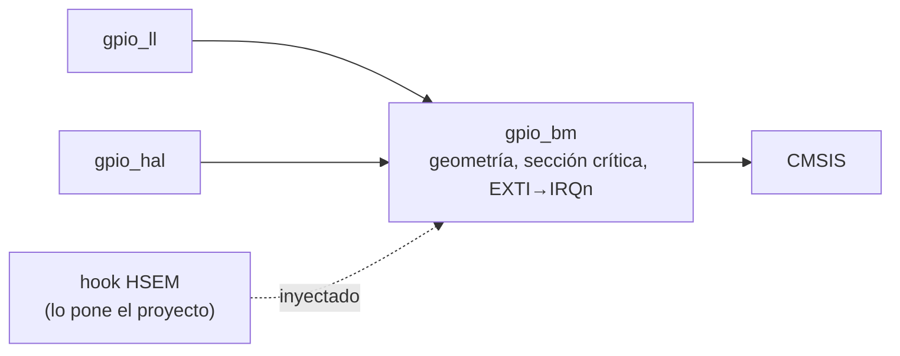

# Plan driver GPIO 00\_gpio

Sep 23, 2026 · @Hector

`gpio_bm` es hoy un conjunto de tres funciones auxiliares: reloj de puerto, modo AF y modo analógico. Siete drivers dependen de ellas, pero todavía no forman un driver de catálogo. Faltan salida, entrada, lock y EXTI, no existen los tiers LL y HAL, y la configuración tiene una carrera real entre núcleos que hoy nadie protege. Este plan cierra 12 hallazgos y construye los tres tiers en las fases F0 a F6. Cada fase pasa una auditoría antes de empezar la siguiente.

Base: commit `8568e5a` de `main`. El árbol de trabajo tiene sin commitear el trabajo de `02_dma` (F0/F1), que toca los mismos archivos de `prj_04`; ver Riesgos. Fuentes: `01_shared_drivers/README.md`, `DRIVER_ARCHITECTURE_GUIDELINES.md`, `00_docs_stm32h7/CLAUDE.md`, RM0399 caps. 12 (GPIO), 13 (SYSCFG) y 21 (EXTI), ES0445, DS12923 tablas 59 y 62, y `stm32h7xx_hal_gpio.c` del Cube.

Banco de pruebas: NUCLEO-H755ZI-Q y un **Analog Discovery 2** (SN 210321B5D38D). El WaveForms SDK 3.25.1 está instalado y `dwf.dll` responde desde `py` con ctypes; al hacer esta comprobación el dispositivo aparecía *in-use*, porque la GUI de WaveForms lo tenía abierto.

## Criterios de catálogo

Estos 11 criterios se auditan en cada fase. C1–C9 son los mismos del plan de `02_dma`, adaptados a GPIO. C10 y C11 son nuevos: salen del hecho de que los registros de GPIO **no** están banqueados por núcleo.

| # | Criterio | Origen |
| --- | --- | --- |
| C1 | El driver no fija puertos ni pines: llegan por parámetro o por config. Las tablas de hechos del silicio sí pueden vivir en el driver: línea EXTI → IRQn, pines SWD PA13/PA14, stride de puertos. | README regla 1, guías §5 Riesgo 2 |
| C2 | La API es inmutable. Las firmas de `GPIO_BM_EnablePortClock`, `GPIO_BM_ConfigAlternate` y `GPIO_BM_ConfigAnalog`, y las constantes `GPIO_BM_PULL_*` y `GPIO_BM_SPEED_*`, no cambian. Todo lo nuevo se añade aparte. Un cambio de comportamiento solo se permite si lo anterior ya estaba roto. | README regla 2, guías §1.4 |
| C3 | Cada archivo lleva su sufijo de tier, los nombres son únicos y ningún `#include` lleva el prefijo numérico. | README reglas 3 y 4 |
| C4 | Hay un target CMake por tier. `stm32h7_driver_gpio` sigue existiendo, porque lo enlazan 7 targets, y el paraguas no cambia. | Precedente A12 de `02_dma` |
| C5 | Si una errata se puede aplicar en el driver, la aplica el driver. Si no, queda documentada en el README con su ID. | CLAUDE.md §F |
| C6 | Lo que RM0399 marca como reservado o prohibido no se puede configurar: la función devuelve `false` antes de la primera escritura. | Estilo de `40fe018` |
| C7 | Los tres tiers usan el mismo modelo de inyección: `GPIO_TypeDef *` más un **índice** de pin 0..15. Las máscaras solo aparecen en operaciones de puerto con varios pines. | Deducido de C1 y de los consumidores actuales (todos usan `pin_idx`) |
| C8 | Las dependencias solo apuntan hacia abajo. BM usa solo CMSIS. LL usa los inline de `stm32h7xx_ll_{gpio,exti,system}.h`, sin `USE_FULL_LL_DRIVER`, más `gpio_bm`. HAL va dentro de `#if defined(HAL_GPIO_MODULE_ENABLED)`, más `gpio_bm`. | `uart_ll.h`, `uart_hal.h` |
| C9 | Hay evidencia: todo compila con `-Werror` en los consumidores, y cada tier tiene su prueba en hardware registrada en el repo junto con los scripts del AD2. | Precedente `a7f700a` |
| C10 | **Concurrencia.** Todo read-modify-write sobre un registro de configuración compartido pasa por una sección crítica: PRIMASK en el mismo núcleo y un hook opcional para el otro núcleo. Esos registros son `GPIOx_MODER/OTYPER/OSPEEDR/PUPDR/AFR`, `SYSCFG_EXTICR/PMCR/CCCSR` y `EXTI_RTSR1/FTSR1/SWIER1`. La escritura del nivel de un pin solo usa `BSRR`, que es atómico (RM0399 §12.3.5). | RM0399 §12.3.5; CLAUDE.md §D |
| C11 | **Sin glitches.** El orden de escritura es fijo: nivel inicial (`BSRR`), luego `OTYPER`, `OSPEEDR` y `PUPDR`, luego `AFR` y por último `MODER`. Así un pin nunca saca un nivel que nadie pidió. | Buenas prácticas; `HAL_GPIO_Init` no escribe ODR |

## Auditoría: lo que existe hoy

Solo existe el tier BM, con 3 funciones. Se ha probado en hardware de forma indirecta, a través de sus consumidores.

| Elemento | Estado |
| --- | --- |
| `00_gpio/gpio_bm.[ch]` | `EnablePortClock` desde el principio; `ConfigAlternate` (PP, validación de AF) y `ConfigAnalog` desde `be31f3c`. |
| `gpio_ll`, `gpio_hal` | No existen. Las guías (§2 B) prometen `gpio_ll`. |
| Salida, entrada, lectura, escritura, lock, deinit | No existen. `led_bm.c:66` escribe `MODER` a mano con `MODIFY_REG`. |
| EXTI | No existe en ningún tier, aunque las guías §4 describen `00_gpio` como "GPIO & EXTI". |
| `00_gpio/README.md` | No existe. |
| Target CMake | `stm32h7_driver_gpio` compila `gpio_bm.c` (`CMakeLists.txt:20-22`). Lo enlazan `led`, `uart` (×3), `adc` (×3) y `eth`, y también el paraguas. |
| Consumidores | `led_bm` (reloj), `uart_{bm,ll,hal}` (AF PP, pull-up, VERY\_HIGH), `adc_{bm,ll,hal}` (analógico), `eth_hal` (reloj + `HAL_GPIO_Init` con máscaras). `prj_03` y `prj_04` desde CM4, y `prj_02`/`prj_03`/`prj_04` desde CM7. |
| Tipos de pin | Hay cinco tipos distintos para lo mismo: `UartBm_Pin_t`, `UartLL_Pin_t`, `uart_hal_pin_t` (con `af` de tipo `uint8_t`), `led_pin_config_t` (con `pin_num` de tipo `uint8_t`) y `port + analog_pin_idx` en adc. `eth_hal` y `board_def.h` usan máscaras `GPIO_PIN_x`. |
| Validación en HW | Indirecta: AF7 en PD5/PD6 (selftest UART, `a7f700a`), analógico en PB1 (ADC a 511 kSPS) y LEDs PB0/PE1/PB14. No hay ninguna prueba propia de GPIO. |

### Lo que está bien y se conserva

- El bit de `RCC_AHB4ENR` se deriva de la dirección del puerto, con `_Static_assert` sobre el stride de 0x400 (`gpio_bm.c:17`) y read-back tras habilitar.
- El comentario de `gpio_bm.c:36-45` sobre el banqueo de `RCC_AHB4ENR` es correcto (RM0399 §9.7.1, offset 0xE0 ≥ 0xD0).
- `ConfigAlternate` escribe `AFR` antes que `MODER`, así que el pin nunca pasa por AF0.
- `ConfigAlternate` rechaza AF > 15 y pin > 15, y `NULL`.

## Hallazgos

Hay 12 hallazgos. Uno es de severidad alta: una carrera silenciosa entre núcleos que ya puede darse en `prj_04`. Alta: comportamiento incorrecto silencioso. Media: acepta una configuración inválida o insegura. Baja: robustez o hueco de catálogo.

| ID | Sev. | Dónde | Hallazgo | Acción (fase) |
| --- | --- | --- | --- | --- |
| G1 | Alta | `gpio_bm.c:79-90`, `:107-110`; `led_bm.c:66`; `HAL_GPIO_Init` | Los registros de configuración de GPIO (`MODER`, `OTYPER`, `OSPEEDR`, `PUPDR`, `AFR`) **no** están banqueados por núcleo: a diferencia de RCC, hay una sola copia para los dos. Todas las escrituras son read-modify-write sin protección. En `prj_04`, CM7 configura PB13 (ETH TXD1, `HAL_GPIO_Init`) dentro de `net_task`, después de liberar a CPU2, y CM4 configura PB1 (ADC, `GPIO_BM_ConfigAnalog`) al despertar. Los dos acceden a GPIOB en la misma ventana. Si se intercalan, CM4 puede devolver PB13 al modo analógico: el enlace sigue arriba pero TX muere, y nada lo detecta. La probabilidad es baja; el efecto, silencioso. | Sección crítica C10 en todo RMW + hook `GPIO_BM_SetSharedLock()` para HSEM (F1). Contrato de propiedad de puertos en el README. Prueba T15 |
| G2 | Doc | `gpio_bm.h:39-46` | La nota dice que el RMW de `RCC_AHB4ENR` puede perder una actualización entre núcleos y recomienda HSEM. Es falso: el propio `gpio_bm.c:36-45`, el commit `91622db` y RM0399 §9.7.1 dicen lo contrario. La nota manda proteger lo que no hace falta y calla sobre G1, que sí lo necesita. | Reescribir la nota: RCC está banqueado; lo que se comparte es GPIO/SYSCFG/EXTI (F1) |
| G3 | Media | `gpio_bm.c:81`, `:84` | `pull` y `speed` se enmascaran con `& 3` sin validarse. `pull = 3` programa `PUPDR = 11`, un valor reservado, y `speed = 4` se convierte en LOW sin aviso. `ConfigAlternate` devuelve `true` en ambos casos. | Rechazar `pull > 2` y `speed > 3` (F1). Ningún consumidor actual pasa esos valores |
| G4 | Baja | `gpio_bm.c:33` | `EnablePortClock` acepta direcciones desalineadas dentro de [GPIOA, GPIOK]: `(GPIO_TypeDef*)((uint32_t)GPIOA + 4)` habilita el puerto A y devuelve `true`. El `_Static_assert` solo comprueba el paso de A a B. | Exigir `(addr − GPIOA) % 0x400 == 0` y añadir un assert para `GPIOK − GPIOA == 10 × 0x400` (F1) |
| G5 | Media | — | No hay API de salida ni de entrada. Cada consumidor escribe registros a mano: `led_bm` pone `MODER` antes que el nivel, y el pin pasa un instante por el valor anterior de ODR (C11). | `ConfigOutput(…, initial_level)`, `ConfigInput`, `ConfigPin` genérica (F1) |
| G6 | Media | — | No hay EXTI. Cuando alguien lo añada con `HAL_GPIO_Init`, heredará dos problemas. `EXTICR` se reescribe sin mirar: poner PG8 en la línea 8 desvía la de PF8 aunque otro núcleo la esté usando. Y `HAL_GPIO_DeInit` (`stm32h7xx_hal_gpio.c:330-343`) borra `RTSR1`/`FTSR1`, que son **compartidos**, aunque el otro núcleo siga usando la línea. | EXTI en BM (F2), LL (F3) y HAL (F4), con detección de conflicto y una deinit que respeta al otro núcleo. Pruebas T11–T14 |
| G7 | Media | `HAL_GPIO_Init` | Con `GPIO_MODE_ANALOG` y `GPIO_PULLUP`, la HAL no escribe `PUPDR` y deja el pull que hubiera antes (`stm32h7xx_hal_gpio.c:207-209`). | El wrapper HAL fuerza `NOPULL` en modo analógico, o lo rechaza (F4) |
| G8 | Baja | — | Faltan lock (`LCKR`), `DeinitPin`, `ReadConfig` (necesaria para las pruebas de paridad) y la celda de compensación (SYSCFG `CCCSR`, que necesita CSI). | API Ex (F1, F2) |
| G9 | Baja | — | Reconfigurar PA13/PA14 (SWD) no da ningún error y deja a la placa sin depurador. | La API nueva rechaza esos pines salvo con `allow_debug_pins` (F1). La legacy no cambia (C2) |
| G10 | Diseño | 5 tipos de pin | Cada driver define su propio tipo de pin, y `board_def.h` usa máscaras mientras los drivers usan índices. | Tipo canónico `GpioBm_Pin_t` y macros `GPIO_BM_PIN_MASK()`/`GPIO_BM_PIN_INDEX()` para código nuevo; los tipos existentes no se tocan (F1) |
| G11 | Build/Doc | `CMakeLists.txt:20`; `README.md:24`; guías §2 B | El target sin sufijo es el tier BM, al revés que en uart/adc (igual que DMA A12). El README dice "gpio\_bm: port clock gating", que ya no es todo lo que hace. Las guías no listan `gpio_hal`. | Target `_gpio_bm` + alias sin fuentes (F0); corregir la documentación (F6) |
| G12 | Pruebas | — | Nunca se han ejercitado en HW: salida OD, pulls, entrada, lock, EXTI ni la paridad entre tiers. | Plan de pruebas T0–T18 con AD2 |

## Relacionado fuera de 00\_gpio

Este plan no toca nada de lo siguiente; queda como pendiente.

- `led_bm.c:40-66`: trae pines por defecto de la Nucleo (`BOARD_LED_*_BIT`) como fallback y escribe `MODER` a mano. Cuando exista `GPIO_BM_ConfigOutput`, se puede migrar sin cambiar la API del LED. Pendiente de `01_led`.
- `uart_hal.c:88-104`: el MSP por defecto lee `BOARD_CONSOLE_*` desde `board_def.h` dentro de un driver compartido, y usa `GPIO_SPEED_FREQ_LOW` mientras el camino explícito usa `VERY_HIGH`. Pendiente de `04_uart`.
- `eth_hal.c:233-261`: `HAL_GPIO_Init` con máscaras. Es candidato a `GPIO_HAL_ConfigPins` cuando exista; pendiente de `08_eth`.
- `SYSCFG_PMCR` guarda a la vez `EPIS` (ETH), `PxSO` (dual pads) y `BOOSTE`/`FMP`. Cualquier escritura desde GPIO o I2C tiene que usar el mismo lock C10 que `eth_hal`. Hoy solo lo escribe `eth_hal`, desde CM7 y antes de que haya concurrencia.

## Alcance y decisiones

Entran GPIO completo y EXTI de GPIO (líneas 0–15) en los tres tiers, más la celda de compensación. Los dual pads y las líneas EXTI internas quedan fuera.

| Qué | Decisión | Por qué |
| --- | --- | --- |
| Configuración de pin (in/out/AF/analog, PP/OD, pull, speed, nivel inicial) | Dentro, en los tres tiers | Es el núcleo del driver |
| Operación de pin (Set/Reset/Toggle/Write/Read/ReadPort/WritePort) | Dentro, `static inline` en los `.h` | En el hot path tiene que ser un solo `STR` a `BSRR` (se verifica con objdump) |
| Lock (`LCKR`) | Dentro, en los tres tiers | Hay secuencia de 4 accesos de palabra; la HAL la tiene, BM y LL no |
| EXTI líneas 0–15 (GPIO) | Dentro, en los tres tiers | Las guías lo prometen, y es donde el dual-core tiene trampas (G6) |
| Celda de compensación | Dentro (BM, reutilizada por LL/HAL) | Hace falta por encima de 50 MHz; necesita CSI, que el driver **no** enciende porque `RCC_CR` pertenece a CPU1 |
| EXTI líneas 16+ (PVD, RTC, COMP…) | Fuera | Cada una pertenece a su periférico |
| Dual pads `PA0_C/PA1_C/PC2_C/PC3_C` (`PMCR.PxSO`) y `BOOSTE` | Condicional (F5) | Solo con un consumidor ADC en esos pads |
| `HSLV` | Fuera, y documentado como prohibido a 3,3 V | Solo vale con la opción `IO_HSLV` y VDD < 2,7 V (RM0399 §13.3.7) |
| Handles | Ninguno: API sin estado, salvo el registro de callbacks EXTI por núcleo | Un pin no tiene estado que un handle aporte |
| Migrar `led`/`uart`/`adc`/`eth` a la API nueva | Fuera (pendiente) | Cambiaría proyectos validados sin ganar nada ahora |

## Archivos, dependencias y targets CMake

`gpio_bm` es la única copia de la geometría (stride, campos de 2 y 4 bits), de la sección crítica y de la tabla EXTI → IRQn. LL y HAL la reutilizan.

```text
00_gpio/
├── README.md             # NUEVO: matriz de capacidades, contrato de propiedad de puertos, cableado AD2, errata
├── IMPLEMENTATION_PLAN.md
├── gpio_bm.h / .c        # EXISTENTE: fixes G1-G4, G9 + API Ex (en el .h solo se añade)
├── gpio_ll.h / .c        # NUEVO
└── gpio_hal.h / .c       # NUEVO
```



El hook de lock entre núcleos lo inyecta el proyecto en tiempo de ejecución. Así `00_gpio` no depende de `10_hsem`, que va después en el orden de arranque y todavía no existe.

```cmake
add_library(stm32h7_driver_gpio_bm INTERFACE)
target_include_directories(stm32h7_driver_gpio_bm INTERFACE ${CMAKE_CURRENT_LIST_DIR}/00_gpio)
target_sources(stm32h7_driver_gpio_bm INTERFACE ${CMAKE_CURRENT_LIST_DIR}/00_gpio/gpio_bm.c)

# Compatibility: every driver below links this name and it always meant the
# _bm tier. It carries no sources, so reaching gpio_bm.c through both names
# compiles it once.
add_library(stm32h7_driver_gpio INTERFACE)
target_link_libraries(stm32h7_driver_gpio INTERFACE stm32h7_driver_gpio_bm)

add_library(stm32h7_driver_gpio_ll  INTERFACE)  # gpio_ll.c  -> links stm32h7_driver_gpio_bm
add_library(stm32h7_driver_gpio_hal INTERFACE)  # gpio_hal.c -> links stm32h7_driver_gpio_bm
```

## Contratos de API: gpio\_bm

### Funciones existentes (firmas intactas)

| Función | Cambio | Justificación (C2) |
| --- | --- | --- |
| `GPIO_BM_EnablePortClock` | Rechaza punteros desalineados (G4). Se corrige la nota (G2). | Un puntero desalineado nunca fue un puerto válido |
| `GPIO_BM_ConfigAlternate` | Rechaza `pull > 2` y `speed > 3` (G3). El RMW pasa a la sección crítica (G1). El orden se mantiene. | `PUPDR = 11` es un valor reservado; `speed = 4` se truncaba sin aviso |
| `GPIO_BM_ConfigAnalog` | El RMW pasa a la sección crítica (G1). | — |

No regresión obligatoria en F1: las llamadas de `uart_*` (PULL\_UP, VERY\_HIGH, AF7) y de `adc_*` (analógico en PB1/PA3) tienen que seguir aceptándose, con el mismo resultado en registros (T2).

### Adiciones

```c
/* ---- Canonical descriptor and constants (C7) ---------------------------- */
typedef struct { GPIO_TypeDef *port; uint8_t pin_idx; } GpioBm_Pin_t;

#define GPIO_BM_PIN_MASK(idx)     (1UL << (idx))
#define GPIO_BM_PIN_INDEX(mask)   ((uint32_t)__builtin_ctz(mask))  /* single-bit masks only */

#define GPIO_BM_MODE_INPUT   0U   /* MODER field values, RM0399 §12.4.1 */
#define GPIO_BM_MODE_OUTPUT  1U
#define GPIO_BM_MODE_AF      2U
#define GPIO_BM_MODE_ANALOG  3U
#define GPIO_BM_OTYPE_PP     0U
#define GPIO_BM_OTYPE_OD     1U

typedef struct
{
    GPIO_TypeDef *port;
    uint32_t pin_idx;          /*!< 0..15                                             */
    uint32_t mode;             /*!< GPIO_BM_MODE_*                                    */
    uint32_t otype;            /*!< GPIO_BM_OTYPE_*; ignored for INPUT/ANALOG          */
    uint32_t speed;            /*!< GPIO_BM_SPEED_*; ignored for INPUT/ANALOG          */
    uint32_t pull;             /*!< GPIO_BM_PULL_*; must be NONE for ANALOG            */
    uint32_t af;               /*!< 0..15, only for MODE_AF                            */
    uint32_t initial_level;    /*!< 0/1, only for MODE_OUTPUT: BSRR before MODER (C11) */
    bool     allow_debug_pins; /*!< false: PA13/PA14 are refused (G9)                  */
} GpioBm_PinConfig_t;

bool     GPIO_BM_ConfigPin(const GpioBm_PinConfig_t *cfg);
bool     GPIO_BM_ConfigOutput(GPIO_TypeDef *port, uint32_t pin_idx, uint32_t otype,
                              uint32_t speed, uint32_t pull, uint32_t initial_level);
bool     GPIO_BM_ConfigInput(GPIO_TypeDef *port, uint32_t pin_idx, uint32_t pull);
bool     GPIO_BM_ConfigAlternateEx(GPIO_TypeDef *port, uint32_t pin_idx, uint32_t af,
                                   uint32_t otype, uint32_t pull, uint32_t speed); /* OD for I2C */
bool     GPIO_BM_DeinitPin(GPIO_TypeDef *port, uint32_t pin_idx);   /* reset state: analog, AF0, PP, LOW, no pull */
bool     GPIO_BM_ReadConfig(const GPIO_TypeDef *port, uint32_t pin_idx, GpioBm_PinConfig_t *out);

/* ---- Pin operations: static inline, one STR to BSRR each (C10) ----------- */
static inline void     GPIO_BM_Set(GPIO_TypeDef *p, uint32_t mask)    { p->BSRR = mask; }
static inline void     GPIO_BM_Reset(GPIO_TypeDef *p, uint32_t mask)  { p->BSRR = mask << 16; }
static inline void     GPIO_BM_Toggle(GPIO_TypeDef *p, uint32_t mask); /* ODR read + one BSRR write, like LL */
static inline void     GPIO_BM_Write(GPIO_TypeDef *p, uint32_t pin_idx, uint32_t level);
static inline void     GPIO_BM_WritePort(GPIO_TypeDef *p, uint32_t mask, uint32_t value); /* one BSRR write */
static inline bool     GPIO_BM_Read(const GPIO_TypeDef *p, uint32_t pin_idx);
static inline uint32_t GPIO_BM_ReadPort(const GPIO_TypeDef *p);

/* ---- Lock ---------------------------------------------------------------- */
bool GPIO_BM_LockPins(GPIO_TypeDef *port, uint32_t mask);  /* LCKK sequence, word accesses; true if LCKK reads 1 */
bool GPIO_BM_IsLocked(const GPIO_TypeDef *port, uint32_t pin_idx);

/* ---- Cross-core guard (C10, G1) ------------------------------------------ */
typedef struct
{
    bool (*lock)(void *ctx);    /*!< Take the cross-core lock (e.g. HSEM). false -> nothing is written */
    void (*unlock)(void *ctx);
    void  *ctx;
} GpioBm_SharedLock_t;

void GPIO_BM_SetSharedLock(const GpioBm_SharedLock_t *lock);  /* per core; NULL -> PRIMASK only */

/* ---- EXTI, lines 0..15 (F2) --------------------------------------------- */
#define GPIO_BM_EXTI_RISING   1U
#define GPIO_BM_EXTI_FALLING  2U
#define GPIO_BM_EXTI_BOTH     3U

bool      GPIO_BM_ExtiConfig(GPIO_TypeDef *port, uint32_t pin_idx, uint32_t trigger,
                             bool interrupt, bool event);    /* masks of the CALLING core only */
bool      GPIO_BM_ExtiDisable(GPIO_TypeDef *port, uint32_t pin_idx);
uint32_t  GPIO_BM_ExtiTakePending(uint32_t line_mask);     /* this core's PR1: read, clear exactly that, DSB */
bool      GPIO_BM_ExtiSoftwareTrigger(uint32_t pin_idx);
IRQn_Type GPIO_BM_ExtiGetIRQn(uint32_t pin_idx);   /* 0..4 -> EXTI0..4_IRQn, 5..9 -> EXTI9_5, 10..15 -> EXTI15_10 */

/* ---- SYSCFG (F2) ------------------------------------------------------- */
bool GPIO_BM_EnableCompensationCell(uint32_t spin_limit);  /* false if CSI is not ready; never touches RCC_CR */
```

Reglas de implementación:

1. **Validar entero antes de escribir (C6).** Se comprueban el puerto (alineado, dentro de A..K), `pin_idx ≤ 15`, `mode ≤ 3`, `otype ≤ 1`, `speed ≤ 3`, `pull ≤ 2`, `af ≤ 15`, `initial_level ≤ 1`, que el modo analógico vaya sin pull y que PA13/PA14 solo se toquen con `allow_debug_pins`.
2. **Sección crítica (C10).** Guardar PRIMASK, deshabilitar interrupciones y ejecutar `__DSB(); __ISB()` (pitfall 4 del README de EXTI). Después, `lock()` si hay hook, el RMW, `unlock()` y restaurar PRIMASK. Deshabilitar primero es obligatorio: un 1-step lock de HSEM que ya tiene el mismo núcleo devuelve "tomado por mí". Si una ISR de ese núcleo lo pidiera de nuevo, parecería que lo consigue, y su `unlock` lo soltaría antes de tiempo.
3. **Orden de escritura (C11).** `BSRR` (solo OUTPUT), `OTYPER`, `OSPEEDR`, `PUPDR`, `AFR` (solo AF) y `MODER` al final. `DeinitPin` va al revés: `MODER = analog` primero, para que el pin deje de conducir antes de cambiar nada más.
4. **EXTI por núcleo.** Con `CORE_CM4` se usa `EXTI_D2`; si no, `EXTI_D1` (el mismo criterio que la HAL, `stm32h7xx_hal_gpio.c:172-175`). `RTSR1`, `FTSR1`, `SWIER1` y `SYSCFG_EXTICR` son compartidos y van bajo C10. El reloj de SYSCFG (`APB4ENR.SYSCFGEN`) está banqueado y lo habilita cada núcleo.
5. **Conflicto de línea.** Si la línea *n* ya apunta a otro puerto en `EXTICR`, y `C1IMR1/C1EMR1/C2IMR1/C2EMR1` tienen el bit *n*, `ExtiConfig` devuelve `false`. Cuatro lecturas bastan, porque los registros de los dos núcleos se leen desde cualquiera.
6. **Pending antes de desenmascarar.** Se limpia el `PR1` de este núcleo antes de poner `IMR1`. Un flanco anterior a la configuración no produce IRQ.
7. **Deinit que respeta al otro núcleo.** `ExtiDisable` borra las máscaras de este núcleo. Solo toca `RTSR1`, `FTSR1` y `EXTICR` si las máscaras del otro núcleo para esa línea están a 0 (G6).
8. **El driver nunca define `EXTIx_IRQHandler`,** para no chocar con el `stm32h7xx_it.c` del proyecto (precedente de `02_dma`).
9. **Celda de compensación.** Comprueba `RCC_CR.CSIRDY` y devuelve `false` si CSI no está listo. Después pone `CCCSR.EN` y espera `READY` durante `spin_limit` vueltas. Nunca escribe `HSLV`.

## Contratos de API: gpio\_ll

`gpio_ll` hace lo mismo que BM con constantes `LL_GPIO_*`, las de los proyectos LL de CubeMX. Donde las constantes coinciden numéricamente con los campos de registro (`LL_GPIO_MODE_*`, `LL_GPIO_PULL_*`, `LL_GPIO_SPEED_FREQ_*`, `LL_GPIO_AF_*`), la validación de BM se reutiliza tal cual.

```c
typedef struct
{
    GPIO_TypeDef *port;
    uint32_t pin_idx;          /*!< Same injection as BM/HAL (C7)                    */
    uint32_t mode;             /*!< LL_GPIO_MODE_INPUT/_OUTPUT/_ALTERNATE/_ANALOG    */
    uint32_t output_type;      /*!< LL_GPIO_OUTPUT_PUSHPULL / _OPENDRAIN             */
    uint32_t speed;            /*!< LL_GPIO_SPEED_FREQ_*                             */
    uint32_t pull;             /*!< LL_GPIO_PULL_NO / _UP / _DOWN                    */
    uint32_t alternate;        /*!< LL_GPIO_AF_0..15                                 */
    uint32_t initial_level;
    bool     enable_clock;
    bool     allow_debug_pins;
} GpioLL_PinConfig_t;

typedef void (*GpioLL_ExtiCallback_t)(uint32_t pin_idx, void *ctx);

bool     GPIO_LL_ConfigPin(const GpioLL_PinConfig_t *cfg);
bool     GPIO_LL_ConfigPins(const GpioLL_PinConfig_t *cfgs, uint32_t count); /* all validated before the first write */
bool     GPIO_LL_DeinitPin(GPIO_TypeDef *port, uint32_t pin_idx);
bool     GPIO_LL_LockPins(GPIO_TypeDef *port, uint32_t mask);
/* Set/Reset/Toggle/Write/Read/ReadPort/WritePort: static inline over LL_GPIO_* */
bool     GPIO_LL_ExtiConfig(GPIO_TypeDef *port, uint32_t pin_idx, uint32_t trigger,
                            bool interrupt, bool event);    /* LL_C1_/LL_C2_EXTI_* depending on CORE_CM4 */
bool     GPIO_LL_ExtiDisable(GPIO_TypeDef *port, uint32_t pin_idx);
bool     GPIO_LL_ExtiEnableIrq(uint32_t pin_idx, uint32_t priority);   /* IRQn from gpio_bm */
void     GPIO_LL_ExtiService(uint32_t line_mask, GpioLL_ExtiCallback_t cb, void *ctx); /* TakePending + cb per line */
```

- Las pruebas de rechazo (T1) y de paridad (T2) exigen el mismo comportamiento que BM: mismos casos rechazados y los mismos bits en registros.
- La cabecera es autocontenida: un `.c` que solo incluye `gpio_ll.h` compila sin HAL y sin `USE_FULL_LL_DRIVER`. `LL_GPIO_Init` no se usa, porque vive en el `.c` de LL completo.

## Contratos de API: gpio\_hal

`gpio_hal` envuelve `HAL_GPIO_*` dentro de `#if defined(HAL_GPIO_MODULE_ENABLED)` y corrige tres comportamientos de la HAL que no son seguros en dual-core (G6, G7).

```c
typedef struct
{
    GPIO_TypeDef *port;
    uint32_t pin_idx;          /*!< Same injection (C7); converted to GPIO_PIN_x inside */
    uint32_t mode;             /*!< GPIO_MODE_* including GPIO_MODE_IT_* / _EVT_*       */
    uint32_t pull;             /*!< GPIO_NOPULL / GPIO_PULLUP / GPIO_PULLDOWN           */
    uint32_t speed;            /*!< GPIO_SPEED_FREQ_*                                   */
    uint32_t alternate;        /*!< GPIO_AFx_*                                          */
    uint32_t initial_level;    /*!< GPIO_PIN_RESET / GPIO_PIN_SET, before HAL_GPIO_Init */
    bool     enable_clock;
    bool     allow_debug_pins;
    int32_t  irq_priority;     /*!< EXTI modes only; < 0 leaves NVIC untouched          */
} GpioHal_PinConfig_t;

typedef void (*GpioHal_ExtiCallback_t)(uint32_t pin_idx, void *ctx);

HAL_StatusTypeDef GPIO_HAL_ConfigPin(const GpioHal_PinConfig_t *cfg);
HAL_StatusTypeDef GPIO_HAL_ConfigPins(const GpioHal_PinConfig_t *cfgs, uint32_t count);
HAL_StatusTypeDef GPIO_HAL_DeinitPin(GPIO_TypeDef *port, uint32_t pin_idx);
HAL_StatusTypeDef GPIO_HAL_LockPins(GPIO_TypeDef *port, uint32_t mask);
HAL_StatusTypeDef GPIO_HAL_ExtiRegister(uint32_t pin_idx, GpioHal_ExtiCallback_t cb, void *ctx);
void              GPIO_HAL_ExtiDispatch(uint16_t GPIO_Pin);   /* the app calls it from ITS HAL_GPIO_EXTI_Callback */
void              GPIO_HAL_ExtiServiceGroup(IRQn_Type irqn);  /* HAL_GPIO_EXTI_IRQHandler for every line in the group */
```

- **Validación propia.** `assert_param` está compilado fuera en release, así que el wrapper valida con `IS_GPIO_MODE`, `IS_GPIO_PULL`, `IS_GPIO_SPEED` e `IS_GPIO_AF` (de `stm32h7xx_hal_gpio.h`) antes de llamar a la HAL.
- **Sin glitch.** `HAL_GPIO_WritePin(initial_level)` va antes de `HAL_GPIO_Init`, porque `HAL_GPIO_Init` no toca ODR.
- **G7.** En modo analógico, `pull != GPIO_NOPULL` devuelve `HAL_ERROR`.
- **G6, init.** Antes de `HAL_GPIO_Init` en un modo EXTI se hace la misma comprobación de conflicto que en BM (regla 5): la HAL reescribiría `EXTICR` sin mirar.
- **G6, deinit.** `GPIO_HAL_DeinitPin` no llama a `HAL_GPIO_DeInit` si el otro núcleo tiene la línea desenmascarada. En ese caso limpia solo las máscaras de este núcleo y deja el pin en analógico con `gpio_bm`.
- **C10.** Cada llamada a la HAL que hace RMW va dentro de la sección crítica de `gpio_bm`, así que el hook HSEM también protege al tier HAL.
- **Propiedad del callback.** El driver **no** define `HAL_GPIO_EXTI_Callback`. Es un símbolo `__weak` global que CubeMX genera en el proyecto, y definirlo aquí causaría un símbolo duplicado. El registro guarda 16 callbacks por núcleo en `.bss`, uno por imagen.

## Contratos del proyecto

### board\_def.h (el mismo para los tres tiers)

El driver no define nada de esto; lo hace el proyecto. Se mantienen las máscaras `GPIO_PIN_x` que ya usa `board_def.h`; el código nuevo obtiene el índice con `GPIO_BM_PIN_INDEX()`.

```c
/* ---- GPIO port ownership (C10) --------------------------------------- *
 * A port listed for both cores MUST have the shared lock installed on both
 * (GPIO_BM_SetSharedLock) before either core reconfigures it at run time.
 *   GPIOB: CPU1 (LEDs PB0/PB14, ETH PB13)  +  CPU2 (ADC PB1)   -> shared
 *   GPIOF: selftest bus, see 00_gpio/README.md                  -> CPU1 + CPU2 (selftest only)
 */
#define BOARD_GPIO_HSEM_ID                 5U     /* shared_memory.h uses 0..4; 5 is the first free ID */
```

### Hook HSEM (código de proyecto, no del driver)

```c
static bool gpio_hsem_lock(void *ctx)   { (void)ctx; return HAL_HSEM_FastTake(BOARD_GPIO_HSEM_ID) == HAL_OK; }
static void gpio_hsem_unlock(void *ctx) { (void)ctx; HAL_HSEM_Release(BOARD_GPIO_HSEM_ID, 0U); }
static const GpioBm_SharedLock_t k_gpio_lock = { gpio_hsem_lock, gpio_hsem_unlock, NULL };
/* each core, before its first run-time pin configuration: */
GPIO_BM_SetSharedLock(&k_gpio_lock);
```

`FastTake` no bloquea. Si el otro núcleo tiene el lock, `lock()` devuelve `false` y la función GPIO no escribe nada. Queda por decidir si el hook reintenta N veces o si la función devuelve `false` y reintenta quien la llamó; ver Decisiones abiertas, punto 2.

## Matriz de cumplimiento RM0399 / ES0445

Cada regla tiene su mecanismo en cada tier y una prueba o revisión que la verifica.

| Regla | BM | LL | HAL | Prueba |
| --- | --- | --- | --- | --- |
| RM §12.3.5: `BSRR` es atómico y el set gana al reset | Set/Reset/Write/WritePort solo por `BSRR` | Igual (`LL_GPIO_*`) | `HAL_GPIO_WritePin` | T3 |
| RM §12.3.5: el RMW de los registros de config **no** es atómico entre maestros | Sección crítica + hook (C10) | Reutiliza BM | Envuelve la HAL | T15 |
| RM §12.4.4: `PUPDR = 11` reservado | Rechazo (G3) | Rechazo | `IS_GPIO_PULL` | T1 |
| RM §12.3.6 y §12.4.8: secuencia LCKK con accesos de palabra y read-back | `LockPins` | Igual | `HAL_GPIO_LockPin` + comprobación | T16 |
| RM §12.3.x: en modo analógico, IDR lee 0 | — (hecho del silicio) | — | — | T7 |
| RM §12.3.11 / §13.3.7: la celda de compensación necesita CSI; `HSLV` solo con la opción y VDD < 2,7 V | Precondición CSI; `HSLV` nunca se escribe | Reutiliza BM | Reutiliza BM | T17, revisión |
| RM §21: IMR/EMR/PR por núcleo; RTSR/FTSR/SWIER y EXTICR compartidos | `EXTI_D1`/`EXTI_D2` según `CORE_CM4`; lo compartido bajo C10 | `LL_C1_`/`LL_C2_` | La HAL + comprobaciones del wrapper | T12 |
| Una línea EXTI por puerto a la vez | Conflicto → `false` | Igual | El wrapper, antes de la HAL | T14 |
| Limpiar pending antes de desenmascarar; `DSB` tras limpiar en el M7 | `ExtiConfig`, `ExtiTakePending` | Igual | `HAL_GPIO_EXTI_IRQHandler` + `__DSB()` en `ServiceGroup` | T14 |
| `HAL_GPIO_DeInit` borra RTSR/FTSR compartidos | Regla 7 | Regla 7 | El wrapper evita la HAL | T14 |
| `HAL_GPIO_Init` analógico con PULLUP no escribe PUPDR | n/a | n/a | El wrapper lo rechaza (G7) | T1 |
| ES0445 2.3.3: un GPIO del DAC no sirve como salida si el DAC solo alimenta un periférico interno | Solo documentación (PA4/PA5) | — | — | Revisión |
| ES0445 2.3.13: los flancos en PC13 perturban el LSE | Solo documentación; PC13 no se usa en las pruebas | — | — | Revisión |
| SWD en PA13/PA14 | Rechazo sin `allow_debug_pins` (G9) | Igual | Igual | T1 |

## Banco de pruebas con Analog Discovery 2

El AD2 hace de estímulo y de instrumento. Tiene 16 DIO (analizador lógico y generador de patrones a 100 MS/s, 10 ns de resolución), 2 canales de osciloscopio (14 bits, 1 MΩ, unos 30 MHz de ancho de banda) y 2 AWG. Todo se automatiza desde `py` con ctypes sobre `dwf.dll`, sin paquetes externos, igual que el resto de las herramientas.

### Cableado propuesto

Todo el bus de prueba va en **GPIOF**, que `prj_04` no usa. Así se pueden probar las operaciones de puerto y no se toca ETH, VCP, LEDs, ADC ni el lazo PD5-PD6. En F0 hay que confirmar con UM2408 y MB1363 que cada pin llega a CN11/CN12 sin solder bridge ni carga en la placa.

| AD2 | MCU | Uso |
| --- | --- | --- |
| DIO0–DIO7 | PF0–PF7 | Bus de 8 bits: salida (captura LA) y entrada (patrón AD2) |
| DIO8 | PF8 | Entrada EXTI8 (EXTI9\_5\_IRQn) para CM7 |
| DIO9 | PF9 | Respuesta de la ISR del CM7 (latencia) |
| DIO10 | PF10 | Entrada EXTI10 (EXTI15\_10\_IRQn) para CM4 |
| DIO11 | PF11 | Respuesta de la ISR del CM4 |
| DIO12 | PF12 | `HOST_REQ`: el host avanza el paso de la prueba |
| DIO13 | PF13 | `MCU_ACK`: el MCU indica "paso listo" |
| DIO14 | PA8 | MCO1 (AF0) para la prueba de AF (T10) |
| Scope 1+ | PF14 | Pulls, open-drain, modo analógico (1− a GND) |
| W1 → 47 kΩ → PF14 | PF14 | Fuente Thévenin para medir R<sub>PU</sub>/R<sub>PD</sub> y el OD (T5, T6) |
| Scope 2+ | PF15 + C de 100–220 pF a GND | Tiempo de subida por `OSPEEDR` (T9) |
| GND | GND | Obligatorio: una sola referencia |

- Hay que poner **330 Ω en serie** en DIO0–DIO15. Si una prueba falla y el MCU y el AD2 conducen la misma línea a la vez, la resistencia limita la corriente a unos 10 mA. El retardo que añade no se nota a 10 ns de resolución.
- La GUI de WaveForms tiene que estar cerrada mientras corre el script: el SDK solo abre un dispositivo que esté libre.
- Si no hay resistencia de 47 kΩ ni condensador, T5 y T9 se hacen solo en cualitativo y queda escrito en la captura.

### Herramientas (según la regla de `README.md` §tools)

| Archivo | Dónde | Por qué ahí |
| --- | --- | --- |
| `tools/ad2.py` | Workspace | No depende de ningún producto: envoltorio ctypes de `dwf.dll`. Abre por SN, maneja DigitalIO estático, patrones y cuenta de pulsos de DigitalOut, captura con trigger de DigitalIn, y AnalogIn/AnalogOut en DC y flancos. Define sus constantes; no copia `dwfconstants.py`. |
| `prj_04/tools/gpio_hw_check.py` | Proyecto | Conoce un protocolo concreto: el mapa de pines, el handshake REQ/ACK y los marcadores `[m7_gpio_test]` / `[m4_gpio_test]`. Lee la consola con el lector serie de `tools/monitor.py`. |

Protocolo: el firmware prepara el paso *n*, sube `MCU_ACK` e imprime `[mX_gpio_test] Tn ready`. El host mide o estimula, y después da un pulso en `HOST_REQ`. Al final el firmware imprime `Tn pass/fail` con sus contadores y un CRC de lo leído. El script compara con lo que espera y escribe la captura en `prj_04/docs/gpio_hw_capture.txt`. Las pruebas que no necesitan el AD2 (T1, T2, T15 y parte de T14) corren igual sin él, y el script marca como `not exercised` las que sí lo necesitan.

## Fases

Son siete fases (F0–F6), y cada una pasa por auditoría antes de empezar la siguiente. Cada fase termina en commits con el estilo del repo (`driver(gpio): …`, `feat(gpio): …`, `test(prj_04): …`, `docs(gpio): …`): una preocupación por commit y el porqué en el cuerpo.

| Fase | Entregable | Salida (gate) |
| --- | --- | --- |
| F0: Base | Target `stm32h7_driver_gpio_bm` y alias `stm32h7_driver_gpio` (G11). Tabla de tamaños de referencia con `tools/build_all.ps1` (8 builds). Cableado confirmado con UM2408/MB1363. `tools/ad2.py` mínimo y T0 en verde. | Las 8 builds en verde y binarios del mismo tamaño que hoy. T0 registrada. |
| F1: `gpio_bm` núcleo | Contrato BM sin EXTI: G1–G5, G8 (lock, deinit, ReadConfig), G9 y G10. Nota de G2 corregida. Primer `00_gpio/README.md` con la matriz BM y el contrato de propiedad de puertos. Selftest BM en CM4 y CM7 (T1, T3–T8, T15, T16). | Matriz en verde. `git diff gpio_bm.h` solo añade. No regresión de uart/adc (T2 legacy y T18). `GPIO_BM_Set` compila a un solo `STR` (objdump). Crecimiento de CM4 release reportado; más de 1 KB hay que justificarlo. |
| F2: EXTI + SYSCFG en BM | EXTI 0–15 con las reglas 4–8, y la celda de compensación. Selftest T11–T14 y T17. | Matriz en verde. Ningún `EXTIx_IRQHandler` dentro del driver (grep). T12 demuestra que las máscaras de cada núcleo son independientes. |
| F3: `gpio_ll` | Contrato LL y target `_gpio_ll`. Selftest LL en CM4 (T1–T4, T7, T11). | Paridad T2 BM↔LL exacta. Cabecera autocontenida sin HAL. |
| F4: `gpio_hal` | Contrato HAL y target `_gpio_hal`. Selftest HAL en CM7 (T1–T4, T7, T11–T14). | Paridad T2 BM↔LL↔HAL exacta. G6 y G7 demostrados en T14 y T1. El driver no define `HAL_GPIO_EXTI_Callback`. |
| F5: Dual pads (condicional) | `PMCR.PxSO` y `BOOSTE` bajo C10. | Solo si aparece un consumidor ADC en `PA0_C/PA1_C/PC2_C/PC3_C`. |
| F6: Cierre del catálogo | README de `01_shared_drivers` (la línea de `00_gpio`), comentarios de `CMakeLists.txt`, árbol de las guías con `gpio_hal`, `errata_summary.md` si hace falta y captura final `test(prj_04): record …`. | Ninguna afirmación de la documentación sin código detrás. Todo lo no ejercitado, escrito. |

## Plan de pruebas

El selftest sigue el precedente de DMA: opción CMake `GPIO_DRIVER_SELFTEST` (por defecto `OFF`) en `prj_04`, con código en `CM4/App/Src/gpio_selftest.c` y `CM7/App/Src/gpio_selftest.c`, nunca en `main.c`. CM4 corre antes de `ADC_Acquisition_Init()` y manda su resultado por `g_shared.m4_to_m7`; CM7 lo imprime como `[m4_gpio_test] …` y el suyo como `[m7_gpio_test] …`. CM4 prueba BM y LL; CM7 prueba BM, LL y HAL.

| ID | Núcleo / tier | Qué | AD2 | Criterio |
| --- | --- | --- | --- | --- |
| T0 | CM7 BM | Caracterizar el banco. Con el AD2 en alta impedancia: pull-up y luego pull-down del MCU en PF0–PF7, y leer IDR. Salida alta y baja medida con Scope 1. | Sí | IDR = 0xFF y luego 0x00. V<sub>OH</sub> ≥ 2,9 V y V<sub>OL</sub> ≤ 0,4 V. Si la entrada del AD2 carga la línea, se registra y se ajustan los criterios |
| T1 | Todos | Rechazos: `NULL`, `GPIOA+4`, dirección pasada de GPIOK, pin 16, AF 16, pull 3, speed 4, mode 4, `initial_level` 2, analógico con pull, PA13/PA14 sin permiso, línea EXTI ocupada por otro puerto; en HAL, `GPIO_MODE_ANALOG` + `GPIO_PULLUP` | No | Todo devuelve `false`/`HAL_ERROR` y la foto de `MODER/OTYPER/OSPEEDR/PUPDR/AFR/EXTICR/RTSR/FTSR/IMR` no cambia |
| T2 | CM4: BM↔LL; CM7: BM↔LL↔HAL | Paridad: 4 modos × 2 tipos × 4 velocidades × 3 pulls × AF {0, 7, 15} en PF0–PF7, más las llamadas legacy de uart/adc | No | `ReadConfig` da exactamente los mismos bits en todos los tiers, y el camino legacy da lo mismo que antes de F1 |
| T3 | Todos | Walking-1 y walking-0 en PF0–PF7 con Set/Reset/Write/WritePort/Toggle. `BSRR` con set y reset del mismo pin a la vez | Sí (LA) | La secuencia capturada coincide exactamente; con set y reset a la vez gana el set |
| T4 | Todos | El AD2 recorre los 256 patrones del bus con estrobo en `HOST_REQ`; el MCU lee con ReadPort y Read(i) | Sí (patrón) | Cuenta = 256 y el CRC32 coincide con el del host |
| T5 | CM7 BM | R<sub>PU</sub> y R<sub>PD</sub> en PF14 con W1 a 0 V / 3,3 V a través de 47 kΩ, midiendo con Scope 1 | Sí (scope + W1) | 30 kΩ ≤ R ≤ 50 kΩ (DS12923 tabla 59) |
| T6 | CM7 BM, HAL | Open-drain en PF14. En bajo: ≤ 0,4 V. Suelto con PU interno: ≈ 3,3 V. Suelto sin PU, con W1 = 1,0 V a través de 47 kΩ: el pin sigue a W1 | Sí | Los tres estados cumplen, lo que demuestra que el OD no conduce en alto |
| T7 | Todos | El AD2 pone el bus en 0xFF. Con `ConfigAnalog`, IDR lee 0; de vuelta a entrada, 0xFF | Sí | IDR = 0x00 en analógico (RM0399 §12.3.x) |
| T8 | Todos | Sin glitch. De entrada con PD a salida alta, y de entrada con PU a salida baja, capturando con trigger en cualquier flanco | Sí (LA) | Exactamente una transición y ningún pulso inverso. Como referencia se registra lo que hace el orden ingenuo (`MODER` primero) |
| T9 | CM7 BM | t<sub>r</sub> del 10 al 90 % en PF15 con carga C, para cada `OSPEEDR` | Sí (scope) | Monótono: LOW > MEDIUM > HIGH ≥ VERY\_HIGH. El valor absoluto es solo informativo, porque el AD2 tiene un suelo de unos 12 ns |
| T10 | CM7 BM, LL, HAL | AF: MCO1 = HSI/4 en PA8 (AF0), 16 MHz; se restaura `RCC_CFGR` al terminar. Regresión del selftest UART en PD5-PD6 | Sí (LA) | 16 MHz ± 2 %; el selftest UART pasa |
| T11 | Todos | EXTI: 1000 pulsos a 10 kHz en PF8 (CM7) y PF10 (CM4), en RISING, FALLING y BOTH | Sí (patrón) | 1000, 1000 y 2000 exactos |
| T12 | CM7 + CM4 | Enrutado dual. PF8 solo a CM7, PF10 solo a CM4, y luego PF8 a los dos núcleos | Sí | Cada núcleo cuenta solo su línea; con la línea compartida, los dos cuentan 1000. Cada `PRx` se limpia por separado |
| T13 | Todos | Latencia del flanco en PF8/PF10 hasta el `BSRR` de la ISR en PF9/PF11, sobre 1000 eventos | Sí (LA) | Se registran mín/p50/máx por núcleo y tier. Ningún evento perdido |
| T14 | Todos | Seguridad EXTI: un flanco con la línea enmascarada no dispara al habilitar; PG8 sobre la línea 8 ocupada se rechaza; la deinit de CM7 no apaga la misma línea en CM4; SWIER dispara | Parcial | 0 IRQ espurias; `false`/`HAL_ERROR`; CM4 sigue contando; SWIER cuenta 1 |
| T15 | CM7 + CM4 | Carrera: cada núcleo reconfigura un millón de veces un pin distinto de GPIOF y comprueba sus bits en cada vuelta. Primero sin hook y luego con el hook HSEM | No | Con hook: 0 corrupciones. Sin hook: se registra la cuenta; se espera > 0, y si sale 0 se escribe "no reproducido" |
| T16 | Todos, al final | Lock de PF5 (BM), PF6 (LL) y PF7 (HAL); luego se intenta reconfigurarlos | No | LCKK = 1; los registros no cambian hasta el reset. Va la última porque solo se deshace con un reset |
| T17 | CM7 BM | Celda de compensación sin CSI y con CSI | No | Sin CSI devuelve `false`; con CSI, READY dentro del `spin_limit` |
| T18 | Regresión | Build sin la opción, y selftests UART/ADC/DMA con ella | No | `prj_04` igual que antes: unos 511 kSPS, `err`/`ovr`/`adc_ovr` = 0, ETH arriba y códigos LED de arranque correctos. Las 8 builds en verde |
| B1 | CM4/CM7 BM, LL | Tasa máxima de toggle por `BSRR` y desensamblado de `GPIO_BM_Set`/`GPIO_LL_Set` | LA si f < 25 MHz | Un solo `STR` por operación; la frecuencia es solo informativa |

## Definición de hecho

Esto es lo que revisaré como auditor en cada fase. La fase no pasa mientras quede un punto abierto.

- [ ] Reglas 1–4 del README y checklist §6 de las guías.
- [ ] `git diff` de `gpio_bm.h` solo añade: ninguna firma ni constante existente cambia.
- [ ] Toda `Config*`/`Lock*`/`Exti*` valida entera antes de escribir el primer registro, y T1 lo demuestra con fotos de registros.
- [ ] Cada RMW sobre un registro compartido está dentro de la sección crítica. Lo compruebo leyendo el código y con un grep de `->MODER`, `->PUPDR`, `->EXTICR`, `->RTSR1` y similares fuera de ella.
- [ ] La matriz de 8 builds (`-Werror`) está en verde, con los tamaños frente a F0.
- [ ] Las cabeceras son autocontenidas, llevan guardas `extern "C"` y no incluyen nada de un tier superior.
- [ ] Ningún puerto aparece como literal fuera de las tablas de hechos (C1). Un `GPIOF` en el driver es un defecto; en `gpio_selftest.c` y `board_def.h` es correcto.
- [ ] Cada fila de la matriz de cumplimiento que toca la fase está implementada y probada.
- [ ] La captura del AD2 está en el repo y dice qué se ejercitó y qué no. Como auditor vuelvo a ejecutar `gpio_hw_check.py` por mi cuenta, porque el AD2 es accesible desde esta máquina.
- [ ] `00_gpio/README.md` coincide con el código: nada prometido que no exista.

## Riesgos

| Riesgo | Mitigación |
| --- | --- |
| El trabajo de DMA sin commitear toca `prj_04` (`CMakeLists.txt`, `board_def.h`, `main.c`) | Commitear y auditar DMA antes de F0 de GPIO, o trabajar GPIO en una rama o worktree propia |
| Que las validaciones de F1 rompan algún consumidor | T2 en su modo legacy + T18; grep de los 7 consumidores |
| Que la sección crítica añada latencia de IRQ | Solo en configuración, nunca en Set/Reset/Read. Se mide en T13 y el coste se reporta |
| Un deadlock por HSEM dentro de una ISR | PRIMASK antes del lock (regla 2); el lock no bloquea |
| Un cortocircuito MCU↔AD2 si una prueba falla | 330 Ω en serie; el AD2 queda en alta impedancia entre pruebas |
| T16 bloquea pines hasta el reset | Va la última y usa pines que no se vuelven a usar |
| Leer el ancho de banda del AD2 como límite del MCU | T9 solo exige que sea monótono; las cifras absolutas se marcan como informativas |
| Tocar PC13 perturba el LSE (ES0445 2.3.13) | Ninguna prueba usa PC13 |

## Decisiones abiertas

Cada una trae la opción por defecto que asume este plan.

1. **Modelo de inyección:** índice 0..15 como canónico, con macros de conversión desde las máscaras de `board_def.h` (recomendado; es lo que ya usan todos los consumidores). Alternativa: máscara en LL/HAL, lo que obligaría a tener dos macros por pin en `board_def.h`.
2. **Guarda entre núcleos:** hook inyectado por el proyecto, que devuelve `false` si el HSEM está ocupado, sin reintento dentro del driver (recomendado). Alternativas: que el driver use un ID de HSEM directamente con CMSIS, lo que acopla `00_gpio` a una política de IDs; o solo documentar la propiedad de puertos.
3. **Callback EXTI en HAL:** el driver no define `HAL_GPIO_EXTI_Callback` y la app llama a `GPIO_HAL_ExtiDispatch` (recomendado). Alternativa: definirlo bajo una macro opcional.
4. **Pines SWD:** rechazarlos en la API nueva salvo con `allow_debug_pins` (recomendado). Alternativa: no protegerlos.
5. **Dónde vive el selftest:** en `prj_04` detrás de `GPIO_DRIVER_SELFTEST`, con el bus en GPIOF (recomendado para GPIO). El plan de DMA dejó escrito que un banco propio tendría sentido "cuando haya un tercer driver con selftest"; GPIO sería el cuarto (UART, ADC, DMA). Alternativa: crear `prj_05_driver_bench` desde `03_firmware_templates` antes de F1.
6. **Dual pads y `BOOSTE`:** en F5, cuando haya un consumidor (recomendado). Alternativa: hacerlo ya, sin consumidor que lo valide.
