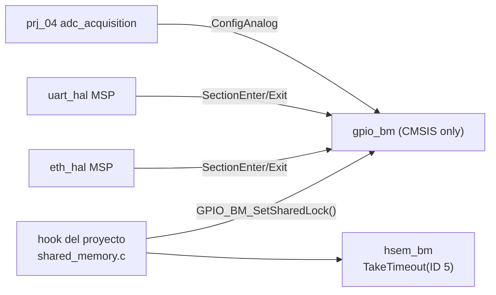

# Plan driver GPIO 00\_gpio — F1–F2

Sep 26, 2026 · @Hector · revisión 2 (sustituye a la del 23-09, `5f97e2e`)

Este plan cubre el paso 2 de `DRIVER_ROADMAP.md`: el núcleo BM completo de `gpio_bm` (F1) y EXTI + SYSCFG (F2), con una fase F0 de preparación y una de cierre. Los tiers LL y HAL (F3–F4) y los dual pads (F5) quedan aplazados hasta que haya consumidor (hoja de ruta §4 y §5.2).

El objetivo que manda es **cerrar G1**, un fallo real hoy en `prj_04`. Los registros de configuración de GPIO no tienen una copia por núcleo, y CM7 y CM4 hacen read-modify-write sin protección sobre el mismo `GPIOB_MODER`. Lo demás es lo que necesitan los drivers siguientes: salida para el CS de SPI, AF open-drain para I2C y EXTI para las líneas de interrupción de los dispositivos.

Cada fase pasa una auditoría independiente antes de empezar la siguiente, con las reglas de [Protocolo de auditoría](#protocolo-de-auditoría). Yo actúo como auditor.

Base: `ca569b6` de `main`, árbol limpio. Fuentes normativas, por orden de precedencia:

1. `01_shared_drivers/README.md` (reglas 1–4).
2. `DRIVER_ROADMAP.md` §5.2 y §6 (ciclo de trabajo y reglas R1–R4).
3. `DRIVER_ARCHITECTURE_GUIDELINES.md`.
4. `00_docs_stm32h7/CLAUDE.md`.
5. `10_hsem/README.md` (el driver del que depende el lock).
6. `00_gpio/README.md` (estado actual).
7. RM0399 cap. 12 (GPIO), 13 (SYSCFG) y 21 (EXTI); ES0445 rev 6; DS12923 tablas 59 y 62; `stm32h7xx_hal_gpio.c` del Cube.

## Cambios respecto a la revisión del 23-09

| # | Cambio | Por qué |
| --- | --- | --- |
| 1 | El alcance baja de F0–F6 a F0–F2 + cierre. F3–F5 solo quedan resumidas | Hoja de ruta §5.2 |
| 2 | **Corrección de un hecho.** CM4 no configura PB1 con `GPIO_BM_ConfigAnalog`: lo hace con RMW a mano en `prj_04 CM4/App/Src/adc_acquisition.c:41-61` (`GPIO_Analog_Init`). La revisión del 23-09 decía lo contrario, y la hoja de ruta §5.2 también; la hoja de ruta se corrigió junto con esta revisión | Leído en el código de `ca569b6` |
| 3 | **G1 no se cierra solo arreglando `gpio_bm`.** El escritor de CM7 sobre GPIOB es `HAL_GPIO_Init` dentro de `ETH_HAL_MspInit_User` (`08_eth/eth_hal.c:260`), que no pasa por `gpio_bm`. Un lock solo protege si lo toman **todos** los escritores de un puerto compartido. Por eso F1 añade un mapa de escritores y una sección pública para envolver `HAL_GPIO_Init` | Nuevo hallazgo G13 |
| 4 | El hook entre núcleos se construye sobre `10_hsem`, que ya existe y está auditado. Usa `HSEM_BM_TakeTimeout` con un límite medido, no `FastTake` solo: un único intento fallaría de forma espuria cada vez que el otro núcleo tuviera el lock unos ciclos | `10_hsem/README.md` §3.5 y §4.9. §13 de ese README dice `FastTake`; se corrige en el cierre |
| 5 | Las funciones nuevas devuelven `GpioBm_Status_t`, no `bool` | Lección de HSEM (§2.1 de su README): un llamador que reintenta mientras recibe `false` se queda girando para siempre ante un parámetro inválido |
| 6 | Nuevo criterio C12 (honestidad): una escritura que el hardware ignora (pin bloqueado por `LCKR`) nunca devuelve éxito | Equivalente de C11 de HSEM |
| 7 | Cada prueba lleva control negativo y oráculo independiente. El "si sale 0, se registra como no reproducido" de T15 desaparece: **si el control no reproduce el peligro, la prueba falla** | Hoja de ruta §6 R1 |
| 8 | Protocolo de auditoría A1–A26, clases de hallazgo y reglas de entrega, como en `10_hsem` | Hoja de ruta §6.4 y §6.5 |
| 9 | G2 ya está cerrado (`a2096d2`). `BOARD_GPIO_HSEM_ID = 5` ya está reservado en `prj_04/Common/Inc/shared_memory.h:56` | Leído en el código |

## Criterios de catálogo

Estos 14 criterios se auditan en cada fase. Todos salen de las fuentes normativas; la columna Origen dice de cuál.

| # | Criterio | Origen |
| --- | --- | --- |
| C1 | **Sin pines ni instancias.** El driver no contiene puertos, pines, IDs de HSEM ni límites de tiempo del proyecto. No incluye `board_def.h`, `shared_memory.h` ni `hsem_*.h`. Solo pueden vivir en él los hechos del silicio: stride 0x400, GPIOA..GPIOK, bit `GPIOxEN` = índice del puerto, PA13/PA14 = SWD, tabla línea EXTI → IRQn. | README regla 1 |
| C2 | **API congelada.** Las firmas y constantes existentes (`GPIO_BM_EnablePortClock`, `GPIO_BM_ConfigAlternate`, `GPIO_BM_ConfigAnalog`, `GPIO_BM_PULL_*`, `GPIO_BM_SPEED_*`) no cambian. La API nueva de F1 se congela al pasar la auditoría de F1, porque SPI e I2C van a construir sobre ella. Un cambio de comportamiento en lo existente solo se permite si lo anterior ya era incorrecto, y aun así tiene que seguir aceptando todas las llamadas actuales de los consumidores. | README regla 2; `00_gpio/README.md` §8.1 |
| C3 | Cada archivo lleva su sufijo de tier, los nombres son únicos y ningún `#include` lleva el prefijo numérico. | README reglas 3 y 4 |
| C4 | **Targets.** `stm32h7_driver_gpio_bm` compila `gpio_bm.c`. `stm32h7_driver_gpio` pasa a ser un alias sin fuentes que lo enlaza, porque lo enlazan 7 targets y el paraguas (precedente de `02_dma`). No se crean `_gpio_ll` ni `_gpio_hal`. | Precedente de `stm32h7_driver_dma` |
| C5 | **Erratas.** Si una errata se puede aplicar en el driver, la aplica el driver. Si no, queda en el README con su ID (ES0445 2.3.3 y 2.3.13). | CLAUDE.md §F |
| C6 | **Validar antes de escribir.** Todo parámetro inválido o reservado (`PUPDR = 11`, `speed > 3`, `mode > 3`, `af > 15`, `pin > 15`, puerto fuera de A..K o desalineado, `initial_level > 1`, analógico con pull, PA13/PA14 sin permiso) devuelve error **antes del primer acceso** a GPIO, SYSCFG o EXTI. | Estilo de `40fe018`; C6 de HSEM |
| C7 | **Estado mínimo.** `gpio_bm` solo guarda en RAM, por núcleo, el puntero al hook y el contador de anidamiento: `.data = 0` y `.bss ≤ 8 B` en el `.map`. No hay registro de callbacks EXTI en BM. | C7 de HSEM |
| C8 | **Dependencias hacia abajo.** `gpio_bm` usa solo CMSIS (`stm32h7xx.h`): ni HAL, ni LL, ni FreeRTOS, ni `hsem_*`. Tiene que seguir funcionando antes del árbol de reloj, del MPU, de `HAL_Init()` y del reloj de HSEM, porque `01_led` depende de eso. | `00_gpio/README.md` §8.2 |
| C9 | **Evidencia.** `tools/build_all.ps1 -Clean` da 8/8 con `-Werror`. Las capturas de la placa están en el repo con `FW_GIT_REV` y los tamaños salen del `.map` enlazado. | Hoja de ruta §6.3 y R2, R3 |
| C10 | **Concurrencia.** Todo read-modify-write sobre un registro de configuración compartido se hace dentro de la sección de `gpio_bm`: PRIMASK guardado y, si el hook está instalado, el lock entre núcleos. Esos registros son `GPIOx_MODER/OTYPER/OSPEEDR/PUPDR/AFR[0..1]`, `SYSCFG_EXTICR1..4`, `SYSCFG_CCCSR` y `EXTI_RTSR1/FTSR1/SWIER1`. El nivel de un pin solo se escribe con `BSRR`, que es atómico (RM0399 §12.3.5). | RM0399 §12.3.5; CLAUDE.md §D; G1 |
| C11 | **Sin glitches.** Orden fijo de escritura: nivel inicial (`BSRR`), luego `OTYPER`, `OSPEEDR` y `PUPDR`, luego `AFR` y por último `MODER`. En la deinit, `MODER = analógico` va primero. | `00_gpio/README.md` §8.3 |
| C12 | **Honestidad.** El driver no devuelve `OK` por una escritura que el hardware ignoró. Un pin con su bit de `LCKR` a 1 devuelve `ERR_LOCKED` sin escribir. Después de escribir se hace un read-back de los campos del pin, y si no coinciden devuelve `ERR_VERIFY`. | C11 de HSEM; RM0399 §12.3.6 |
| C13 | **Esperas acotadas.** Toda espera del driver tiene un límite que pasa el llamador. La del lock la acota el hook (límite en ciclos DWT, de `hsem_bm`) y la de la celda de compensación, `max_cycles`. No hay ningún bucle sin salida. | C13 de HSEM |
| C14 | **El driver no define símbolos del proyecto:** ni `EXTIx_IRQHandler` ni `HAL_GPIO_EXTI_Callback`. | Precedente de `02_dma` y `10_hsem` (A11) |

## Auditoría: lo que existe hoy (`ca569b6`)

### El driver

| Elemento | Estado |
| --- | --- |
| `gpio_bm.[ch]` | 3 funciones, `bool`: `EnablePortClock`, `ConfigAlternate` (solo push-pull) y `ConfigAnalog`. La nota dual-core de `gpio_bm.h:39` ya es correcta (G2 cerrado en `a2096d2`). |
| `README.md` | Existe (`9acfc32`). Describe solo lo que hay y apunta a este plan (§9). |
| Target | `stm32h7_driver_gpio` compila `gpio_bm.c` (`CMakeLists.txt:20-22`). Lo enlazan `led`, `uart` ×3, `adc` ×3, `eth` y el paraguas. |
| Pruebas propias | Ninguna. Cobertura indirecta: selftest UART (PD5/PD6), ADC en PB1 y LEDs. |

### Mapa de escritores de configuración GPIO en `prj_04`

Esta es la tabla que decide G1. "Antes de liberar" significa antes de `HSEM_BM_BootReleaseCpu2` (`CM7 main.c:209`). En esa ventana CPU2 está parada en `HSEM_BM_BootWaitForCpu1` y no toca GPIO, así que no hay concurrencia.

| Núcleo | Cuándo | Quién | Puerto / pines | Cómo escribe | ¿Pasa por `gpio_bm`? |
| --- | --- | --- | --- | --- | --- |
| CM7 | Antes de liberar | `LED_Init` (`CM7 main.c:49` → `led_bm.c:66`) | GPIOB PB0/PB14, GPIOE PE1 | `MODIFY_REG(MODER)` | No (reloj sí) |
| CM7 | Antes de liberar | `EarlyBoot_UartBm` → `uart_bm` | GPIOD PD8/PD9 | `GPIO_BM_ConfigAlternate` | Sí |
| CM7 | **Después** | `App_Log_Init` → `UART_Console_Init` → MSP de `uart_hal.c:98,103` | GPIOD PD8/PD9 | `HAL_GPIO_Init` | **No** |
| CM7 | **Después** | `net_task` → MSP de `eth_hal.c:260` | GPIOA PA1/2/7, **GPIOB PB13**, GPIOC PC1/4/5, GPIOG PG11/13 | `HAL_GPIO_Init` | **No** |
| CM7 | Cualquiera (fallo) | `LED_PanicRed` (`led_bm.c:146`) | GPIOB PB14 | `MODIFY_REG(MODER)` | No |
| CM4 | **Después** | `ADC_Acquisition_Init` → `GPIO_Analog_Init` (`adc_acquisition.c:57,60`) | **GPIOB PB1** | `MODER \|=`, `PUPDR &=` a mano | **No** (solo el reloj) |
| CM4 | Después, solo `selftest-uart` | `CM4 main.c:223-231` | GPIOD PD5/PD6 | RMW a mano | No |
| CM4 | Después, solo `selftest-dma` | `dma_selftest.c:834-837` | GPIOD PD5/PD6 | RMW a mano | No |
| CM4 | Después, `selftest-uart` | `uart_bm`/`uart_ll` | GPIOD PD5/PD6 | `GPIO_BM_ConfigAlternate` | Sí |
| CM7 | Solo `selftest-hsem` (H5c) | `CM7 main.c:113-133` | EXTI línea 15 (`RTSR1/FTSR1/C2EMR1/SWIER1`) | RMW a mano | No |

Puertos compartidos entre núcleos **después de liberar**: GPIOB en producción (CM7 PB13 + CM4 PB1), y GPIOD en las imágenes de selftest UART y DMA (CM7 PD8/PD9 + CM4 PD5/PD6).

La plantilla `prj_01_template_dualcore` solo configura GPIO desde CM7 (`LED_Init` y la consola), así que no tiene ningún puerto compartido.

### Lo que está bien y se conserva

- El bit de `RCC_AHB4ENR` se deriva de la dirección del puerto, con `_Static_assert` y read-back. Ese registro tiene una copia por núcleo (RM0399 §9.7.1), así que `EnablePortClock` **no** entra en la sección C10.
- `ConfigAlternate` escribe `AFR` antes que `MODER`.
- `ConfigAlternate` y `ConfigAnalog` rechazan `NULL`, pin > 15 y AF > 15.

## Hallazgos

Clases de severidad. Alta: comportamiento incorrecto silencioso. Media: acepta una configuración inválida o insegura. Baja: robustez o hueco de catálogo. En la columna Fase, "F1a" es el núcleo de `gpio_bm` y "F1b" el cierre de G1 en los consumidores (ver Fases).

| ID | Sev. | Dónde | Hallazgo | Acción | Fase |
| --- | --- | --- | --- | --- | --- |
| G1 | Alta | `gpio_bm.c:79-110`, `adc_acquisition.c:57,60`, `eth_hal.c:260` | Los registros de configuración de GPIO no tienen una copia por núcleo. CM7 (PB13, en `net_task`) y CM4 (PB1, al despertar) hacen RMW sobre `GPIOB_MODER` en la misma ventana. Si se intercalan, CM4 escribe de vuelta un `MODER` viejo y PB13 vuelve a analógico: el enlace sigue arriba y TX muere sin que nada lo detecte | Sección C10 con hook HSEM (F1a) **y** migración de todos los escritores de puertos compartidos (G13, F1b) | F1a+F1b |
| G2 | — | `gpio_bm.h:39` | Nota del RCC equivocada | **Cerrado** en `a2096d2` | — |
| G3 | Media | `gpio_bm.c:81,84` | `pull = 3` programa `PUPDR = 11` (reservado) y `speed = 4` se convierte en LOW; en los dos casos devuelve `true` | Rechazar | F1a |
| G4 | Baja | `gpio_bm.c:33` | Acepta direcciones desalineadas (`GPIOA + 4` → puerto A). El `_Static_assert` solo mira A→B | Exigir stride; añadir un assert para `GPIOK − GPIOA = 10 × 0x400` | F1a |
| G5 | Media | — | No hay API de salida ni de entrada; `led_bm` y los proyectos escriben `MODER` a mano | `ConfigOutput` (con nivel inicial), `ConfigInput`, `ConfigPin` | F1a |
| G6 | Media | — | No hay EXTI. `HAL_GPIO_Init` reasigna `EXTICR` sin mirar, y `HAL_GPIO_DeInit` borra `RTSR1/FTSR1`, que son compartidos (`stm32h7xx_hal_gpio.c:330-343`) | EXTI BM con detección de conflicto y una deinit que respeta al otro núcleo | F2 |
| G7 | — | `HAL_GPIO_Init` | Analógico con PULLUP no escribe `PUPDR` | Aplazado a F4 (tier HAL) | — |
| G8 | Baja | — | Faltan lock (`LCKR`), `DeinitPin`, `ReadConfig` y la celda de compensación | API nueva | F1a, F2 |
| G9 | Baja | — | Reconfigurar PA13/PA14 deja a la placa sin SWD, sin ningún error | La API nueva lo rechaza sin `allow_debug_pins`; la legacy no cambia | F1a |
| G10 | Diseño | 5 tipos de pin | Cada consumidor tiene su tipo de pin; `board_def.h` usa máscaras y `gpio_bm` índices | `GpioBm_Pin_t`, `GPIO_BM_PIN_MASK()` y `GPIO_BM_PIN_INDEX()`. Los tipos existentes no se tocan | F1a |
| G11 | Build | `CMakeLists.txt:20` | Target sin sufijo | `_gpio_bm` + alias | F0 |
| G12 | Pruebas | — | Nunca se han ejercitado en la placa: salida, OD, pulls, entrada, lock, EXTI ni la carrera | T0–T18 | F0–F2 |
| **G13** | **Alta** | Mapa de escritores | **Escritores fuera de `gpio_bm` en puertos compartidos.** `HAL_GPIO_Init` en los MSP de `eth_hal` y `uart_hal`, y RMW a mano en `adc_acquisition.c` y en los selftests. Mientras uno solo de ellos no tome el lock, G1 sigue abierto | Envolver o migrar cada escritor posterior a la liberación que toque un puerto compartido | F1b |
| **G14** | Media | `led_bm.c:146` | `LED_PanicRed` hace RMW de `MODER` desde un fault handler, sin lock. No puede tomar un HSEM: el otro núcleo podría tenerlo y el fault no puede esperar | Excepción documentada: el camino de fallo es terminal. Se escribe en el README y en el mapa | F1b (doc) |
| **G15** | Baja | — | Con `bool` no se distingue "lock ocupado" de "parámetro inválido" | `GpioBm_Status_t` en la API nueva | F1a |

### Fuera de 00\_gpio (no se toca, se deja apuntado)

- `led_bm.c:40-66`: pines por defecto como fallback y `MODER` a mano. Se puede migrar a `GPIO_BM_ConfigOutput` cuando se toque `01_led`. Antes de la liberación es seguro por contrato.
- `CM7 main.c:113-133` (H5c de HSEM): EXTI línea 15 a mano, con un evento hacia **el otro** núcleo (`C2EMR1` escrito desde CM7). La API de F2 solo configura las máscaras del núcleo que llama, así que H5c sigue a mano. La prueba de GPIO no usa la línea 15 (ver Banco de pruebas).
- `uart_hal.c:88-104`: el MSP lee `BOARD_CONSOLE_*` dentro de un driver compartido. F1b solo le añade la sección, sin cambiar nada más.

## Alcance

| Qué | F1–F2 | Nota |
| --- | --- | --- |
| Configuración de pin (in/out/AF/analog, PP/OD, pull, speed, nivel inicial) | Dentro (F1a) | |
| Operaciones de pin (Set/Reset/Toggle/Write/WritePort/Read/ReadPort) | Dentro (F1a), `static inline` | Un solo `STR` a `BSRR` (objdump) |
| Lock `LCKR`, deinit, `ReadConfig` | Dentro (F1a) | |
| Sección C10 pública + hook entre núcleos | Dentro (F1a) | Para envolver `HAL_GPIO_Init` en los consumidores |
| Cierre de G1/G13 en `prj_04`, `eth_hal` y `uart_hal`, e instalación del hook en `prj_04` y la plantilla | Dentro (F1b) | Hoja de ruta §8: se migran `prj_04` y la plantilla |
| EXTI líneas 0–15 del núcleo que llama | Dentro (F2) | |
| Celda de compensación | Dentro (F2) | CSI es precondición; el driver no toca `RCC_CR` |
| Eventos EXTI hacia el otro núcleo, líneas 16+ | Fuera | H5c sigue a mano |
| `gpio_ll`, `gpio_hal` (F3–F4) | Aplazado | Hasta que haya consumidor; ver [Aplazado](#aplazado-f3f5) |
| Dual pads `PxSO`, `BOOSTE` (F5) | Aplazado | Solo con un ADC en los pads `_C` |
| `HSLV` | Nunca | Solo con la opción `IO_HSLV` y VDD < 2,7 V (RM0399 §13.3.7) |
| Migrar `prj_02`/`prj_03` | Fuera | Hoja de ruta §8 |

## Archivos, dependencias y targets

```text
00_gpio/
├── README.md               # se actualiza en cada fase; al cierre absorbe este plan
├── IMPLEMENTATION_PLAN.md  # este archivo; se borra al cierre (queda en git)
├── AUDIT.md                # lo escribe SOLO el auditor; se borra al cierre (queda en git)
├── gpio_bm.h / .c          # en el .h solo se añade
```

```cmake
add_library(stm32h7_driver_gpio_bm INTERFACE)
target_include_directories(stm32h7_driver_gpio_bm INTERFACE ${CMAKE_CURRENT_LIST_DIR}/00_gpio)
target_sources(stm32h7_driver_gpio_bm INTERFACE ${CMAKE_CURRENT_LIST_DIR}/00_gpio/gpio_bm.c)

# Compatibility: every driver below links this name and it always meant the
# _bm tier. No sources of its own, so gpio_bm.c is compiled once.
add_library(stm32h7_driver_gpio INTERFACE)
target_link_libraries(stm32h7_driver_gpio INTERFACE stm32h7_driver_gpio_bm)
```



`gpio_bm` no enlaza `hsem_bm`. El hook lo escribe y lo instala el proyecto, y `00_gpio` sigue en la base de la pila (C8).

## Contrato de API: gpio\_bm (F1a)

### Lo existente (firmas intactas)

| Función | Cambio | Justificación (C2) |
| --- | --- | --- |
| `GPIO_BM_EnablePortClock` | Rechaza punteros desalineados (G4) | Nunca fueron un puerto válido |
| `GPIO_BM_ConfigAlternate` | Rechaza `pull > 2` y `speed > 3` (G3). Entra en la sección C10. Devuelve `false` si el pin está bloqueado por `LCKR` o si el read-back no coincide (C12). Es una envoltura de `ConfigAlternateEx(…, OTYPE_PP, …)` | Antes devolvía `true` por escrituras que el hardware ignoraba o que eran reservadas |
| `GPIO_BM_ConfigAnalog` | Sección C10 + C12. Envoltura de `ConfigPin(MODE_ANALOG)` | — |

No regresión obligatoria: las llamadas de `uart_*` (AF7, `PULL_UP`, `VERY_HIGH`) y `adc_*` (analógico) se siguen aceptando y dejan los mismos bits en los registros (T2).

### Adiciones

```c
/* ---- Status (G15) --------------------------------------------------------- */
typedef enum
{
    GPIO_BM_OK = 0,
    GPIO_BM_ERR_PARAM,       /*!< refused before any peripheral access (C6)            */
    GPIO_BM_ERR_DEBUG_PIN,   /*!< PA13/PA14 without allow_debug_pins (G9)              */
    GPIO_BM_ERR_LOCKED,      /*!< LCKR freezes this pin: the write would be ignored    */
    GPIO_BM_ERR_BUSY,        /*!< the cross-core hook did not get the lock in its limit */
    GPIO_BM_ERR_VERIFY,      /*!< read-back differs from what was written (C12)        */
    GPIO_BM_ERR_CONFLICT,    /*!< EXTI line already routed to another port (F2)        */
    GPIO_BM_ERR_NOT_READY    /*!< compensation cell: CSI off or READY not set (F2)      */
} GpioBm_Status_t;

/* ---- Canonical pin (G10) ---------------------------------------------------- */
typedef struct { GPIO_TypeDef *port; uint8_t pin_idx; } GpioBm_Pin_t;
#define GPIO_BM_PIN_MASK(idx)    (1UL << (idx))
#define GPIO_BM_PIN_INDEX(mask)  ((uint32_t)__builtin_ctz((uint32_t)(mask)))   /* single-bit masks only */

#define GPIO_BM_MODE_INPUT   0U   /* MODER field values, RM0399 §12.4.1 */
#define GPIO_BM_MODE_OUTPUT  1U
#define GPIO_BM_MODE_AF      2U
#define GPIO_BM_MODE_ANALOG  3U
#define GPIO_BM_OTYPE_PP     0U
#define GPIO_BM_OTYPE_OD     1U

typedef struct
{
    GPIO_TypeDef *port;
    uint32_t pin_idx;          /*!< 0..15                                             */
    uint32_t mode;             /*!< GPIO_BM_MODE_*                                    */
    uint32_t otype;            /*!< GPIO_BM_OTYPE_*; ignored for INPUT/ANALOG          */
    uint32_t speed;            /*!< GPIO_BM_SPEED_*; ignored for INPUT/ANALOG          */
    uint32_t pull;             /*!< GPIO_BM_PULL_*; must be NONE for ANALOG            */
    uint32_t af;               /*!< 0..15, MODE_AF only                                */
    uint32_t initial_level;    /*!< 0/1, MODE_OUTPUT only: BSRR before MODER (C11)     */
    bool     allow_debug_pins; /*!< false: PA13/PA14 refused                          */
} GpioBm_PinConfig_t;

GpioBm_Status_t GPIO_BM_ConfigPin(const GpioBm_PinConfig_t *cfg);
GpioBm_Status_t GPIO_BM_ConfigOutput(GPIO_TypeDef *port, uint32_t pin_idx, uint32_t otype,
                                     uint32_t speed, uint32_t pull, uint32_t initial_level);
GpioBm_Status_t GPIO_BM_ConfigInput(GPIO_TypeDef *port, uint32_t pin_idx, uint32_t pull);
GpioBm_Status_t GPIO_BM_ConfigAlternateEx(GPIO_TypeDef *port, uint32_t pin_idx, uint32_t af,
                                          uint32_t otype, uint32_t pull, uint32_t speed);
GpioBm_Status_t GPIO_BM_DeinitPin(GPIO_TypeDef *port, uint32_t pin_idx);  /* analog, AF0, PP, LOW, no pull */
GpioBm_Status_t GPIO_BM_ReadConfig(const GPIO_TypeDef *port, uint32_t pin_idx, GpioBm_PinConfig_t *out);

/* ---- Pin operations: static inline, one BSRR store each (C10) --------------- */
static inline void     GPIO_BM_Set(GPIO_TypeDef *p, uint32_t mask);
static inline void     GPIO_BM_Reset(GPIO_TypeDef *p, uint32_t mask);
static inline void     GPIO_BM_Toggle(GPIO_TypeDef *p, uint32_t mask);        /* ODR read + one BSRR write */
static inline void     GPIO_BM_Write(GPIO_TypeDef *p, uint32_t pin_idx, uint32_t level);
static inline void     GPIO_BM_WritePort(GPIO_TypeDef *p, uint32_t mask, uint32_t value);
static inline bool     GPIO_BM_Read(const GPIO_TypeDef *p, uint32_t pin_idx);
static inline uint32_t GPIO_BM_ReadPort(const GPIO_TypeDef *p);

/* ---- LCKR -------------------------------------------------------------------- */
GpioBm_Status_t GPIO_BM_LockPins(GPIO_TypeDef *port, uint32_t mask);  /* LCKK sequence, word accesses, LCKK read back */
bool            GPIO_BM_IsLocked(const GPIO_TypeDef *port, uint32_t pin_idx);

/* ---- Section and cross-core hook (C10, G1, G13) ---------------------------------- */
typedef struct
{
    bool (*lock)(void *ctx);    /*!< true = taken. Bounded by the project (TakeTimeout) */
    void (*unlock)(void *ctx);
    void  *ctx;
} GpioBm_SharedLock_t;

typedef struct { uint32_t primask; uint8_t took_shared; } GpioBm_Section_t;

void            GPIO_BM_SetSharedLock(const GpioBm_SharedLock_t *lock);   /* per core; NULL = PRIMASK only */
GpioBm_Status_t GPIO_BM_SectionEnter(GpioBm_Section_t *s);   /* for consumers wrapping HAL_GPIO_Init */
void            GPIO_BM_SectionExit(const GpioBm_Section_t *s);
```

### Reglas de implementación (lo que audito línea a línea)

1. **Validación completa antes del primer acceso (C6).** El orden de los rechazos es fijo: `NULL`, puerto, pin, campos, pin SWD. Un rechazo no toca ni el reloj del puerto.
2. **Sección (C10).**
   - `SectionEnter` guarda PRIMASK, hace `__disable_irq(); __DSB(); __ISB()` e incrementa el contador de anidamiento del núcleo.
   - Solo en el nivel 1, y si hay hook, llama a `lock()`. Si falla, restaura PRIMASK, deja el contador como estaba y devuelve `ERR_BUSY`.
   - `SectionExit` hace lo inverso y restaura PRIMASK con `__set_PRIMASK(saved)`. Nunca se llama a `__enable_irq()`, para que el driver sirva desde un fault handler (C12 de HSEM).
   - PRIMASK va **antes** que el HSEM. Así ninguna ISR del mismo núcleo puede entrar mientras el lock está tomado, y `HSEM_BM_FastTake` nunca ve `BUSY_SELF` por culpa del driver.
   - El anidamiento permite envolver con `SectionEnter` un bloque que llama a funciones de `gpio_bm`.
3. **Sin sección donde no hace falta.** `EnablePortClock` no la usa: su registro tiene una copia por núcleo. `ReadConfig`, `IsLocked`, `Read*` y `BSRR` tampoco.
4. **Orden de escritura (C11).** Dentro de la sección: comprobar `LCKR` (C12); `BSRR` si es OUTPUT; `OTYPER`, `OSPEEDR`, `PUPDR`; `AFR` si es AF; `MODER`; read-back de los cinco campos del pin.
5. **LCKR.** La secuencia es `LCKK=1|mask`, `mask`, `LCKK=1|mask`, lectura, y otra lectura de `LCKK`, todo con accesos de 32 bits (RM0399 §12.4.8), dentro de la sección, porque es una secuencia que no se puede intercalar. Si `LCKK` no lee 1, devuelve `ERR_VERIFY`.
6. **Tiempo con PRIMASK.** La sección cubre un solo pin. Los consumidores envuelven cada `HAL_GPIO_Init` de un pin, no un bucle de 9 pines. B1 mide el tiempo máximo con PRIMASK y con el lock, y se publica.
7. **Sin literales de proyecto (C1).** Ningún `GPIOB`, `5U` ni `BOARD_` en `gpio_bm.[ch]`.

## Contrato de API: EXTI y SYSCFG (F2)

```c
#define GPIO_BM_EXTI_RISING   1U
#define GPIO_BM_EXTI_FALLING  2U
#define GPIO_BM_EXTI_BOTH     3U

GpioBm_Status_t GPIO_BM_ExtiConfig(GPIO_TypeDef *port, uint32_t pin_idx, uint32_t trigger,
                                   bool interrupt, bool event);    /* calling core's masks only */
GpioBm_Status_t GPIO_BM_ExtiDisable(GPIO_TypeDef *port, uint32_t pin_idx);
uint32_t        GPIO_BM_ExtiTakePending(uint32_t line_mask);      /* this core's PR1: read, clear what was read, DSB */
GpioBm_Status_t GPIO_BM_ExtiSoftwareTrigger(uint32_t pin_idx);
IRQn_Type       GPIO_BM_ExtiGetIRQn(uint32_t pin_idx);   /* 0..4 -> EXTI0..4_IRQn, 5..9 -> EXTI9_5, 10..15 -> EXTI15_10 */
GpioBm_Status_t GPIO_BM_EnableCompensationCell(uint32_t max_cycles);  /* needs CSI; never writes RCC_CR or HSLV */
```

Reglas:

1. **Registros por núcleo.** Con `CORE_CM4` se usa `EXTI_D2`; si no, `EXTI_D1` (el mismo criterio que la HAL, `stm32h7xx_hal_gpio.c:172-175`). `RTSR1`, `FTSR1`, `SWIER1` y `SYSCFG_EXTICR` son compartidos y van en la sección. `SYSCFGEN` (`RCC_APB4ENR`) tiene una copia por núcleo y la habilita el núcleo que llama.
2. **Conflicto de línea.** Si `EXTICR` enruta la línea *n* a otro puerto y alguna de `C1IMR1`, `C1EMR1`, `C2IMR1` o `C2EMR1` tiene el bit *n*, la función devuelve `ERR_CONFLICT` sin escribir.
3. **Pending antes de desenmascarar.** Se limpia el `PR1` de este núcleo, y después se pone `IMR1` o `EMR1`.
4. **Deinit que respeta al otro núcleo.** `ExtiDisable` borra las máscaras de este núcleo. Solo toca `RTSR1`, `FTSR1` y `EXTICR` si las máscaras del otro núcleo están a 0 para esa línea.
5. **`ExtiTakePending` acaba en `__DSB()`,** para que la línea baje antes de salir de la ISR del M7 (pitfall 2 de `interrupts_exti/README.md`).
6. **Celda de compensación.** Si `RCC_CR.CSIRDY = 0`, devuelve `ERR_NOT_READY` sin escribir. Si no, pone `CCCSR.EN` en la sección y espera `READY` durante `max_cycles` ciclos de DWT. Si `CYCCNT` no avanza, devuelve `ERR_NOT_READY`.
7. **El driver no define handlers (C14).**

## Contrato del proyecto (F1b)

### Hook sobre `10_hsem` (`prj_04/Common/Src/shared_memory.c`, los dos núcleos)

```c
/* shared_memory.h: limits in time, converted per core (10_hsem/README.md §3.5).
   The value comes from the hold time measured in B1 (F1a), with its margin written down. */
#define SHARED_GPIO_LOCK_US            <B1 max hold x margin>
#define SHARED_GPIO_LOCK_CYCLES_CM7   (SHARED_GPIO_LOCK_US * 400U)
#define SHARED_GPIO_LOCK_CYCLES_CM4   (SHARED_GPIO_LOCK_US * 200U)

static bool gpio_lock(void *ctx)
{
    (void)ctx;
    if (HSEM_BM_TakeTimeout(BOARD_GPIO_HSEM_ID, 0U, SHARED_GPIO_LOCK_CYCLES) == HSEM_BM_OK) { return true; }
    g_shared.mX_gpio_lock_fail_count++;     /* one counter per core, never a cross-core RMW */
    return false;
}
static void gpio_unlock(void *ctx) { (void)ctx; (void)HSEM_BM_Release(BOARD_GPIO_HSEM_ID, 0U); }
static const GpioBm_SharedLock_t k_gpio_lock = { gpio_lock, gpio_unlock, NULL };
void Shared_GpioLockInstall(void) { GPIO_BM_SetSharedLock(&k_gpio_lock); }
```

- `CYCCNT` sigue contando con PRIMASK activo, así que `TakeTimeout` funciona dentro de la sección (`10_hsem/README.md` §4.9).
- `BOARD_GPIO_HSEM_ID` pasa a ser un 1-step lock con **un solo contexto por núcleo a la vez**. Eso lo garantiza PRIMASK, y la tabla de IDs de `shared_memory.h` tiene que decirlo así.

### Orden de instalación

| Núcleo | Dónde | Por qué ahí |
| --- | --- | --- |
| CPU1 | Después de `SystemClock_Config()` y de `HSEM_BM_TimebaseStart()` (`CM7 main.c:191`), **antes** de `HSEM_BM_BootReleaseCpu2` (`:209`) | Antes de liberar solo escribe CPU1. Desde la liberación, todo lo de CPU1 pasa por el lock. Los límites en ciclos suponen ya los 400 MHz |
| CPU2 | Después de `HSEM_BM_Init()` y `HSEM_BM_TimebaseStart()` (`CM4 main.c:85-86`), **antes** de cualquier selftest y de `ADC_Acquisition_Init()` | Es la primera escritura GPIO de CPU2 |
| Plantilla | Lo mismo en los dos `main.c` | Hoja de ruta §8: los proyectos nuevos empiezan con el patrón correcto |

### Migración de escritores (cierra G1/G13)

| Escritor | Cambio | Qué pasa si devuelve `ERR_BUSY` |
| --- | --- | --- |
| `prj_04 adc_acquisition.c` `GPIO_Analog_Init` | Se sustituye por `GPIO_BM_ConfigAnalog(BOARD_ADC_PORT, GPIO_BM_PIN_INDEX(BOARD_ADC_PIN))` | `ADC_Acquisition_Init()` devuelve `false`: el camino de error que ya existe (`CM4 main.c:117`) |
| `08_eth/eth_hal.c:258-260` | `GPIO_BM_SectionEnter` / `HAL_GPIO_Init` / `SectionExit` **por pin**. Commit propio `fix(eth): … (G13)`, coordinado con E1/E2 de `08_eth` | El pin no se escribe y el contador de fallos sube. El MSP es `void`, así que el fallo se ve en el contador y en el log de arranque de `net_task` |
| `04_uart/uart_hal.c:98,103` | Lo mismo | Igual; la consola no arranca y el fallo se ve en el contador por SWD |
| Selftests CM4 (`main.c:223-231`, `dma_selftest.c:834-837`) | Se migran a `gpio_bm` (ConfigOutput/Input/AlternateEx) | La prueba falla con su propio mensaje |
| `LED_Init` (antes de liberar) | Sin cambio | Seguro por contrato: CPU2 está parada |
| `LED_PanicRed` (fallo) | Sin cambio; queda como excepción G14 en el README | — |
| H5c (`CM7 main.c:113-133`) | Sin cambio (fuera de alcance) | — |

**Criterio de cierre de G1:** todas las filas del mapa de escritores marcadas "Después" pasan por `gpio_bm`, o por `SectionEnter`, o están documentadas como excepción (G14). Lo compruebo con un grep (A20).

## Matriz de cumplimiento RM0399 / ES0445

| Regla | Mecanismo | Prueba |
| --- | --- | --- |
| RM §12.3.5: `BSRR` es atómico y el set gana al reset | Set/Reset/Write/WritePort solo por `BSRR` | T3 |
| RM §12.3.5: el RMW de los registros de config no es atómico entre maestros | Sección + hook (C10) | T15 |
| RM §12.4.4: `PUPDR = 11` reservado | `ERR_PARAM` (G3) | T1 |
| RM §12.3.6 y §12.4.8: secuencia LCKK con accesos de palabra; un pin bloqueado ignora las escrituras | `LockPins`, y `ERR_LOCKED` antes de escribir (C12) | T16 |
| RM §12.3.x: en modo analógico, IDR lee 0 | Hecho del silicio | T7 |
| RM §9.7.1: `AHB4ENR` y `APB4ENR` tienen una copia por núcleo | Sin sección en `EnablePortClock` ni en `SYSCFGEN` | Revisión |
| RM §12.3.11 y §13.3.7: la celda de compensación necesita CSI; `HSLV` solo con la opción y VDD < 2,7 V | Precondición CSI; `HSLV` nunca se escribe | T17, grep |
| RM §21: IMR/EMR/PR por núcleo; RTSR/FTSR/SWIER/EXTICR compartidos | `EXTI_D1`/`EXTI_D2`; lo compartido en la sección | T12 |
| Una línea EXTI se enruta a un solo puerto | `ERR_CONFLICT` | T14 |
| Limpiar pending antes de desenmascarar; `DSB` tras limpiar | `ExtiConfig`, `ExtiTakePending` | T14 |
| ES0445 2.3.3: un GPIO del DAC no sirve de salida si el DAC solo alimenta un periférico interno | README (PA4/PA5) | Revisión |
| ES0445 2.3.13: los flancos en PC13 perturban el LSE | README; ninguna prueba usa PC13 | Revisión |
| SWD en PA13/PA14 | `ERR_DEBUG_PIN` (G9) | T1 |

## Banco de pruebas

Placa NUCLEO-H755ZI-Q (Rev V) con un **Analog Discovery 2** (SN 210321B5D38D, WaveForms SDK 3.25.1, `dwf.dll` por ctypes desde `py`). La GUI de WaveForms tiene que estar cerrada.

### Cableado

El bus de prueba va en **GPIOF**, que ningún proyecto usa. Todas las líneas del AD2 van con **330 Ω en serie**.

| AD2 | MCU | Uso |
| --- | --- | --- |
| DIO0–7 | PF0–PF7 | Bus de 8 bits (salida: captura LA; entrada: patrón) |
| DIO8 / DIO9 | PF8 / PF9 | EXTI8 de CM7 / respuesta de la ISR de CM7 |
| DIO10 / DIO11 | PF10 / PF11 | EXTI10 de CM4 / respuesta de la ISR de CM4 |
| DIO12 / DIO13 | PF12 / PF13 | `HOST_REQ` (AD2→MCU) / `MCU_ACK` (MCU→AD2) |
| DIO14 | PA8 | MCO1 en AF0 (T10) |
| Scope 1+ (1− a GND) | PF14 | Pulls, OD, analógico |
| W1 → 47 kΩ → PF14 | PF14 | Fuente Thévenin (T5, T6) |
| Scope 2+ | PF15 + 100–220 pF a GND | t<sub>r</sub> por `OSPEEDR` (T9) |
| GND | GND | Referencia única |

- **T0 verifica el cableado físicamente.** Un walking-1 en PF0–PF7 tiene que aparecer en DIO0–7 en el mismo orden. El implementador confirma además en UM2408/MB1363 que ningún PFx tiene carga ni solder bridge en la placa, y lo escribe en el README.
- **Líneas EXTI de la prueba:** 8 y 10 (y 12 para SWIER). **Nunca la 15**, que usa H5c de HSEM.
- **Área SRAM4 de la prueba:** se define en F0 fuera de `.shared_ram` de producción y del área de HSEM (`0x38009000`), y se escribe en `shared_memory.h`.

### Herramientas

| Archivo | Dónde | Contenido |
| --- | --- | --- |
| `tools/ad2.py` | Workspace (no depende de ningún producto) | ctypes sobre `dwf.dll`: abrir por SN, DigitalIO, patrones y cuenta de pulsos, captura LA con trigger, AnalogIn DC y flancos, AnalogOut DC. Sin copiar `dwfconstants.py` |
| `prj_04/tools/gpio_hw_check.py` | Proyecto (conoce el protocolo) | Mapa de pines, handshake REQ/ACK, marcadores `[m7_gpio_test]`/`[m4_gpio_test]`. Lee la consola con el lector de `tools/monitor.py` y **escribe una sola captura por ejecución**, con marcas de tiempo, que intercala las líneas del firmware y las mediciones `[ad2] …` |

### Selftest

- Preset `selftest-gpio` (`GPIO_DRIVER_SELFTEST=ON`). El código va en `CM4/App/Src/gpio_selftest.c` y `CM7/App/Src/gpio_selftest.c`, nunca en `main.c`.
- Cada núcleo imprime primero `Rev <FW_GIT_REV>`.
- CM4 corre después de instalar el hook y antes de `ADC_Acquisition_Init()`. CM7 corre en `Status_Task`, como DMA y HSEM. Las ISR de prueba (`EXTI9_5_IRQHandler` en CM7 y `EXTI15_10_IRQHandler` en CM4) viven en `gpio_selftest.c` bajo la opción; `stm32h7xx_it.c` no define ninguna EXTI.
- **Veredicto global.** CM7 lo imprime solo después de que CM4 haya terminado, e incluye los flags de CM4. Las pruebas con AD2 pasan solo si **también** pasan las líneas `[ad2]` de la misma captura. El script imprime `HOST VERDICT=` al final.

## Fases

Todo va en la rama `driver/gpio`. Cada fase termina en commits del estilo del repo (`build(gpio)`, `feat(gpio)`, `fix(gpio)`, `fix(eth)`, `fix(uart)`, `refactor(prj_04)`, `test(prj_04)`, `docs(gpio)`), con una preocupación por commit, el porqué en el cuerpo y el ID del hallazgo entre paréntesis.

| Fase | Entregable | Gate (lo compruebo yo) |
| --- | --- | --- |
| **F0: Base** | Target `_gpio_bm` + alias (G11). Tabla de tamaños de referencia del `.map` (8 builds). Esqueleto del preset `selftest-gpio` (Rev, veredicto global, área SRAM4). `tools/ad2.py` y `gpio_hw_check.py` mínimos. **T0.** **Control de T15 sin driver:** la carrera se reproduce con RMW a mano, antes de tocar `gpio_bm`. **Referencias:** captura de arranque de `prj_04` y regresión T18 (carga ETH + ADC, contadores por SWD) antes de ningún cambio. Mapa de escritores revisado contra el código | 8/8, con binarios del mismo tamaño que en `ca569b6` (opción apagada). T0 en verde. Control de T15 con corrupciones **> 0**. Referencias en `prj_04/docs/` |
| **F1a: núcleo `gpio_bm`** | Todo el contrato de F1a: G3, G4, G5, G8 (lock, deinit, ReadConfig), G9, G10, G15, C10–C12. Selftest: T1, T2, T3–T10, T15 (con hook, en GPIOF), T16 y B1 | Protocolo A1–A26 en verde. `git diff ca569b6 -- 00_gpio/gpio_bm.h`: solo añade. B1 publicado. **API congelada.** |
| **F1b: cierre de G1** | Hook e instalación en `prj_04` y en la plantilla; `SHARED_GPIO_LOCK_*` salido de B1; migración de los escritores de la tabla; excepción G14 documentada; tabla de IDs de `shared_memory.h` actualizada. T15b, T18 y los selftests UART y ADC | A20 (mapa de escritores) sin excepciones no documentadas. T18 igual que la referencia de F0 y `mX_gpio_lock_fail_count = 0`. `git diff` vacío en `prj_02`, `prj_03` y `prj_eth_lwip_node` |
| **F2: EXTI + SYSCFG** | Contrato de F2. T11–T14 y T17. Regresión T18 | A1–A26 en verde, más A24 y A25. Ningún handler en el driver (grep) |
| **Cierre** | README de `00_gpio` reescrito desde el código (validado, no ejercitado, limitaciones, mapa de escritores, excepción G14). Línea de `00_gpio` en el README del catálogo. Estado de `00_gpio` en `DRIVER_ROADMAP.md` §1 y §5.2. `10_hsem/README.md` §13 (TakeTimeout). Se borran `IMPLEMENTATION_PLAN.md` y `AUDIT.md`: quedan en git, con los hashes en la historia del README | Nada documentado sin código detrás. Merge y borrado de la rama |

## Plan de pruebas

Cada prueba tiene un **control negativo** (R1) y un **oráculo** que no es el driver. Si el control no falla como se espera, la prueba no vale: no cuenta como pasada y hay que rediseñarla.

| ID | Fase | Qué | Oráculo | Control negativo | Criterio |
| --- | --- | --- | --- | --- | --- |
| T0 | F0 | Banco. AD2 en alta impedancia; pull-up y luego pull-down del MCU en PF0–7; walking-1 del MCU | Las DIO del AD2 y el scope | Con el bus en analógico, el AD2 no ve el patrón | IDR 0xFF y luego 0x00; walking-1 en orden en DIO0–7; V<sub>OH</sub> ≥ 2,9 V y V<sub>OL</sub> ≤ 0,4 V |
| T1 | F1a | Rechazos: `NULL`, `GPIOA+4`, pasado de GPIOK, pin 16, AF 16, pull 3, speed 4, mode 4, level 2, analógico con pull, PA13/PA14 | Foto de `MODER/OTYPER/OSPEEDR/PUPDR/AFR/ODR` de A..K, `RCC_AHB4ENR` y `LCKR` antes y después | Una llamada válida sí cambia la foto: el comparador detecta cambios | Estado exacto por caso (`ERR_PARAM`/`ERR_DEBUG_PIN`) y fotos idénticas |
| T2 | F1a | Paridad: 4 modos × 2 tipos × 4 velocidades × 3 pulls × AF {0, 7, 15} en PF0–7, más las llamadas legacy de uart y adc | CM7: la imagen de registros que deja `HAL_GPIO_Init` con la misma config. CM4: una tabla de campos RM escrita a mano en el test | Una foto alterada a propósito se detecta | Bits idénticos en todos los casos, y el camino legacy igual que en `ca569b6` |
| T3 | F1a | Walking-1/0 con Set/Reset/Write/WritePort/Toggle; set + reset del mismo pin en una escritura | Captura LA del AD2 | Paso con un valor equivocado a propósito: el script lo marca | Secuencia exacta; con set y reset a la vez gana el set |
| T4 | F1a | El AD2 recorre los 256 patrones con estrobo en `HOST_REQ`; el MCU lee con ReadPort y Read(i) | CRC32 calculado por el host | Patrón invertido en una pasada → el CRC no coincide | Cuenta = 256 y CRC igual |
| T5 | F1a | R<sub>PU</sub>/R<sub>PD</sub> en PF14 con W1 a 0 V / 3,3 V por 47 kΩ | Scope 1 + divisor | Sin pull: el pin sigue a W1 | 30 kΩ ≤ R ≤ 50 kΩ (DS12923 tabla 59) |
| T6 | F1a | Open-drain en PF14: en bajo; suelto con PU; suelto sin PU con W1 = 1,0 V | Scope 1 | En push-pull alto, el pin **no** sigue a W1 | ≤ 0,4 V; ≈ 3,3 V; sigue a W1 ± 50 mV |
| T7 | F1a | El AD2 pone 0xFF; en analógico, IDR = 0 | Patrón AD2 | En entrada, IDR = 0xFF | 0x00 en analógico |
| T8 | F1a | Sin glitch: de entrada con PD a salida alta, y de entrada con PU a salida baja | LA con trigger en cualquier flanco | Orden ingenuo (`MODER` primero, 1 µs de espera y luego `BSRR`) con ODR opuesto: el LA **tiene que** ver el pulso | Driver: exactamente una transición. Control: pulso visto |
| T9 | F1a | t<sub>r</sub> del 10 al 90 % en PF15 con C, para cada `OSPEEDR`, 10 repeticiones | Scope 2 | Pin en entrada: no hay flanco | Monótono, y LOW − VERY\_HIGH > 5σ. Cifras absolutas solo informativas (suelo de unos 12 ns del AD2) |
| T10 | F1a | MCO1 = HSI/4 en PA8 (AF0) desde CM7; se restauran `RCC_CFGR` y PA8 | Frecuencia medida por el AD2 | PA8 en AF1: no aparece la señal de 16 MHz | 16 MHz ± 2 % |
| T15 | F0 (control), F1a, F1b | Carrera: CM7 reconfigura PF0 y CM4 PF1, 500 000 veces cada uno, con salida sincronizada en SRAM4. Después de cada llamada se comprueban los bits propios y que los del otro pin sean uno de los dos valores válidos | Contadores privados por núcleo y fotos | **El mismo bucle con RMW a mano: corrupciones > 0.** Si sale 0, se ensancha la ventana; nunca se da por bueno | Con el hook: 0 corrupciones, y llamadas = suma de las privadas |
| T15b | F1b | Igual que T15, pero CM7 con `HAL_GPIO_Init` dentro de `SectionEnter/Exit` (el patrón de eth/uart) | Igual | `HAL_GPIO_Init` sin sección: > 0 | 0 corrupciones |
| T16 | F1a | `LockPins` en PF5–PF7; luego `ConfigPin` sobre ellos | Foto de registros | Un pin no bloqueado sí cambia | `ERR_LOCKED`, registros sin cambio, `LCKK = 1` |
| T11 | F2 | 1000 pulsos a 10 kHz en PF8 (CM7) y PF10 (CM4), en RISING, FALLING y BOTH | Cuenta de pulsos del AD2 | Línea enmascarada: 0 IRQ | 1000 / 1000 / 2000 exactos |
| T12 | F2 | PF8 solo a CM7 y PF10 solo a CM4; luego PF8 a los dos | Cuentas de cada núcleo | Máscara de CM4 borrada: CM4 cuenta 0 | Cada núcleo cuenta solo su línea; compartida, 1000 y 1000 |
| T13 | F2 | Latencia de flanco a `BSRR` de la ISR, sobre 1000 eventos | LA del AD2 | EXTI enmascarada: ninguna respuesta | Mín/p50/máx registrados; ningún evento perdido |
| T14 | F2 | (a) Un flanco con la línea enmascarada no dispara al habilitar. (b) PG8 sobre la línea 8 ocupada → `ERR_CONFLICT`. (c) `ExtiDisable` en CM7 no para a CM4 en la misma línea. (d) SWIER en la línea 12 | Cuentas y fotos | (a) sin limpiar el pending: 1 IRQ espuria. (b) enrutado crudo que desvía la línea. (c) la secuencia de `HAL_GPIO_DeInit` a mano sí para a CM4 | (a) 0 IRQ; (b) sin escritura; (c) CM4 sigue contando; (d) cuenta 1 |
| T17 | F2 | Celda de compensación sin CSI y con CSI (CM7; se guarda y restaura `CSION` y `CCCSR`) | `CCCSR.READY` leído aparte | Sin CSI: `READY = 0` | Sin CSI: `ERR_NOT_READY`; con CSI: OK dentro de `max_cycles` |
| T18 | F0 (ref), F1b, F2 | Producción (opción apagada) bajo carga: ETH a 100 Mbps, ADC a 500 kSPS, 300 `WAVE` seguidos; contadores por SWD | La referencia de F0 con el mismo script | — (es regresión frente a la referencia) | 300/300 respuestas (salida cruda de `query_adc.py`), `err`/`ovr`/`adc_ovr` = 0, fallos de HSEM 4 = 0, `mX_gpio_lock_fail_count = 0`, códigos LED de arranque correctos. Además, los selftests UART y ADC en verde |
| B1 | F1a | Medida. Ciclos de `ConfigPin` con y sin hook; tiempo máximo con PRIMASK y con el lock en cada núcleo; objdump de `Set`/`Reset`/`Write` | DWT de cada núcleo | — | Solo registro. `SHARED_GPIO_LOCK_US` sale de aquí, con el margen escrito. Un `STR` por operación |

## Protocolo de auditoría

### Qué me entrega el implementador al cerrar una fase

1. El rango de commits en `driver/gpio`, con el árbol limpio y el push hecho (así la rama deja rastro).
2. La salida de `tools/build_all.ps1 -Clean`: 8/8 con `-Werror` y tamaños del `.map` frente a F0.
3. La captura de `gpio_hw_check.py`: una sola ejecución, sin editar, con marcas de tiempo, `Rev <hash>` igual al commit y sin `-dirty` en los dos núcleos, hasta `HOST VERDICT=`.
4. La lista de controles negativos de la fase, con el valor que dio cada uno.
5. Los fragmentos de objdump y `.map` que pide la fase.
6. Los cambios de estado de los hallazgos, citados en los mensajes de commit. **El implementador no escribe en `AUDIT.md`.**

### Qué compruebo y cómo

| # | Punto | Cómo | Pasa si |
| --- | --- | --- | --- |
| A1 | Reglas 1–4 del README y checklist §6 de las guías | Lectura del diff | Sin excepciones |
| A2 | C1: sin literales de proyecto | `grep -nE "GPIO[A-K]\b\|BOARD_\|HSEM\|shared_memory\|board_def" 00_gpio/gpio_bm.*` | Solo `GPIOA`/`GPIOK` en los límites de rango y en los asserts |
| A3 | C2: API congelada | `git diff ca569b6 -- 00_gpio/gpio_bm.h` (F1a); `git diff <cierre F1a> -- …` (F1b, F2) | Solo añade o comenta |
| A4 | C2: consumidores | `git grep -n "GPIO_BM_" 01_shared_drivers 02_firmware_projects 03_firmware_templates` + T2 legacy | Cada llamada actual se acepta con los mismos bits |
| A5 | C4: targets | `CMakeLists.txt` | `_gpio_bm` con fuente; alias sin fuentes; paraguas igual |
| A6 | C6: validación antes del acceso | Lectura de cada función pública + T1 con fotos | Ningún camino toca un periférico antes de validar |
| A7 | C7: estado | `.map` de CM4 y CM7 release | `.data = 0`, `.bss ≤ 8 B` en `gpio_bm.o` |
| A8 | C8: dependencias | `grep -nE "#include" gpio_bm.*` + un `.c` que solo incluye `gpio_bm.h` compilado sin HAL | Solo `stm32h7xx.h` y cabeceras estándar; compila |
| A9 | C10: todo RMW compartido en la sección | `grep -nE "->(MODER\|OTYPER\|OSPEEDR\|PUPDR\|AFR\|EXTICR\|RTSR1\|FTSR1\|SWIER1\|CCCSR)" gpio_bm.c` y lectura | Cada coincidencia está entre `SectionEnter` y `SectionExit` |
| A10 | C10: PRIMASK antes del HSEM; restaurado, nunca forzado | Lectura; `grep -n "__enable_irq" gpio_bm.c` | 0 `__enable_irq`; se restaura con `__set_PRIMASK(saved)` |
| A11 | C11: orden de escritura | Lectura + T8 | BSRR → OTYPER/OSPEEDR/PUPDR → AFR → MODER |
| A12 | C12: honestidad | Lectura + T16 | `LCKR` se mira antes de escribir y hay read-back |
| A13 | C13: esperas acotadas | Lectura de cada bucle | Todos terminan por un límite del llamador |
| A14 | C14: símbolos del proyecto | `grep -nE "EXTI[0-9_]+IRQHandler\|HAL_GPIO_EXTI_Callback" 00_gpio/` | 0 |
| A15 | Inline de una instrucción | `arm-none-eabi-objdump -d` de un uso de `GPIO_BM_Set` | Un solo `str` a `BSRR` |
| A16 | C9: build | `tools/build_all.ps1 -Clean` ejecutado por mí | 8/8. Crecimiento de CM4 release > 1 KB justificado |
| A17 | R3: tamaños | Del `.map` enlazado, sin contar "Discarded input sections" | Coinciden con la entrega |
| A18 | Pruebas de la fase | Flasheo `selftest-gpio` y ejecuto **yo** `gpio_hw_check.py` con el AD2, en frío y sin depurador | Mis resultados coinciden con los de la entrega, con el mismo `Rev` |
| A19 | R1: controles negativos | Cada control imprime su valor y falla como se espera | Un control que no falla invalida su prueba |
| A20 | Cierre de G1 (F1b) | `git grep -nE "HAL_GPIO_Init\|->MODER\|->PUPDR\|->OTYPER\|->OSPEEDR\|->AFR" 01_shared_drivers 02_firmware_projects/prj_04_adc_dma_bm_eth 03_firmware_templates` contra el mapa de escritores | Cada escritor posterior a la liberación en un puerto compartido pasa por `gpio_bm`/`SectionEnter`, o es la excepción G14 documentada |
| A21 | R2: trazabilidad | Cada captura | `Rev` limpio en los dos núcleos y marcas de tiempo |
| A22 | R4: no destructivas | Lectura + ejecución | Solo GPIOF, PA8 y las líneas 8/10/12. `RCC_CFGR`, `CSION` y `CCCSR` restaurados. `LCKR` solo en PF5–7, que nadie usa después. La aplicación sigue igual tras el selftest |
| A23 | Oráculo independiente | Lectura del selftest y del script | Ninguna prueba compara el driver consigo mismo |
| A24 | EXTI por núcleo (F2) | Lectura + T12/T14 | `EXTI_D1`/`D2` según `CORE_CM4`; conflicto y deinit según las reglas 2–4 |
| A25 | Límites medidos (F1b) | `shared_memory.h` contra B1 | El límite sale de una retención medida, con el margen escrito |
| A26 | Documentación | README y comentarios contra el código | Nada prometido que no exista; lo no ejercitado, escrito |

### Clasificación de lo que encuentre

| Clase | Significado | Efecto |
| --- | --- | --- |
| Bloqueante (B) | Incumple un criterio C, una regla R o un gate; o una prueba no se reproduce en mi ejecución; o hay evidencia editada o sin hash | La fase no pasa |
| Mayor (M) | Defecto real que no invalida la fase | Se corrige antes de empezar la siguiente |
| Menor (m) | Robustez, estilo o documentación | Puede ir al cierre, apuntado en `AUDIT.md` |
| Nota | Observación sin acción | Solo registro |

### Reglas del registro

- **`AUDIT.md` lo escribe solo el auditor**, con un apartado por fase: commit auditado, lo que ejecuté, la tabla A1–A26 y los hallazgos (`B1`, `M1`, `m1`…). En las reauditorías los hallazgos nuevos llevan el prefijo `R-` y se añade un apartado "Reauditoría n".
- **Un hallazgo se cierra cuando lo verifico yo,** no cuando un commit dice que lo corrige.
- **Las capturas no se editan.** Una ejecución nueva es un archivo nuevo o una sección nueva, con su propio hash.
- **Un resumen escrito a mano no es evidencia.** Por ejemplo, "300/300" tiene que ser la salida cruda de `query_adc.py` (lección de `10_hsem` §12).

## Riesgos

| Riesgo | Mitigación |
| --- | --- |
| Tocar `08_eth` mientras E1/E2 están en curso | El cambio es un commit propio y mínimo (sección por pin). Si choca, se rebasa sobre el trabajo de ETH |
| Que el lock haga fallar un MSP `void` sin que se note | Contador por núcleo, que se lee en T18 por SWD. El límite sale de B1, con margen |
| Latencia de IRQ por la sección | Un pin por sección; se mide en B1; nunca en Set/Reset/Read |
| Que el control de T15 no reproduzca la carrera | Ensanchar la ventana. Si sigue en 0, T15 se rediseña; no se rebaja el criterio |
| Cortocircuito MCU↔AD2 si falla una prueba | 330 Ω en serie; AD2 en alta impedancia entre pruebas |
| `LCKR` dura hasta el reset | Solo PF5–7, que nadie usa después |
| Que T10/T17 dejen RCC distinto | Guardar y restaurar; A22 lo comprueba |
| Confundir el ancho de banda del AD2 con el del MCU | T9 solo exige orden y separación estadística |

## Aplazado (F3–F5)

La revisión del 23-09 (`git show 5f97e2e:01_shared_drivers/00_gpio/IMPLEMENTATION_PLAN.md`) conserva los contratos completos de `gpio_ll` y `gpio_hal`. Cuando aparezca un consumidor, esos contratos se retoman, con dos reglas que no se pueden perder:

- **G6 en HAL:** comprobación de conflicto antes de `HAL_GPIO_Init` en modos EXTI, y una deinit que no llama a `HAL_GPIO_DeInit` si el otro núcleo usa la línea.
- **G7 en HAL:** analógico con pull se rechaza.

Además, LL y HAL reutilizan la sección y la validación de `gpio_bm`, y tienen paridad exacta con BM en T1 y T2.

## Decisiones abiertas

Cada una trae la opción por defecto que asume este plan.

1. **Retorno de la API nueva:** `GpioBm_Status_t` (recomendado, G15). Alternativa: `bool`, como la legacy, con un `GetLastError`.
2. **Lock:** hook sobre `HSEM_BM_TakeTimeout` con límite medido (recomendado). Alternativa: `FastTake` de un solo intento, como dice hoy `10_hsem/README.md` §13, con fallos espurios bajo contención.
3. **Escritores en `08_eth`/`04_uart`:** envolver `HAL_GPIO_Init` con `SectionEnter/Exit` por pin (recomendado: el cambio mínimo). Alternativa: migrarlos a `GPIO_BM_ConfigAlternateEx`, lo que cambia más código en drivers ya validados.
4. **Selftests de CM4 que escriben GPIOD a mano:** migrarlos en F1b (recomendado). Alternativa: dejarlos y documentar que en esas imágenes GPIOD no está protegido.
5. **Pines SWD:** rechazarlos sin `allow_debug_pins` (recomendado).
6. **Documentos de proceso al cierre:** borrar el plan y `AUDIT.md`, como en `10_hsem` (hoja de ruta §6.6). La información de F3–F4 queda recuperable con `git show`.
