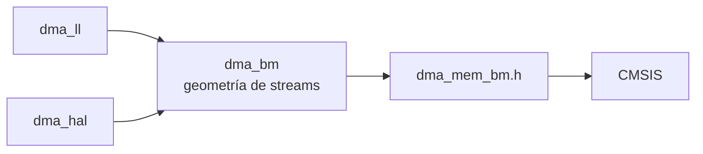

# Plan driver DMA 02\_dma

Sep 23, 2026 · @Hector

`dma_bm` funciona para su único uso validado, el ADC del CM4 en `prj_04`, pero todavía no es un driver de catálogo. Este plan cierra 13 hallazgos y añade los tiers LL y HAL en las fases F0 a F6. Cada fase se audita antes de empezar la siguiente.

Base: commit `a7f700a` de `main`. Copia de trabajo en el repo: `01_shared_drivers/02_dma/IMPLEMENTATION_PLAN.md`. Fuentes: `01_shared_drivers/README.md`, `DRIVER_ARCHITECTURE_GUIDELINES.md`, `CLAUDE.md`, RM0399 caps. 16 y 18, ES0445 rev 6.

## Criterios de catálogo

Estos 9 criterios se auditan en cada fase. Todos salen de las fuentes normativas; C7 es el único nuevo y se deduce de C1.

| # | Criterio | Origen |
| --- | --- | --- |
| C1 | Nada de instancias ni de pines en el driver. El stream, la request y las direcciones llegan por la estructura de config. Las tablas de hechos del silicio (stream a IRQn, IDs de request UART) sí viven en el driver, igual que `k_ll_instances[]` en `uart_ll.c`. | README regla 1, guías §5 Riesgo 2 |
| C2 | La API es inmutable. Las firmas públicas y el layout de `DmaBm_Config_t` no cambian; todo lo nuevo se añade aparte (`*Ex`, funciones nuevas). Un fix de comportamiento solo se permite si lo anterior ya estaba roto. | README regla 2, guías §1.4 |
| C3 | Cada archivo lleva su sufijo de tier, los nombres son únicos y ningún `#include` lleva el prefijo numérico. | README reglas 3 y 4 |
| C4 | Un target CMake por tier, que cada proyecto enlaza si lo necesita. El paraguas `stm32h7_shared_drivers` no cambia. | Precedente de `04_uart` |
| C5 | La errata la aplica el driver, no quien lo llama. | CLAUDE.md §F ("non-negotiable") |
| C6 | Lo que RM0399 prohíbe no se puede configurar: `Init` devuelve `false` antes de escribir ningún registro. | Estilo de `40fe018` |
| C7 | Los tres tiers usan el mismo modelo de inyección: `DMA_Stream_TypeDef *` más un request ID numérico. Así un mismo `board_def.h` sirve para BM, LL y HAL. | Deducido de C1 |
| C8 | Las dependencias solo apuntan hacia abajo. BM usa solo CMSIS; LL solo los inline de `stm32h7xx_ll_*.h`, sin `USE_FULL_LL_DRIVER` ni `stm32h7xx_hal.h`; HAL va dentro de `#if defined(HAL_DMA_MODULE_ENABLED)`. | `uart_ll.h:7-9`, `uart_hal.h:14` |
| C9 | Hay evidencia: compila con `-Werror` en todos los consumidores y cada tier tiene su prueba en hardware registrada en el repo. | Precedente `a7f700a` |

## Auditoría: lo que existe hoy

Solo existe el tier BM para DMA1/DMA2 + DMAMUX1, y se ha probado en hardware con una única configuración.

| Elemento | Estado |
| --- | --- |
| `02_dma/dma_bm.[ch]` | DMA1/DMA2 + DMAMUX1, tier BM. Existe desde `40fe018`. |
| `dma_ll`, `dma_hal` | No existen. |
| Helpers de caché y alineación | Solo `DMA_BM_ALIGN_32` (`dma_bm.h:24`). |
| BDMA / DMAMUX2 / MDMA | No existen. |
| `02_dma/README.md` | No existe (`04_uart` sí tiene el suyo). |
| Target CMake | `stm32h7_driver_dma` compila `dma_bm.c` y está dentro del paraguas. |
| Consumidores | `07_adc/adc_bm` (`adc_bm.c:382-409`) y `prj_04` CM4 `adc_acquisition.c` (DMA1 Stream0, request 9, P2M circular, halfword). Se compila sin usarse en el CM7 de `prj_02` y `prj_03` a través del paraguas. |
| Build (verificado 2026-09-23) | `prj_04` release limpio con `-Wall -Wextra -Wshadow -Werror`. CM4: 5 144 B de `.text`, FLASH 5 168 B. CM7: FLASH 83 996 B. |
| Validación en HW | Una sola configuración: P2M circular halfword en modo directo, DMA1 Stream0 (camino `LISR`), en el CM4. 511 kSPS y `err`/`ovr`/`adc_ovr` a 0 en unos 5 M de muestras. |

### Lo que está bien y se conserva

- El controlador, el índice y el canal DMAMUX se derivan del puntero al stream, con un `_Static_assert` sobre el stride de 0x18 (`dma_bm.c:14`).
- La geometría de `LISR`/`HISR` queda oculta tras `DMA_BM_FLAG_*`. Comprobada contra RM0399: shifts 0/6/16/22, FE bit 0, DME 2, TE 3, HT 4, TC 5.
- En M2M se fuerza `DMDIS` y se rechaza el modo circular, como pide RM0399.
- `Stop()` devuelve `bool` e `InitStream` aborta si el stream no se para. Con `EN=1` las escrituras a PAR/M0AR/NDTR se ignoran.
- DMAMUX se escribe con `SE=0` y `SPOL=00`, lo que cumple ES0445 2.6.4.
- La nota sobre el banqueo por núcleo de `AHB1ENR` es correcta (RM0399 9.7.1).
- `adc_bm` limpia exactamente los flags que leyó, así que no pierde eventos.

## Hallazgos

Hay 13 hallazgos; los tres de severidad alta pueden bloquear un stream o producir datos erróneos sin aviso. Alta: comportamiento incorrecto silencioso o bloqueo. Media: acepta una configuración inválida o insegura. Baja: robustez o hueco de catálogo.

| ID | Sev. | Dónde | Hallazgo | Acción (fase) |
| --- | --- | --- | --- | --- |
| A1 | Alta | `dma_bm.c:214-220` | `DMA_BM_Start()` pone `EN=1` sin limpiar los flags del stream, y RM0399 §16.5.5 lo exige. `Stop()` deja `TCIF=1`, así que parar y volver a arrancar da un TC fantasma. Al devolver `void`, no hay forma de detectarlo. | `Start()` limpia `DMA_BM_FLAG_ALL` antes de EN (misma firma) + `DMA_BM_StartEx()` → `bool` (F1) |
| A2 | Alta | `dma_bm.h:95-150` | No se puede re-armar un transfer (PAR/M0AR/NDTR) sin volver a llamar a Init. UART TX, SPI o M2M tendrían que escribir registros a mano. | `DMA_BM_SetTransfer()` (F1) |
| A3 | Alta | `dma_bm.c:168-171`, `dma_bm.h:59,81` | TRBUFF (ES0445 2.20.3) es opcional: si se olvida con una request UART, el stream puede bloquearse para siempre. La HAL lo activa sola (`stm32h7xx_hal_dma.c:299-308`). LPUART1 solo existe en DMAMUX2/BDMA, sin bit 20. HASH\_IN (78) también lo necesita (2.3.12). | Automático para requests {41–46, 63–66, 71–72, 78, 79–82} con la condición de revisión de la HAL (`REV_ID ≥ 0x2000`); `enable_trbuff` queda como forzado (F1) |
| A4 | Media | `dma_bm.c:65,107,135,148-150` | Validación incompleta. `buffer_length > 65535` se trunca sin aviso (70 000 → 4 464, Init devuelve `true`). Acepta `DIR=11` y `PSIZE`/`MSIZE=11` (reservados). `request_id` se enmascara con `0xFF` aunque el campo es `[6:0]`. Request 0 en P2M/M2P nunca arranca. No comprueba alineación de PAR/M0AR (§16.3.8) ni la tabla 115. | Rechazar en Init (F1) |
| A5 | Media | `dma_bm.c:63-176` | No rechaza ITCM (`0x0000_0000`) ni DTCM (`0x2000_0000`), donde caen por defecto el `.bss` y la pila del CM7. Pasa Init y falla en runtime con TE o stall. | Init usa `DMA_MEM_BM_IsReachable()` (F1) |
| A6 | Media | `dma_bm.c:121-131` | En modo directo el hardware fuerza MSIZE = PSIZE al activar EN. Pedir tamaños distintos sin FIFO se acepta y el empaquetado nunca ocurre. | Rechazar `!fifo && psize != msize` (F1) |
| A7 | Media | `dma_bm.c:100`, `:186` | Init y Deinit paran a la fuerza un stream activo. Los dos núcleos llegan a DMA1/DMA2: un error de reparto mata la transferencia del otro núcleo, y Deinit resetea su canal DMAMUX. | `fail_if_busy` en la config Ex + reparto de streams en `board_def.h` (F1) |
| A8 | Baja | `dma_bm.c:19-45` | `GetController`/`GetStreamIndex` aceptan direcciones desalineadas dentro de \[Stream0, Stream7\]; `Stream0 + 4` devuelve el índice 0. | Exigir `(addr - base) % 0x18 == 0` (F1) |
| A9 | Baja | `dma_bm.h` | Faltan doble buffer (DBM/M1AR/CT), burst con chequeo FIFO y límite de 1 KB, PFCTRL, tabla stream → IRQn y leer + limpiar flags en una llamada. | API Ex (F1) |
| A10 | Baja | `dma_bm.c:222-238` | El timeout de `Stop` son 10 000 vueltas, sin relación con el reloj (unos 20 µs a 480 MHz). Con bursts hacia FMC/QSPI lento podría quedarse corto. | `DMA_BM_StopEx(stream, spin_limit)` (F1) |
| A11 | Doc | `README.md:26,32`; `CMakeLists.txt:82,88`; `dma_bm.h:23` | Se prometen BDMA, MDMA y helpers de caché, y que `08_eth` depende de `02_dma`: nada de eso existe. `DMA_BM_ALIGN_32` dice "cache safety", pero el tamaño también debe ser múltiplo de 32. La guía no lista `dma_hal`. | Corregir en F6; README mínimo de `02_dma` en F1 |
| A12 | Build | `CMakeLists.txt:29-31` | `stm32h7_driver_dma` es el tier BM, cuando en uart/adc el nombre sin sufijo es HAL. No se puede renombrar: lo enlazan `prj_04` CM4 y `stm32h7_driver_adc_bm`. | Alias de compatibilidad sin fuentes que apunta a `_dma_bm` (F0) |
| A13 | Pruebas | — | Nunca se han ejercitado en HW: M2M, M2P, FIFO, DMA2, streams 4–7 (camino `HISR`), `Deinit` ni los flags de error. | Selftest (T1–T12) |

## Relacionado fuera de 02\_dma

Este plan no toca nada de lo siguiente, salvo donde se indica.

- `uart_hal.c:241-279` `UART_HAL_CheckDmaErrata()`: redundante con `HAL_DMA_Init()`, que ya activa TRBUFF para requests UART cuando `REV_ID ≥ 0x2000`. Solo sirve como verificación y se conserva (regla 2). En F6 puede delegar en `DMA_HAL_CheckErrata()` sin cambiar su firma.
- `adc_hal.c:112-129`: llama a `HAL_DMA_Init` sin habilitar el reloj del DMA y confía en la app (`prj_03/CM4/App/Src/adc_acquisition.c:96`). No requiere cambios; el contrato se documenta en el README de `02_dma`.
- `prj_04` `adc_acquisition.c:104`: la app escribe `request_id = 9U` como literal. Está permitido en código de proyecto, pero el contrato de `board_def.h` lo mueve allí.
- `uart_bm` y `uart_ll` no ofrecen hooks de DMA (`CR3.DMAT/DMAR`). La prueba T3 los activa desde el código de test; añadir esos hooks queda pendiente para `04_uart`.

## Alcance y decisiones

Entran DMA1/DMA2 + DMAMUX1 en los tres tiers, los helpers de memoria y BDMA en el tier HAL; MDMA queda fuera.

| Qué | Decisión | Por qué |
| --- | --- | --- |
| DMA1/DMA2 + DMAMUX1 | Dentro, en los tres tiers | Es el núcleo y ya tiene consumidores |
| Helpers de memoria y caché | Dentro (`dma_mem_bm.h`) | Los promete el README; la coherencia en el M7 es la fuente de bugs número 1 |
| BDMA en el tier HAL | Dentro (F3) | Sale casi gratis: `HAL_DMA_*` trata igual streams y canales BDMA |
| BDMA + DMAMUX2 en BM | Condicional (F5) | Solo con un consumidor en D3 (LPUART1, SPI6, I2C4, ADC3) |
| MDMA | Fuera; se corrige el README | Otro controlador (listas enlazadas, triggers) sin consumidor |
| DMAMUX sync y request generator | Fuera | ES0445 2.6.1–2.6.3: sus flags de overrun no son fiables |
| Migrar `uart_hal`/`adc_hal` a `dma_hal` | Fuera (pendiente) | Cambiaría el comportamiento de `prj_03` sin ganar nada ahora |

## Archivos, dependencias y targets CMake

`dma_bm` es la única copia de la geometría de los streams; LL y HAL la reutilizan en lugar de duplicarla.

```text
02_dma/
├── README.md          # NUEVO: matriz de capacidades, contrato board_def.h, ejemplos, errata
├── dma_mem_bm.h       # NUEVO, solo cabecera y solo CMSIS: alineación, tamaño, caché + DMB, alcanzabilidad
├── dma_bm.h / .c      # EXISTENTE: fixes A1-A10 + API Ex (en el .h solo se añade)
├── dma_ll.h / .c      # NUEVO
├── dma_hal.h / .c     # NUEVO: DMA1/DMA2 + BDMA mediante la HAL
└── bdma_bm.h / .c     # F5, condicional
```



Las dependencias solo bajan, igual que `uart_hal` ya depende de `gpio_bm`. Controlador, índice, canal DMAMUX, IRQn e IDs de request UART viven solo en `dma_bm`.

```cmake
add_library(stm32h7_driver_dma_bm INTERFACE)
target_include_directories(stm32h7_driver_dma_bm INTERFACE ${CMAKE_CURRENT_LIST_DIR}/02_dma)
target_sources(stm32h7_driver_dma_bm INTERFACE ${CMAKE_CURRENT_LIST_DIR}/02_dma/dma_bm.c)

# Compatibility: this name predates the tiers and always meant the _bm tier
# (prj_04 CM4, stm32h7_driver_adc_bm). Unlike uart/adc, the unsuffixed DMA
# target is therefore BM, not HAL. It carries no sources of its own, so a
# project reaching dma_bm.c through both names compiles it once.
add_library(stm32h7_driver_dma INTERFACE)
target_link_libraries(stm32h7_driver_dma INTERFACE stm32h7_driver_dma_bm)

add_library(stm32h7_driver_dma_ll INTERFACE)   # dma_ll.c  -> links stm32h7_driver_dma_bm
add_library(stm32h7_driver_dma_hal INTERFACE)  # dma_hal.c -> links stm32h7_driver_dma_bm
```

El paraguas `stm32h7_shared_drivers` no cambia: sigue enlazando `stm32h7_driver_dma`, es decir, el tier BM.

## Contratos de API: dma\_mem\_bm.h y dma\_bm

`dma_mem_bm.h` concentra alineación, caché y alcance de memoria; `dma_bm` conserva su API y crece solo por adición.

### dma\_mem\_bm.h (solo CMSIS, todo `static inline`)

```c
#define DMA_MEM_BM_LINE          32U
#define DMA_MEM_BM_ALIGN         __attribute__((aligned(32)))
#define DMA_MEM_BM_SIZE(bytes)   ((((bytes) + 31U) / 32U) * 32U)

typedef enum { DMA_MEM_BM_MASTER_DMA, DMA_MEM_BM_MASTER_BDMA } DmaMemBm_Master_t;

static inline bool DMA_MEM_BM_IsReachable(DmaMemBm_Master_t m, uint32_t addr, uint32_t bytes);
static inline bool DMA_MEM_BM_IsLineAligned(const void *p, uint32_t bytes);
static inline void DMA_MEM_BM_CleanForTx(const void *p, uint32_t bytes);  /* CPU -> DMA            */
static inline bool DMA_MEM_BM_PrepareRx(void *p, uint32_t bytes);         /* antes de arrancar RX  */
static inline bool DMA_MEM_BM_CompleteRx(void *p, uint32_t bytes);        /* después de HT/TC      */
```

1. Compila igual en CM4 y CM7: si `__DCACHE_PRESENT != 1`, las funciones de caché no hacen nada. `core_cm4.h` no declara `SCB_*DCache*`.
2. `CleanForTx` puede redondear hacia fuera a líneas enteras; limpiar nunca destruye datos.
3. `PrepareRx` y `CompleteRx` devuelven `false` si `p` o `bytes` no están alineados a 32: invalidar una línea compartida destruye la variable vecina. `PrepareRx` hace clean + invalidate; `CompleteRx` hace invalidate.
4. Cada operación de mantenimiento va seguida de `__DMB()` (ES0445 2.1.5), aunque CMSIS ya meta un DSB.
5. Si la D-Cache está apagada (`SCB->CCR.DC == 0`), no hacen nada.
6. DMA1/DMA2: lista de rechazo de ITCM `[0x0000_0000, 0x0001_0000)` y DTCM `[0x2000_0000, 0x2002_0000)`. BDMA: lista de permitidos con SRAM4 `[0x3800_0000, 0x3801_0000)` y los periféricos de D3. Comprobar en RM0399 §2 si el BDMA llega a la backup SRAM (`0x3880_0000`) antes de incluirla. En ambos casos, comprobar desbordamiento de `addr + bytes`.
7. `DMA_BM_ALIGN_32` se queda en `dma_bm.h` como alias (C2).

### dma\_bm: funciones existentes (firmas intactas)

| Función | Cambio | Justificación (C2) |
| --- | --- | --- |
| `DMA_BM_InitStream` | Envuelve a `InitStreamEx` con `fail_if_busy=false`. Añade las validaciones A4, A5, A6 y A8 y TRBUFF automático (A3). Valida todo antes de la primera escritura. | Lo que ahora se rechaza antes se truncaba, no llegaba a la memoria o ignoraba MSIZE |
| `DMA_BM_Start` | Limpia los flags antes de EN (A1) | RM0399 lo exige |
| `GetController` / `GetStreamIndex` | Comprueban el stride (A8) | Un puntero desalineado nunca fue un stream válido |

No regresión obligatoria en F1: la config de `prj_04` debe seguir aceptándose. Es P2M, PSIZE = MSIZE = halfword, modo directo, NDT = 1024, M0AR en SRAM2 alineada a 32, PAR = `&ADC1->DR` y request 9 (no UART).

### dma\_bm: adiciones

```c
typedef struct
{
    DmaBm_Config_t base;          /*!< Legacy config: first member, embed it unchanged    */
    uint32_t       mem1_addr;     /*!< != 0 -> double-buffer (DBM). Forbidden with M2M     */
    uint32_t       mem_burst;     /*!< DMA_BM_BURST_SINGLE/INCR4/INCR8/INCR16, FIFO only   */
    uint32_t       periph_burst;
    bool           periph_flow_ctrl; /*!< PFCTRL. Forbidden with M2M and with circular     */
    bool           fail_if_busy;  /*!< true: refuse when EN=1 instead of stopping (A7)     */
    uint32_t       stop_spin_limit;  /*!< 0 -> DMA_DISABLE_TIMEOUT_LOOPS                    */
} DmaBm_ConfigEx_t;

bool      DMA_BM_InitStreamEx(const DmaBm_ConfigEx_t *cfg);
bool      DMA_BM_SetTransfer(DMA_Stream_TypeDef *s, uint32_t periph_addr,
                             uint32_t mem_addr, uint32_t length);  /* EN must be 0; same validation as Init */
bool      DMA_BM_StartEx(DMA_Stream_TypeDef *s);   /* clear flags, EN=1; true if EN or TCIF reads back */
bool      DMA_BM_StopEx(DMA_Stream_TypeDef *s, uint32_t spin_limit);
uint32_t  DMA_BM_TakeFlags(DMA_Stream_TypeDef *s); /* read + clear exactly what was read              */
bool      DMA_BM_SetIdleMemory(DMA_Stream_TypeDef *s, uint32_t addr); /* DBM: writes M1AR if CT=0, M0AR if CT=1 */
uint32_t  DMA_BM_GetCurrentTarget(const DMA_Stream_TypeDef *s);
IRQn_Type DMA_BM_GetIRQn(const DMA_Stream_TypeDef *s);  /* DMA1 S0-6 -> 11..17, S7 -> 47; DMA2 S0-4 -> 56..60, S5-7 -> 68..70 */
bool      DMA_BM_IsUartRequest(uint32_t request_id);    /* silicon fact, reused by LL and HAL */
```

Reglas nuevas de validación (RM0399 cap. 16):

- DBM obliga a circular: DBM con M2M se rechaza (tabla 113).
- `SetIdleMemory` solo escribe el registro que no está en uso según CT. Escribir el activo pone TEIF y deshabilita el stream.
- Un burst exige FIFO; el umbral debe ser compatible, replicando `DMA_CheckFifoParam()` de la HAL.
- Con burst, la dirección se alinea a beats × tamaño para no cruzar 1 KB; ese error AHB no aparece en los registros del DMA.
- PFCTRL con circular o con M2M se rechaza.
- La condición de TRBUFF se copia de la HAL: `(DBGMCU->IDCODE & 0xFFFF0000U) >= 0x20000000U`.

## Contratos de API: dma\_ll

`dma_ll` usa un handle y fija las direcciones en cada arranque, como `uart_ll`, con timeouts `spin_limit` y un servicio de IRQ con callback. BM configura una vez y usa solo CMSIS; LL usa las constantes `LL_DMA_*` de los proyectos LL de CubeMX.

```c
typedef struct
{
    DMA_Stream_TypeDef *stream;     /*!< Same injection as BM/HAL (C7)                   */
    uint32_t request;               /*!< LL_DMAMUX1_REQ_* (numerically = DMAMUX1 ID)       */
    uint32_t direction;             /*!< LL_DMA_DIRECTION_*                                */
    uint32_t mode;                  /*!< LL_DMA_MODE_NORMAL / _CIRCULAR / _PFCTRL          */
    uint32_t periph_inc, mem_inc;   /*!< LL_DMA_PERIPH_INCREMENT / _NOINCREMENT, ...      */
    uint32_t periph_size, mem_size; /*!< LL_DMA_PDATAALIGN_* / LL_DMA_MDATAALIGN_*         */
    uint32_t priority;              /*!< LL_DMA_PRIORITY_*                                 */
    bool     fifo_enable;
    uint32_t fifo_threshold, mem_burst, periph_burst;
    bool     double_buffer;
    bool     enable_clock;
    bool     fail_if_busy;
} DmaLL_Config_t;

typedef struct DmaLL_Handle DmaLL_Handle_t;
typedef void (*DmaLL_Callback_t)(DmaLL_Handle_t *h, uint32_t flags, void *ctx);

struct DmaLL_Handle
{
    DMA_TypeDef        *dma;
    uint32_t            ll_stream;       /*!< LL_DMA_STREAM_0..7                 */
    DMA_Stream_TypeDef *stream;
    volatile uint32_t   error_flags;     /*!< Accumulated TE/DME/FE (TakeErrors) */
    volatile uint32_t   tc_count, ht_count;
};

bool     DMA_LL_Init(DmaLL_Handle_t *h, const DmaLL_Config_t *cfg);
bool     DMA_LL_Deinit(DmaLL_Handle_t *h, uint32_t spin_limit);
bool     DMA_LL_Start(DmaLL_Handle_t *h, uint32_t periph_addr, uint32_t mem_addr, uint32_t length);
bool     DMA_LL_StartDoubleBuffer(DmaLL_Handle_t *h, uint32_t periph_addr,
                                  uint32_t mem0, uint32_t mem1, uint32_t length);
bool     DMA_LL_Stop(DmaLL_Handle_t *h, uint32_t spin_limit);
uint32_t DMA_LL_GetRemaining(const DmaLL_Handle_t *h);
uint32_t DMA_LL_TakeFlags(DmaLL_Handle_t *h);
uint32_t DMA_LL_TakeErrors(DmaLL_Handle_t *h);          /* PRIMASK-guarded, like UART_LL_TakeErrors */
bool     DMA_LL_EnableIrq(DmaLL_Handle_t *h, uint32_t it_mask, uint32_t priority); /* IRQn from dma_bm */
void     DMA_LL_DisableIrq(DmaLL_Handle_t *h);
void     DMA_LL_IrqService(DmaLL_Handle_t *h, DmaLL_Callback_t cb, void *ctx);
bool     DMA_LL_MemCopy(DmaLL_Handle_t *h, void *dst, const void *src, uint32_t length, uint32_t spin_limit);
```

- Las validaciones son las mismas que en BM y se comparten, no se duplican: viven en `dma_bm.c`, expuestas en su `.h` o en una cabecera privada común.
- TRBUFF se activa solo con `LL_DMA_EnableBufferableTransfer()` cuando `DMA_BM_IsUartRequest()` lo indica.
- Política de errores, escrita en el README: TE y DME se registran y pasan al callback. FE se cuenta pero no es fatal, igual que en la HAL, que no activa FEIE en `HAL_DMA_Start_IT`. Quien implemente documenta, citando RM0399 §16.3.20, qué errores deshabilitan el stream por hardware.

## Contratos de API: dma\_hal y board\_def.h

`dma_hal` envuelve la HAL de ST para DMA1/DMA2 y BDMA, dentro de `#if defined(HAL_DMA_MODULE_ENABLED)`.

```c
typedef struct
{
    void     *instance;       /*!< DMA1_Stream0..DMA2_Stream7 or BDMA_Channel0..7         */
    uint32_t  request;        /*!< DMA_REQUEST_* / BDMA_REQUEST_*                          */
    uint32_t  direction;      /*!< DMA_PERIPH_TO_MEMORY / DMA_MEMORY_TO_PERIPH / _TO_MEMORY */
    uint32_t  periph_inc, mem_inc, periph_align, mem_align, mode, priority;
    uint32_t  fifo_mode, fifo_threshold, mem_burst, periph_burst;
    bool      enable_clock;   /*!< DMA1/DMA2 on AHB1, BDMA on AHB4                         */
    int32_t   irq_priority;   /*!< < 0: leave NVIC untouched                               */
} DmaHal_Config_t;

HAL_StatusTypeDef DMA_HAL_Init(DMA_HandleTypeDef *hdma, const DmaHal_Config_t *cfg);
HAL_StatusTypeDef DMA_HAL_DeInit(DMA_HandleTypeDef *hdma);
HAL_StatusTypeDef DMA_HAL_CheckErrata(const DMA_HandleTypeDef *hdma);  /* TRBUFF read-back on UART/HASH streams */
IRQn_Type         DMA_HAL_GetIRQn(const void *instance);
void              DMA_HAL_IRQDispatch(const void *instance);           /* per-core registry, filled by Init */
HAL_StatusTypeDef DMA_HAL_MemCopy(DMA_HandleTypeDef *hdma, void *dst, const void *src,
                                  uint32_t bytes, uint32_t timeout_ms);
```

- Nombres: `DmaHal_Config_t` sigue el estilo de BM, LL y `adc_hal`. Dentro de una carpeta prima la coherencia entre tiers, aunque `uart_hal` use `uart_hal_config_t`.
- M2M con FIFO forzado, igual que en BM. `HAL_DMA_Init` no lo valida y acepta una configuración que RM0399 prohíbe.
- Se rechaza BDMA con un buffer fuera de SRAM4, y DMA1/DMA2 con un buffer en TCM, usando `DMA_MEM_BM_IsReachable`.
- `DMA_HAL_MemCopy` hace: clean de `src`, `PrepareRx(dst)`, `HAL_DMA_Start`, `HAL_DMA_PollForTransfer` y `CompleteRx(dst)`. Devuelve `HAL_ERROR` si `dst` no está alineado a 32 en un CM7 con D-Cache encendida.
- El registro de IRQ (24 punteros por núcleo: 16 streams y 8 canales BDMA) es opcional. El driver nunca define `DMAx_Streamy_IRQHandler`, para no chocar con el `stm32h7xx_it.c` del proyecto.
- La HAL necesita un timebase (`HAL_GetTick`) para `Abort` y `PollForTransfer`; en el CM7 con FreeRTOS es TIM6 o TIM7 (CLAUDE.md §E).

### Contrato de board\_def.h (el mismo para los tres tiers)

El driver no define nada de esto; lo hace el proyecto. Ejemplo de `prj_04`:

```c
/* DMA stream allocation - ONE line per stream in use, per core. A stream listed
   twice is a dual-core collision (A7): the second InitStreamEx with
   fail_if_busy = true refuses instead of killing the first. */
#define BOARD_ADC_DMA_STREAM        DMA1_Stream0   /* CPU2 */
#define BOARD_ADC_DMA_REQUEST       9U             /* DMAMUX1: adc1_dma */
```

## Matriz de cumplimiento RM0399 / ES0445

Cada regla tiene su mecanismo en cada tier y una prueba o revisión que la verifica.

| Regla | BM | LL | HAL | Prueba |
| --- | --- | --- | --- | --- |
| ES0445 2.20.3/2.21.1: TRBUFF en requests UART | Automático por ID | Automático por ID | Lo pone `HAL_DMA_Init`; `DMA_HAL_CheckErrata` lo verifica | T3, T10 |
| ES0445 2.3.12: TRBUFF en HASH\_IN, sin DMA1 y DMA2 a la vez | Automático (78); la exclusión DMA1/DMA2 solo se documenta | Igual | Verificación | Revisión |
| ES0445 2.1.5: `__DMB()` tras mantener la caché | `dma_mem_bm.h` | Igual | Igual | T8 |
| ES0445 2.1.1: nunca write-through | Solo documentación | — | — | Revisión |
| ES0445 2.6.4: `SE=0` ⇒ `SPOL=00` | Escribe CCR completo (ya se cumple) | `LL_DMA_SetPeriphRequest` no toca SE | La HAL no activa sync | Revisión |
| ES0445 2.6.1–2.6.3: SOF/OF poco fiables | No se exponen | — | — | — |
| ES0445 2.5.1: nunca escribir `CGIFx` en BDMA | F5: solo HT/TC/TE | — | La HAL ya lo cumple | T11 |
| RM: limpiar flags antes de EN | A1 | Sí | La HAL lo hace | T6 |
| RM: registros solo con `EN=0` | Ya se cumple | Sí | La HAL lo hace | T2 |
| RM: M2M sin circular, sin modo directo, sin DBM, sin PFCTRL | Ya se cumple + DBM/PFCTRL | Sí | Forzado por el wrapper | T2 |
| RM: NDT ≤ 65535 y tabla 115 | A4 | Sí | El wrapper | T2 |
| RM: alineación de PAR/M0AR y límite de 1 KB en burst | A4, A9 | Sí | El wrapper | T2 |
| RM: umbral de FIFO compatible con el burst | A9 | Sí | La HAL (`DMA_CheckFifoParam`) | T1, T2 |
| RM: modo directo ⇒ MSIZE = PSIZE | A6 | Sí | El wrapper | T2 |

## Fases

Son siete fases (F0–F6), y cada una pasa por auditoría antes de empezar la siguiente. Cada fase acaba en commits con el estilo del repo (`driver(dma): …`, `test(prj_04): …`, `docs(drivers): …`), una preocupación por commit y el porqué en el cuerpo.

| Fase | Entregable | Salida (gate) |
| --- | --- | --- |
| F0: Base | Targets `stm32h7_driver_dma_bm` y alias `stm32h7_driver_dma` (A12). `tools/build_all.ps1`: template, prj\_02, prj\_03 y prj\_04 en debug y release, la mitigación "Multi-Project CI Matrix Build" de las guías §5. Tabla de tamaños de referencia. | Las 8 builds en verde y binarios idénticos en tamaño a los de hoy |
| F1: `dma_mem_bm.h` + `dma_bm` | Contratos de `dma_mem_bm.h` y `dma_bm` completos, A1–A10 cerrados. Primer `02_dma/README.md` con la matriz de capacidades BM. Selftest BM en el CM4 (T1–T7). | Matriz en verde. `git diff dma_bm.h` solo añade. No regresión de `prj_04`. T12 en verde. Crecimiento del CM4 release reportado; más de 1 KB necesita justificación |
| F2: `dma_ll` | Contrato de `dma_ll` y target `_dma_ll`. Selftest LL en el CM4 (T1–T6). | Matriz en verde. Cabecera autocontenida: un `.c` que solo incluye `dma_ll.h` compila sin HAL |
| F3: `dma_hal` | Contrato de `dma_hal` (DMA1/DMA2 + BDMA) y target `_dma_hal`. Selftest en el CM7 (T8–T11). | Matriz en verde. `DMA_HAL_CheckErrata` coincide con `HAL_DMA_Init`. El registro de IRQ no define ningún vector |
| F4: Registro en HW | Captura de los dos núcleos en `prj_04/docs/` y commit `test(prj_04): record …` que diga qué se ejercitó. | Todas las pruebas con resultado observado; lo que no se pudo ejercitar, escrito explícitamente |
| F5: `bdma_bm` (condicional) | BDMA + DMAMUX2 en BM, respetando ES0445 2.5.1. | Solo si hay un consumidor en D3 |
| F6: Cierre del catálogo | Corregir A11: README de `01_shared_drivers` (sin prometer MDMA), comentarios de `CMakeLists.txt`, árbol de la guía con `dma_hal` y `dma_mem_bm`, aclaración TRBUFF/HASH en `errata_summary.md`. Opcional: `UART_HAL_CheckDmaErrata` delega en `DMA_HAL_CheckErrata`. | Ninguna afirmación de la documentación sin código detrás |

## Plan de pruebas

El selftest sigue el precedente de UART: la opción CMake `DMA_DRIVER_SELFTEST` (por defecto `OFF`) en `prj_04`, ejecutada en el CM4 antes de `ADC_Acquisition_Init()`. El CM4 envía su resultado por `g_shared.m4_to_m7` y el CM7 lo imprime como `[m4_dma_test] …`; el CM7 imprime el suyo como `[m7_dma_test] …`.

El código va en archivos propios (`CM4/App/Src/dma_selftest.c` y `CM7/App/Src/dma_selftest.c`), no en `main.c`. El selftest UART añadió 254 líneas a `CM4/Core/Src/main.c`, y eso no escala a un segundo driver.

Reparto de streams: el CM4 usa DMA1 S1–S7 (S0 es del ADC); el CM7 usa DMA2 S0–S7 y BDMA Ch0. El timer de request es TIM7\_UP (request 70), libre hoy en `prj_04` e inyectado por `board_def.h`. Hardware: NUCLEO-H755ZI-Q con el cable PD5-PD6 ya puesto para el selftest UART.

| ID | Núcleo / tier | Qué | Criterio |
| --- | --- | --- | --- |
| T1 | CM4 BM, LL; CM7 BM (DMA2) | M2M de 8, 16 y 32 bits con los 4 umbrales de FIFO y con INCR4/8/16, en todos los streams libres, incluidos S4–S7 (`HISR`) | `memcmp` = 0, flags = solo TC, NDTR = 0 |
| T2 | Todos | Rechazos: M2M con circular o DBM; NDT 0 y 65536; DIR=3; PSIZE=3; request 0 en P2M; request 128; direcciones desalineadas; modo directo con PSIZE ≠ MSIZE; burst sin FIFO o con umbral incompatible; burst que cruzaría 1 KB; DTCM/ITCM (CM7); stream desalineado; `fail_if_busy` con EN=1 | Todo devuelve `false`/`HAL_ERROR` y el `CR` del stream sigue a 0 |
| T3 | CM4 BM, LL | Lazo USART2 de PD5 a PD6: TX por DMA (request 44) y RX por DMA (request 43), 256 B a 115 200 y 921 600 baudios | TRBUFF = 1 sin haberlo pedido, datos idénticos, stream del ADC intacto |
| T4 | CM4 BM, LL | P2M circular con TIM7\_UP a 10 kHz sobre un buffer de 1000 muestras durante 1 s | Unos 10 TC y 10 HT (± 1), sin errores |
| T5 | CM4 BM, LL | Doble buffer con la misma fuente, `SetIdleMemory` en cada TC | CT alterna y no aparece TEIF |
| T6 | CM4 BM, LL | `Stop` a mitad, luego `TakeFlags`, `SetTransfer` y `StartEx` | Completa sin TC fantasma (demuestra A1) |
| T7 | CM4 BM | Tras Init se escribe a mano una dirección ITCM en M0AR, saltándose la validación | Se espera TEIF con EN=0 y el sistema vivo; si no sale TE, se registra lo observado |
| T8 | CM7 BM + `dma_mem_bm` | M2M por DMA2 de `.axi_ram` cacheable a `.axi_ram` cacheable con CleanForTx, PrepareRx y CompleteRx | `memcmp` = 0; `PrepareRx` con buffer no alineado devuelve `false` |
| T9 | CM7 HAL | `DMA_HAL_MemCopy` en DMA2, y `HAL_DMA_Start_IT` con callbacks vía `DMA_HAL_IRQDispatch` | Datos correctos y exactamente 1 callback de TC |
| T10 | CM7 HAL | TX de USART3 (consola VCP) por DMA2 con request 46 | La línea aparece en `monitor.py` y `DMA_HAL_CheckErrata` devuelve `HAL_OK` |
| T11 | CM7 HAL, BDMA | M2M de SRAM4 a SRAM4 (`.d3_ram`) por BDMA Ch0, y un buffer en SRAM1 para BDMA | Datos correctos; el buffer en SRAM1 se rechaza |
| T12 | Regresión | Build sin la opción | `prj_04` igual que antes: unos 511 kSPS y `err`/`ovr`/`adc_ovr` = 0 |

## Definición de hecho

Esto es lo que el auditor revisa en cada fase.

- [ ] Reglas 1–4 del README y checklist §6 de las guías.
- [ ] `git diff` de los `.h` existentes solo añade: ninguna firma ni campo de `DmaBm_Config_t` cambia.
- [ ] Todo `Init`/`Set*` valida entero antes de escribir el primer registro, y T2 lo demuestra.
- [ ] La matriz de 8 builds (`-Werror`) está en verde y se reportan los tamaños frente a F0.
- [ ] Cabeceras autocontenidas, con guardas `extern "C"` y sin incluir nada de un tier superior.
- [ ] Las instancias solo aparecen como datos de tablas de hechos (C1). Un `DMA1_Stream3` literal fuera de una tabla es un defecto.
- [ ] Cada fila de la matriz de cumplimiento que toca la fase está implementada y probada.
- [ ] La captura de HW está en el repo y dice qué se ejercitó y qué no.
- [ ] `02_dma/README.md` coincide con el código: nada prometido que no exista.

## Riesgos

| Riesgo | Mitigación |
| --- | --- |
| Que las validaciones de F1 rompan la adquisición de `prj_04` | Comprobación de no regresión + T12 |
| Que el tier BM del CM4 engorde (su razón de ser es el tamaño) | Más de 1 KB en `prj_04` CM4 release hay que justificarlo |
| Choques de streams entre núcleos | `fail_if_busy`, reparto en `board_def.h` y reparto de la prueba |
| Compilar dos veces `dma_bm.c` por el alias | El alias no tiene fuentes, solo enlaza `_dma_bm` |
| Un timeout de bucle que depende del reloj | `spin_limit` explícito en `StopEx` y en LL |
| Leer "incluye BDMA" como "BDMA en los tres tiers" | La matriz de capacidades del README marca BDMA como solo HAL hasta F5 |

## Decisiones abiertas

Cada una trae la opción por defecto que asume este plan.

1. MDMA: fuera, y se corrige el README (recomendado). Alternativa: una fase F7 con su propio consumidor (SDMMC, QSPI o JPEG).
2. BDMA en BM: cuando exista un consumidor en D3, en F5 (recomendado). Alternativa: hacerlo ya, sin consumidor que lo valide.
3. Dónde vive el selftest: en `prj_04` detrás de una opción CMake, como el de UART (recomendado). Alternativa: un proyecto de banco de pruebas propio, cuando haya un tercer driver con selftest.
4. `tools/build_all.ps1`: crearlo en F0 (recomendado). Alternativa: lanzar las 8 builds a mano en cada gate.
