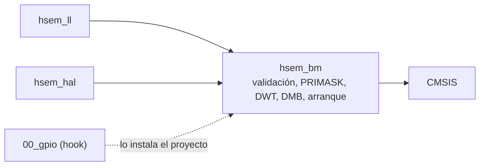
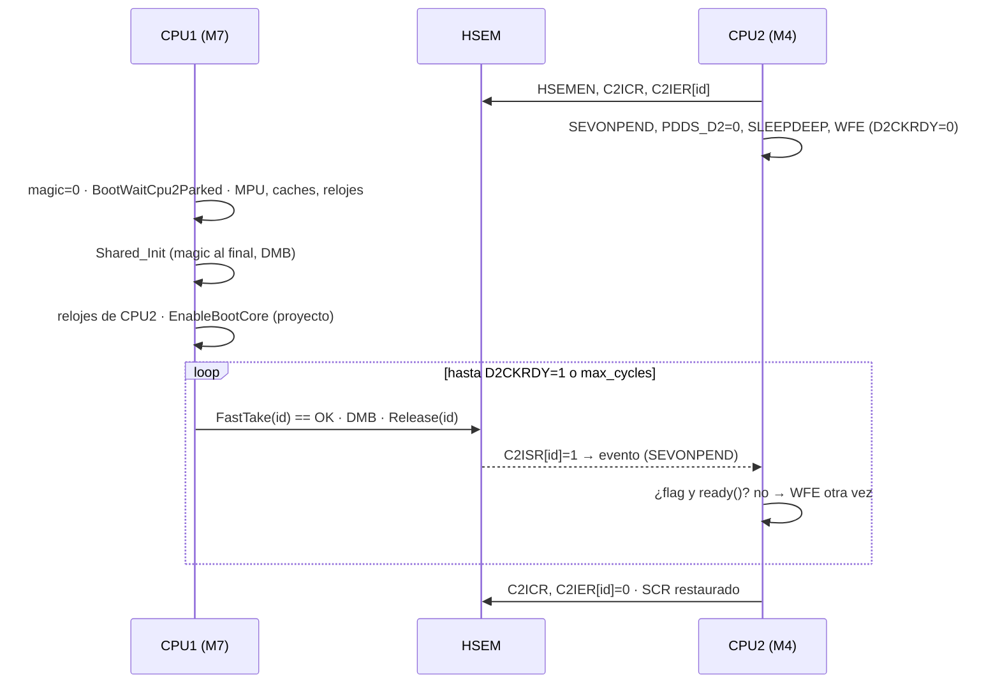

# Plan driver HSEM 10\_hsem

Sep 26, 2026 · @Hector

`10_hsem` está vacío, pero el HSEM se usa en todos los proyectos duales. Cada proyecto tiene su copia del arranque sincronizado y de `SHARED_LOCK()`, y esas copias ya han divergido: la corrección de `9034a5f` (CPU2 salía del STOP demasiado pronto tras un reset en caliente) solo llegó a `prj_04`. La auditoría del código existente encuentra 13 hallazgos. El más grave está latente: el lock de 1 paso que usan todos los proyectos no excluye entre dos contextos del mismo núcleo, y en CM7 hay FreeRTOS. Este plan construye los tres tiers y la utilidad de arranque en las fases F0 a F5, y migra `prj_04` y la plantilla. Cada fase pasa una auditoría antes de empezar la siguiente, con las reglas de la sección [Protocolo de auditoría](#protocolo-de-auditoría).

Base: commit `a776454` de `main`. `DRIVER_ROADMAP.md` y `.vscode/` están sin commitear; no tocan ningún archivo de este plan. Fuentes: `01_shared_drivers/README.md`, `DRIVER_ROADMAP.md` §5.1 y §6, `00_gpio/IMPLEMENTATION_PLAN.md` (formato y criterios), `DRIVER_ARCHITECTURE_GUIDELINES.md`, `00_docs_stm32h7/CLAUDE.md`, RM0399 cap. 11 (HSEM), §7 (PWR), §9.7.1 (banqueo de RCC) y §21 (EXTI), ES0445, y `stm32h7xx_hal_hsem.c`, `stm32h7xx_ll_hsem.h` y `stm32h7xx_hal_pwr_ex.c` del Cube.

Banco de pruebas: NUCLEO-H755ZI-Q con su ST-LINK (SWD y VCP). **No hace falta hardware externo.** Todas las pruebas se hacen con los dos núcleos, la consola y el depurador. El Analog Discovery 2 del plan de GPIO no se usa aquí.

## Criterios de catálogo

Estos 13 criterios se auditan en cada fase. C1–C9 son los mismos del plan de `00_gpio`, adaptados a HSEM. C10–C13 salen de lo que hace distinto a este periférico: lo comparten dos maestros, el hardware ignora en silencio las operaciones que no autoriza y el orden de memoria entre núcleos no es gratis.

| # | Criterio | Origen |
| --- | --- | --- |
| C1 | El driver no fija IDs de semáforo, PROCIDs ni claves: llegan por parámetro. Solo los hechos del silicio pueden vivir en el driver: 32 semáforos, COREID 3 para CPU1 y 1 para CPU2 (RM0399 tabla 95), `HSEM1_IRQn`/`HSEM2_IRQn`. El driver no incluye `shared_memory.h` ni `board_def.h`. | README regla 1; `DRIVER_ROADMAP.md` §5.1 |
| C2 | Las firmas se congelan al pasar la auditoría de F1, porque `00_gpio` F1 construye sobre ellas. Desde entonces todo lo nuevo se añade aparte. Las macros de proyecto `SHARED_LOCK`/`SHARED_UNLOCK`/`Shared_TryLock` siguen compilando igual en los proyectos que no se migran. | README regla 2 |
| C3 | Cada archivo lleva su sufijo de tier, los nombres son únicos y ningún `#include` lleva el prefijo numérico. | README reglas 3 y 4 |
| C4 | Hay un target CMake por tier: `_hsem_bm`, `_hsem_ll` y `_hsem_hal`. No hay target sin sufijo: no hay un nombre antiguo que conservar, y el nombre sin sufijo significa BM en `dma`/`gpio` y HAL en `uart`/`adc`. El paraguas no cambia. | Precedente A12 de `02_dma`; G11 de `00_gpio` |
| C5 | Si una errata se puede aplicar en el driver, la aplica el driver; si no, queda en el README con su ID. ES0445 no tiene ninguna entrada de HSEM (un grep de `HSEM` y `semaphore` en la copia del hub da 0 resultados), y el README lo dice de forma explícita. | CLAUDE.md §F |
| C6 | Lo inválido no se ejecuta: `id > 31`, `proc_id > 255`, `proc_id = 0` en el lock de 2 pasos, máscara vacía, clave 0 y un núcleo que no coincide con el build devuelven error **antes del primer acceso** al periférico. | Estilo de `40fe018`; hallazgo S10 |
| C7 | BM y LL no tienen estado en RAM (`.bss` y `.data` de `hsem_bm.o` y `hsem_ll.o` = 0 en el `.map`). Los dos núcleos enlazan el mismo código sin compartir nada más que el periférico. Solo HAL puede tener estado: el registro de callbacks de su núcleo. | Precedente del registro EXTI de `00_gpio` |
| C8 | Las dependencias solo apuntan hacia abajo. BM usa solo CMSIS (`stm32h7xx.h`): nada de HAL, FreeRTOS ni `cmsis_os`. LL usa los inline de `stm32h7xx_ll_hsem.h`, sin `USE_FULL_LL_DRIVER`, más `hsem_bm`. HAL va dentro de `#if defined(HAL_HSEM_MODULE_ENABLED)`, más `hsem_bm`. | `uart_ll.h`, `uart_hal.h`; `DRIVER_ROADMAP.md` §8 punto 2 |
| C9 | Hay evidencia: todo compila con `-Werror` en las 8 builds, y cada tier tiene su prueba en la placa registrada en el repo, con el `FW_GIT_REV` de la imagen en la captura. | Precedente `a7f700a`; `DRIVER_ROADMAP.md` §6 R2 |
| C10 | **Orden de memoria.** Hay un `__DMB()` después de cada take con éxito y otro antes de cada release, en los tres tiers y en los dos núcleos. Todo acceso al HSEM es una palabra de 32 bits (RM0399 §11.4: un acceso de byte o de media palabra da bus error). | Modelo de memoria ARMv7-M; hallazgo S2 |
| C11 | **Honestidad.** El driver nunca devuelve éxito por una operación que el hardware ignoró. Un release se comprueba antes de escribir, y si el llamador no es dueño devuelve error y no escribe. Las funciones de diagnóstico leen `HSEM_Rx` y **nunca** `HSEM_RLRx`, porque leer RLR toma el semáforo (RM0399 §11.4.2). | RM0399 §11.3.5 y §11.4.2; hallazgos S1 y S3 |
| C12 | **Sección crítica local.** Todo read-modify-write sobre `HSEM_CnIER`, y la secuencia de detección del lock de 1 paso, se hace con PRIMASK guardado y restaurado, nunca forzado a 0, para que funcione dentro de un fault handler. | Precedente de `UART_BM_TakeErrors`; hallazgo S7 |
| C13 | **Esperas acotadas.** Cada espera del driver tiene un límite en **ciclos de CPU** (DWT `CYCCNT`), no en vueltas. La única excepción es la espera de arranque de CPU2: el núcleo está en STOP, `CYCCNT` no cuenta y no tiene otra cosa que hacer. La excepción queda escrita en la firma y en el README. | Hallazgos S3 y S4 |

## Auditoría: lo que existe hoy

No hay driver. Lo que existe es código de proyecto repetido, que depende de la HAL en los dos núcleos.

| Elemento | Estado |
| --- | --- |
| `10_hsem/` | Solo `.gitkeep`. Las guías (`DRIVER_ARCHITECTURE_GUIDELINES.md:92-94`) prometen solo `hsem_bm`; la hoja de ruta pide BM, LL y HAL. |
| IDs | `shared_memory.h:32-36` (`prj_04`): 0 arranque, 1 estado, 2 y 3 buzones, 4 datos del ADC. Las mismas líneas están en la plantilla, `prj_02` y `prj_03`, esta última también con el 4. El plan de GPIO reserva el 5 (`BOARD_GPIO_HSEM_ID`). |
| Lock | `SHARED_LOCK(id)` es `do {} while (HAL_HSEM_FastTake(id) != HAL_OK)`: 1 paso y sin límite (`shared_memory.h:103`, en 4 copias). `SHARED_UNLOCK(id)` es `HAL_HSEM_Release(id, 0)`, `void` y sin comprobación. |
| Lock acotado | Solo en `prj_04`: `Shared_TryLock(id, retries)` (`shared_memory.c:64-75`), acotado en **vueltas**. Lo usan `adc_acquisition.c:168,197` (CM4) y `adc_server.c:127,163` (CM7), siempre con 1000. La hoja de ruta (§5.1) dice "No hay timeout", y no es del todo así. |
| Arranque CPU2 | `CPU2_WaitForCPU1()` en el `main.c` de CM4. En `prj_04` (`:148-197`) repite el STOP mientras falte `SHARED_MAGIC` **o** el flag de HSEM 0 (`9034a5f`). En la plantilla (`:115-117`), `prj_02` (`:115-117`) y `prj_03` (`:149-151`) entra en STOP **una sola vez** y sigue con cualquier despertar. |
| Arranque CPU1 | `main.c` de CM7 (`prj_04:60-66`, `:121-135`): espera a que `D2CKRDY` baje con 0xFFFF vueltas, luego hace `FastTake` + `Release` de HSEM 0 **sin mirar el resultado**, y lo repite hasta que `D2CKRDY` sube. En la plantilla, `prj_02`, `prj_03` y `prj_eth_lwip_node` es igual. |
| Notificación | Solo en el arranque, por evento (`SEVONPEND` + WFE). Nadie usa `HSEM1_IRQn`/`HSEM2_IRQn`, y ningún `stm32h7xx_it.c` define sus handlers. |
| Consumidores en `prj_04` | HSEM 3 (buzón M4→M7): en CM7 solo `Status_Task` (`app_main.c:160,170,283`); en CM4 el super-loop y los selftests (`main.c:394,797`, `adc_selftest_hw.c:1131`, `dma_selftest.c:1542`). HSEM 4 (ADC): en CM7 solo el hilo `tcpip` (`adc_server.c`); en CM4 el super-loop (`adc_acquisition.c`). |
| Documentación del hub | `hsem_dualcore/README.md` §2 tiene otro mapa de IDs (2 = RCC, 3 = GPIO, 4 = periféricos). `dual_core_boot_ipc.md` §1 propone para CPU2 un sondeo de `IsSemTaken` que se puede colgar (S13). |
| Validación en HW | Indirecta: el arranque funciona y el log de `prj_04/docs/boot_capture.txt` es correcto. Ninguna prueba ha demostrado la exclusión mutua, el timeout ni la protección del release. |

### Lo que está bien y se conserva

- El orden del arranque en CPU2: suscribirse **antes** de entrar en STOP, poner `SEVONPEND` y limpiar flag, notificación y `SEVONPEND` al salir (`prj_04 CM4 main.c:148-197`). El comentario que explica por qué sin `SEVONPEND` CPU2 no despierta nunca es correcto y pasa al README.
- El doble predicado de `9034a5f`: magic **y** flag de HSEM 0. El flag se resetea con el sistema; el magic sobrevive en SRAM4.
- `g_shared.magic = 0` al principio del `main` de CM7, y `Shared_Init()` antes de liberar a CPU2, publicando el magic al final con `__DMB()`.
- Los IDs viven en el proyecto (`shared_memory.h`), no en ningún driver.
- El comentario "NEVER lock HSEM in ISR" de `adc_acquisition.c:195` y las notas "NO HSEM" de los callbacks de `07_adc`.

## Hallazgos

Hay 13 hallazgos. Dos son de severidad alta: uno está latente hoy y el otro no se ha observado nunca, pero lo exige el modelo de memoria. Alta: comportamiento incorrecto silencioso. Media: se cuelga sin diagnóstico o pierde datos sin avisar. Baja: robustez o condición latente. Doc/Diseño/Pruebas: hueco sin efecto en ejecución.

| ID | Sev. | Dónde | Hallazgo | Acción (fase) |
| --- | --- | --- | --- | --- |
| S1 | Alta (latente) | `shared_memory.h:103` (4 copias); `HAL_HSEM_FastTake` | El lock de 1 paso **no excluye dentro de un núcleo.** RM0399 §11.3.3 (nota) prohíbe usarlo con varios procesos del mismo maestro: `RLR` devuelve "tomado por mí" a cualquier contexto de ese núcleo, y el primer `SHARED_UNLOCK` lo suelta para todos. En `prj_04` no pasa hoy, porque cada ID tiene un solo contexto por núcleo (HSEM 3: `Status_Task`; HSEM 4: `tcpip`). Pasa en cuanto un segundo contexto de CM7, o una ISR de CM4, use el mismo ID. Los dos entrarían en la sección crítica y nada lo detectaría. | `FastTake` detecta "tomado por este núcleo" con PRIMASK y devuelve `BUSY_SELF`. Lock de 2 pasos con un PROCID por contexto. Tabla de propiedad de IDs en el proyecto (F1). Prueba H7 |
| S2 | Alta (teórica) | `stm32h7xx_hal_hsem.c:196-250` | Ni `FastTake`, ni `Take`, ni `Release` tienen barrera. En CM7 los datos protegidos están en SRAM4, memoria Normal no cacheable, y el HSEM es memoria Device. ARMv7-M no garantiza el orden entre accesos Normal y Device sin `DMB`. Una escritura en el buffer puede quedar visible **después** del release, y el otro núcleo lee datos a medio escribir. No se ha observado nunca. | `DMB` tras el take y antes del release (C10). Se verifica con objdump y con la prueba de registro roto H1b (F1) |
| S3 | Media | `SHARED_LOCK` en `app_main.c:160,170,283` y en CM4 `main.c:394,797`, `adc_selftest_hw.c:1131`, `dma_selftest.c:1542` | Espera sin límite y sin diagnóstico. Si el dueño deja de ejecutar sin soltar el lock (núcleo parado por el depurador, HardFault dentro de la sección, reset de un solo núcleo), el otro gira para siempre. Nada dice quién retiene el semáforo, y no hay manera de liberar los semáforos de un núcleo caído. | `TakeTimeout`, `GetOwner`, `GetLockedMask`, `ReleaseAllOfCore` con clave (F1). Pruebas H4 y H8 |
| S4 | Media | `shared_memory.c:64-75`; `adc_acquisition.c:197`; `adc_server.c:127,163` | `Shared_TryLock(id, 1000)` cuenta vueltas. El mismo número es otro tiempo en CM7 (400 MHz) que en CM4 (200 MHz), y el camino de bus hasta el HSEM (D3) también es distinto. Nadie ha medido si 1000 vueltas cubren la retención más larga, que es CM4 copiando 1 KB de forma de onda bajo HSEM 4. Cuando falla, falla en silencio: CM4 descarta una publicación sin contarla, y CM7 no contesta al UDP. | Timeout en ciclos (C13) y estado `TIMEOUT`. B1 mide las retenciones reales. `Shared_TryLockCycles` en el proyecto, con un contador de fallos (F2) |
| S5 | Media | CM4 `main.c` de la plantilla `:115-117`, `prj_02 :115-117` y `prj_03 :149-151` | El arranque ha divergido. La corrección de `9034a5f` solo está en `prj_04`. En la plantilla, CPU2 sale del STOP con **cualquier** despertar, así que tras un reset en caliente puede seguir con el magic viejo y arrancar en HSI con un SysTick 3 veces rápido. La plantilla es de donde salen los proyectos nuevos: todos nacen con el fallo. | La utilidad de arranque implementa el bucle con predicado de `prj_04`. La plantilla y `prj_04` se migran (F2). `prj_02`/`prj_03`: ver Decisiones abiertas, punto 8 |
| S6 | Baja | CM7 `main.c:121-135` (todas las copias) | CPU1 ignora el resultado de `FastTake(0)` y repite take + release hasta que sube `D2CKRDY`. Cada release vuelve a poner `C2ISR[0]`, así que puede quedar un ISF viejo después de que CPU2 lo limpie. Hoy nadie vuelve a habilitar la notificación del ID 0, pero quien lo haga recibirá una IRQ en el acto. Los límites son 0xFFFF vueltas. | `BootReleaseCpu2` comprueba el take y va acotada en ciclos. `NotifyEnable` limpia `CnICR` antes de escribir `CnIER` (RM0399 §11.3.7) (F1, F2). H5, H9 |
| S7 | Baja | `stm32h7xx_hal_hsem.c:336,341,360,365` contra `:386,397` | `HAL_HSEM_ActivateNotification`/`DeactivateNotification` hacen RMW de `CnIER` sin proteger, y `HAL_HSEM_IRQHandler` hace otro RMW del mismo registro en la ISR. `CnIER` es de un solo núcleo, así que no hay carrera entre núcleos, pero sí entre una tarea y la ISR del mismo núcleo: se pierde o reaparece un bit. | PRIMASK en los tres tiers (C12) (F1, F4) |
| S8 | Baja (latente) | `HAL_PWREx_EnterSTOPMode` (`stm32h7xx_hal_pwr_ex.c`), llamado desde el bucle de arranque de CM4 | La HAL hace `MODIFY_REG(PWR->CR1, LPDS)`, y `PWR_CR1` es compartido (`DBP`, `PVDE`, `SVOS`...). CM4 lo ejecuta mientras CM7 está en `SystemClock_Config`. Hoy CM7 no escribe `CR1` en el arranque (`ConfigSupply` escribe `CR3`; VOS, `D3CR`), así que no pasa nada. Pasará el día que el arranque de CM7 habilite `DBP` o el PVD. | La espera BM no escribe `PWR_CR1`, porque `LPDS` vale 0 tras el reset: solo escribe `PWR_CPU2CR`, que es de CPU2, y `SCB->SCR` (F2). Revisión |
| S9 | Media | `HSEM_CR_COREID_CURRENT` (CMSIS), `LL_HSEM_COREID`, `HAL_HSEM_FastTake` con `USE_MULTI_CORE_SHARED_CODE = 0` | El COREID propio sale del macro de build (`CORE_CM4`), no del núcleo que ejecuta. Si una imagen se compila con el macro equivocado, `RLR` **toma** el semáforo con el COREID real y la comparación falla. El llamador cree que está ocupado, el semáforo queda tomado para siempre y el otro núcleo se bloquea. | `HSEM_BM_Init` compara `CORE_CM4` con `SCB->CPUID` y devuelve `ERR_CORE`. Ninguna función opera sin un `Init` correcto (F1). H0 |
| S10 | Baja | `HAL_HSEM_*` con `USE_FULL_ASSERT` apagado (los dos `hal_conf.h`) | Los IDs solo se validan con `assert_param`, y en estos proyectos está compilado fuera. `HSEM->R[id]` con `id = 32..63` cae en el banco `RLR`, e `id = 64` en `C1IER`. Un `Release(64, 0)` escribe la máscara de interrupciones de CPU1. | Validación propia en los tres tiers (C6) (F1). H0 |
| S11 | Baja | `app_main.c:160-176`; `app_log.c` | `Status_Task` tiene HSEM 3 mientras hace `APP_LOG`, y `App_Log` primero espera hasta 100 ms el mutex del log (`xSemaphoreTake`) y después transmite de forma bloqueante (`HAL_UART_Transmit`, unos 14 ms para una línea de 160 caracteres a 115200). La retención puede llegar a más de 100 ms, y depende de otra tarea que esté escribiendo en el log. Mientras, el selftest de CM4 gira en `SHARED_LOCK`. | Regla del README: nada de E/S con un HSEM tomado. En `prj_04`: copiar el buzón y soltar antes del log (F2). B1 |
| S12 | Doc | `shared_memory.h:101` (4 copias) | El comentario dice "2-step lock, process ID 0" sobre `FastTake`, que es el lock de **1 paso**. Confunde justo lo que importa para S1. | Se corrige al migrar (F2) y el README explica la diferencia |
| S13 | Doc | `hsem_dualcore/README.md` §1 y §2; `dual_core_boot_ipc.md` §1; `DRIVER_ARCHITECTURE_GUIDELINES.md:92-94,137`; `DRIVER_ROADMAP.md` §5.1 | (a) El mapa de IDs del hub contradice `shared_memory.h`. (b) El ejemplo para CPU2 espera con `while (!IsSemTaken(0))` y luego `while (IsSemTaken(0))`, pero CPU1 hace take y release seguidos: si el sondeo no cae dentro de esa ventana, CPU2 se cuelga para siempre. (c) "1-cycle read/write lock" no tiene fuente. (d) Las guías solo listan `hsem_bm`. (e) La hoja de ruta decía que no hay timeout, y `Shared_TryLock` existe. | (e) se corrigió al escribir este plan. El resto, en F5. El ejemplo (b) se sustituye por la utilidad del driver |

Y un hueco de pruebas, que no cuenta como hallazgo del código: nada demuestra hoy la exclusión mutua. El plan H0–H11 lo cierra.

## Relacionado fuera de 10\_hsem

Este plan no toca nada de lo siguiente; queda como pendiente o como contrato con otros drivers.

- **`00_gpio` F1** implementa el hook de `GPIO_BM_SetSharedLock()` en el proyecto con `HSEM_BM_FastTake(BOARD_GPIO_HSEM_ID) == HSEM_BM_OK`. La regla 2 de ese plan (PRIMASK antes del lock) y la detección `BUSY_SELF` de S1 son compatibles: un intento reentrante devuelve `false` y GPIO no escribe nada. La API de F1 de este plan es todo lo que GPIO necesita.
- **Registros compartidos que hoy se evitan:** la selección del reloj de kernel en RCC (fuera del banco por núcleo), `SYSCFG_PMCR` y `SYSCFG_EXTICR`. Cada uno necesitará su ID en `shared_memory.h` cuando un driver los toque desde los dos núcleos. El driver HSEM no los conoce.
- **`09_fdcan`:** la RAM de mensajes, si los dos núcleos usan una instancia cada uno (`DRIVER_ROADMAP.md` §5.6).
- **`prj_02`, `prj_03`:** conservan sus copias y S5 (ver Decisiones abiertas, punto 8). **`prj_eth_lwip_node`** no se migra; sus copias privadas son una decisión registrada.

## Alcance y decisiones

| Qué | Decisión | Por qué |
| --- | --- | --- |
| Take de 1 paso (`RLR`), take de 2 pasos (`R` + read-back), release, estado | Dentro, en los tres tiers | Es el núcleo del driver |
| Detección de "tomado por este núcleo" en el lock de 1 paso | Dentro, con PRIMASK | Convierte S1 de silencioso en error |
| Timeout en ciclos, con un hook `relax` entre intentos | Dentro (BM, que reutilizan LL y HAL) | S3/S4. El hook permite ceder la CPU (`taskYIELD`, `__WFE`) sin que el driver dependa de FreeRTOS |
| Dueño, máscara de semáforos por núcleo, `ReleaseAllOfCore` con clave | Dentro (BM, que reutilizan LL y HAL) | Diagnóstico y recuperación (S3) |
| Notificación por interrupción y por evento, por núcleo | Dentro, en los tres tiers | La pide la hoja de ruta; el procedimiento de RM0399 §11.3.7 es fácil de hacer mal (S6) |
| Utilidad de arranque (CPU1 libera, CPU2 espera en STOP) | Dentro, solo BM. LL y HAL la reutilizan tal cual | CPU2 tiene que poder usarla sin HAL. Una sola copia (S5) |
| Handlers `HSEM1_IRQHandler`/`HSEM2_IRQHandler` y `HAL_HSEM_FreeCallback` | Fuera: el driver **no** los define | Son del `stm32h7xx_it.c` del proyecto o `__weak` de la HAL (precedentes de `02_dma` y `00_gpio`) |
| Mutex con cola, prioridades o FreeRTOS | Fuera | Decisión de la hoja de ruta (§8 punto 2): el proyecto decide si cede la CPU |
| IDs, PROCIDs, clave de borrado | Fuera: son del proyecto | C1 |
| `HAL_RCCEx_EnableBootCore` (`RCC_GCR`) y la configuración de relojes | Fuera | Son de RCC. El driver solo **lee** `RCC_CR.D2CKRDY` |
| Migrar `prj_04` y la plantilla | Dentro (F2) | Criterio de salida de la hoja de ruta |

## Archivos, dependencias y targets CMake

`hsem_bm` es la única copia de la validación, de la sección crítica, del time base y de la utilidad de arranque. LL y HAL la reutilizan.

```text
10_hsem/
├── README.md              # NUEVO (F5): contratos, pitfalls, validado / no ejercitado
├── IMPLEMENTATION_PLAN.md # este documento; se borra al cerrar (DRIVER_ROADMAP.md §6.6)
├── AUDIT.md               # NUEVO: un apartado por fase auditada; se funde en el README en F5
├── hsem_bm.h / .c         # NUEVO (F1, F2)
├── hsem_ll.h / .c         # NUEVO (F3)
└── hsem_hal.h / .c        # NUEVO (F4)
```



```cmake
add_library(stm32h7_driver_hsem_bm INTERFACE)
target_include_directories(stm32h7_driver_hsem_bm INTERFACE ${CMAKE_CURRENT_LIST_DIR}/10_hsem)
target_sources(stm32h7_driver_hsem_bm INTERFACE ${CMAKE_CURRENT_LIST_DIR}/10_hsem/hsem_bm.c)

add_library(stm32h7_driver_hsem_ll  INTERFACE)  # hsem_ll.c  -> links stm32h7_driver_hsem_bm
add_library(stm32h7_driver_hsem_hal INTERFACE)  # hsem_hal.c -> links stm32h7_driver_hsem_bm
# No unsuffixed stm32h7_driver_hsem (C4). The umbrella stm32h7_shared_drivers is not touched.
```

## Contratos de API: hsem\_bm

```c
/* ---- Silicon facts (C1) ------------------------------------------------- */
#define HSEM_BM_NUM_SEMAPHORES   32U
#define HSEM_BM_COREID_CPU1      3U     /* RM0399 table 95: bus master 0, Cortex-M7 */
#define HSEM_BM_COREID_CPU2      1U     /* RM0399 table 95: bus master 1, Cortex-M4 */
#define HSEM_BM_PROCID_MAX       255U
#define HSEM_BM_SEM_MASK(id)     (1UL << (id))

typedef enum
{
    HSEM_BM_OK = 0,         /*!< Locked by the caller / done                                        */
    HSEM_BM_BUSY,           /*!< Held by the other core                                             */
    HSEM_BM_BUSY_SELF,      /*!< Held by THIS core: other PROCID, other context, or re-entry (S1)   */
    HSEM_BM_TIMEOUT,        /*!< Still held when max_cycles elapsed                                 */
    HSEM_BM_ERR_PARAM,      /*!< Refused before any peripheral access (C6)                          */
    HSEM_BM_ERR_NOT_OWNER,  /*!< Release refused: the caller does not hold it; nothing written (C11) */
    HSEM_BM_ERR_TIMEBASE,   /*!< DWT CYCCNT not running: a bounded wait is impossible (C13)         */
    HSEM_BM_ERR_CORE        /*!< CORE_CM4 build flag disagrees with SCB->CPUID, or no Init (S9)     */
} HsemBm_Status_t;

typedef struct
{
    bool     locked;
    uint32_t core_id;       /*!< HSEM_BM_COREID_* ; 0 when free */
    uint32_t proc_id;       /*!< 0 for a 1-step lock            */
} HsemBm_Owner_t;

/* ---- Setup, per core ---------------------------------------------------- */
HsemBm_Status_t HSEM_BM_Init(void);            /* HSEMEN (banked, read-back), core check (S9); idempotent */
bool            HSEM_BM_TimebaseStart(void);   /* DWT CYCCNT on; core-local; true if CYCCNT advances */
uint32_t        HSEM_BM_GetCoreId(void);       /* this core's COREID, as verified by Init */

/* ---- Lock --------------------------------------------------------------- */
HsemBm_Status_t HSEM_BM_FastTake(uint32_t id);                         /* 1-step, PROCID 0 */
HsemBm_Status_t HSEM_BM_Take(uint32_t id, uint32_t proc_id);           /* 2-step, proc_id 1..255 */
HsemBm_Status_t HSEM_BM_TakeTimeout(uint32_t id, uint32_t proc_id,     /* proc_id 0 -> 1-step */
                                    uint32_t max_cycles);
HsemBm_Status_t HSEM_BM_TakeTimeoutEx(uint32_t id, uint32_t proc_id, uint32_t max_cycles,
                                      void (*relax)(void *ctx), void *ctx);
HsemBm_Status_t HSEM_BM_Release(uint32_t id, uint32_t proc_id);        /* ownership checked first */

/* ---- State: reads HSEM_Rx only, never HSEM_RLRx (C11) ------------------- */
bool            HSEM_BM_IsLocked(uint32_t id);
bool            HSEM_BM_GetOwner(uint32_t id, HsemBm_Owner_t *out);
uint32_t        HSEM_BM_GetLockedMask(uint32_t core_id);               /* which IDs that core holds */

/* ---- Recovery, RM0399 §11.3.6 ------------------------------------------- */
bool            HSEM_BM_SetClearKey(uint16_t key);                     /* key 0 refused */
HsemBm_Status_t HSEM_BM_ReleaseAllOfCore(uint32_t core_id, uint16_t key); /* key 0 refused */

/* ---- Notification: the calling core's line only ------------------------- */
bool            HSEM_BM_NotifyEnable(uint32_t sem_mask);   /* CnICR first, then CnIER, under PRIMASK */
bool            HSEM_BM_NotifyDisable(uint32_t sem_mask);
uint32_t        HSEM_BM_NotifyTake(void);   /* CnMISR -> clear those CnIER bits, write CnICR, DSB */
uint32_t        HSEM_BM_GetRawStatus(void); /* CnISR */
IRQn_Type       HSEM_BM_GetIRQn(void);      /* HSEM1_IRQn on CM7, HSEM2_IRQn on CM4 */
HsemBm_Status_t HSEM_BM_TakeOrNotify(uint32_t id, uint32_t proc_id);  /* §11.3.7: OK, or BUSY with notify armed */

/* ---- Boot handshake (F2) ------------------------------------------------ */
typedef struct
{
    uint32_t sem_id;              /*!< From the project (shared_memory.h), never from the driver */
    bool   (*ready)(void *ctx);   /*!< Extra condition, e.g. SHARED_MAGIC; NULL = flag only        */
    void    *ctx;
} HsemBm_BootWait_t;

HsemBm_Status_t HSEM_BM_BootWaitForCpu1(const HsemBm_BootWait_t *cfg);           /* CPU2; no timeout (C13) */
HsemBm_Status_t HSEM_BM_BootWaitCpu2Parked(uint32_t max_cycles);                 /* CPU1: D2CKRDY -> 0 */
HsemBm_Status_t HSEM_BM_BootReleaseCpu2(uint32_t sem_id, uint32_t max_cycles);   /* CPU1: until D2CKRDY = 1 */
```

**Por qué un `enum` y no `bool`.** El resto del catálogo BM devuelve `bool`, pero aquí `false` mezclaría "ocupado", "error de parámetro" y "me lo quitó otro contexto de mi núcleo". Un llamador que reintenta mientras le llegue `false` se quedaría girando para siempre sobre un ID inválido. Ver Decisiones abiertas, punto 2.

Reglas de implementación:

1. **Validar entero antes de tocar el periférico (C6).** `Init` hecho y correcto, `id ≤ 31`, `proc_id ≤ 255`, `proc_id ≠ 0` en `Take`, `sem_mask ≠ 0`, `key ≠ 0` y `core_id ∈ {1, 3}`. PROCID 0 queda para el lock de 1 paso: si un contexto usara 2 pasos con PROCID 0, sería indistinguible de uno de 1 paso.
2. **1 paso con detección (S1).** Guardar PRIMASK y deshabilitar. Leer `R[id]`: si está tomado por este COREID, devolver `BUSY_SELF` sin leer `RLR`. Si no, leer `RLR[id]` y comparar con `LOCK | COREID << 8`: si coincide, `OK` y `DMB`; si no, `BUSY`. Restaurar PRIMASK. Sin PRIMASK, una ISR podría tomarlo entre las dos lecturas y el contexto interrumpido lo daría por suyo.
3. **2 pasos (RM0399 §11.3.3).** Leer `R[id]`: si está tomado por este COREID, devolver `BUSY_SELF`, también con el mismo PROCID: sin reentrada. Si no, escribir `LOCK | COREID << 8 | proc_id` y releer. Si coincide, `OK` y `DMB`. Si no, `BUSY` o `BUSY_SELF` según el COREID que se lee. No hace falta PRIMASK: el PROCID distingue a los contextos.
4. **Release honesto (C11).** Leer `R[id]` y comprobar `LOCK`, COREID propio y `proc_id`. Si falla, `ERR_NOT_OWNER`, sin escribir. Si no, `DMB` y escribir `COREID << 8 | proc_id` con `LOCK = 0`. No se relee después: el otro núcleo puede tomarlo en el ciclo siguiente, y eso no sería un fallo.
5. **Timeout (C13).** `max_cycles` va de 1 a 2³¹ − 1, lo que da diferencias sin signo correctas en `CYCCNT` (unos 5,3 s a 400 MHz). Sin `CYCCNT` en marcha, devuelve `ERR_TIMEBASE` sin intentar el take. `relax(ctx)` se llama entre intentos y nunca con el semáforo tomado. `CYCCNT` sigue contando con PRIMASK a 1, así que el timeout también vale en una ISR o en una sección crítica; `HAL_GetTick` no.
6. **Accesos (C10, C11).** Todo `uint32_t volatile` de 32 bits. `RLR` solo se lee dentro de `FastTake` y de `TakeOrNotify`. `IsLocked`, `GetOwner` y `GetLockedMask` leen `R`.
7. **Notificación (RM0399 §11.3.7).** `NotifyEnable` escribe primero `CnICR` con la máscara y luego pone `CnIER`, con PRIMASK: así un ISF viejo (S6) no dispara. `NotifyTake` es one-shot, igual que `HAL_HSEM_IRQHandler`: lee `CnMISR`, quita esos bits de `CnIER`, escribe exactamente esa máscara en `CnICR` y ejecuta `DSB`, para que la línea baje antes de salir de la ISR del M7. La línea del núcleo sale de `CORE_CM4`, con el mismo criterio que `HSEM_COMMON` en CMSIS. Una notificación **no** toma el semáforo: quien la recibe tiene que hacer el take.
8. **`TakeOrNotify`** sigue RM0399 §11.3.7 al pie de la letra: intentar; si falla, limpiar `CnICR` e intentar otra vez; si vuelve a fallar, habilitar `CnIER` y devolver `BUSY`. El llamador reintenta cuando llegue la notificación.
9. **Recuperación (RM0399 §11.3.6).** `ReleaseAllOfCore` escribe `HSEM_CR = key << 16 | core_id << 8`. Si `KEYR` no coincide con la clave, el hardware no hace nada; el driver lo detecta releyendo `GetLockedMask(core_id)` y devuelve `ERR_PARAM` si no cambió nada que debiera. `KEYR` vale 0 tras el reset, así que con la clave 0 cualquier escritura en `HSEM_CR` borraría los semáforos: por eso la 0 se rechaza. Esto obliga al proyecto a fijar una clave.
10. **Arranque, CPU2 (`BootWaitForCpu1`).** Habilitar `HSEMEN` (banqueado, con read-back), limpiar `C2ICR`, poner `C2IER` y `SEVONPEND`, `PWR_CPU2CR.PDDS_D2 = 0` y `SLEEPDEEP`. Después, `DSB; ISB` y un bucle `SEV; WFE; WFE` mientras falte el flag (`C2ISR`) o `ready()` devuelva `false`. Al salir, limpiar `C2ICR`, quitar el bit de `C2IER` y restaurar `SCB->SCR` **al valor que tenía**. No escribe `PWR_CR1` (S8) ni llama a la HAL. Una llamada desde CM7 devuelve `ERR_CORE`.
11. **Arranque, CPU1.** `BootWaitCpu2Parked` solo lee `RCC_CR.D2CKRDY`. `TIMEOUT` no es fatal: con `BCM4 = 0`, CPU2 no ha arrancado y nunca aparca. `BootReleaseCpu2` hace `FastTake` (comprobando el resultado), `DMB` y `Release` hasta que `D2CKRDY = 1` o se agotan los ciclos. Si el take no es `OK`, devuelve el estado sin soltar nada. Nunca escribe RCC. Una llamada desde CM4 devuelve `ERR_CORE`.
12. **El driver nunca define `HSEMx_IRQHandler` ni `HAL_HSEM_FreeCallback`** (C8, precedentes de `02_dma` y `00_gpio`).

## Contratos de API: hsem\_ll

`hsem_ll` hace lo mismo que BM sobre `LL_HSEM_1StepLock`, `LL_HSEM_2StepLock`, `LL_HSEM_ReleaseLock`, `LL_HSEM_GetStatus` y las `LL_HSEM_{Enable,Disable}IT_CxIER`, `LL_HSEM_ClearFlag_CxICR` e `LL_HSEM_IsActiveFlag_CxMISR`, eligiendo C1 o C2 con `CORE_CM4`. Devuelve el mismo `HsemBm_Status_t`.

```c
HsemBm_Status_t HSEM_LL_FastTake(uint32_t id);
HsemBm_Status_t HSEM_LL_Take(uint32_t id, uint32_t proc_id);
HsemBm_Status_t HSEM_LL_TakeTimeout(uint32_t id, uint32_t proc_id, uint32_t max_cycles);
HsemBm_Status_t HSEM_LL_Release(uint32_t id, uint32_t proc_id);
bool            HSEM_LL_NotifyEnable(uint32_t sem_mask);
bool            HSEM_LL_NotifyDisable(uint32_t sem_mask);
uint32_t        HSEM_LL_NotifyTake(void);
/* IsLocked / GetOwner / recovery / boot: the BM functions, not re-implemented */
```

- `LL_HSEM_1StepLock` devuelve 0 con "tomado **o ya tomado por el mismo núcleo**" (su propia documentación). El wrapper añade la detección de la regla 2 de BM.
- LL no tiene barreras; el wrapper añade las de C10.
- La cabecera es autocontenida: un `.c` que solo incluye `hsem_ll.h` compila sin HAL y sin `USE_FULL_LL_DRIVER`.

## Contratos de API: hsem\_hal

`hsem_hal` envuelve `HAL_HSEM_*` dentro de `#if defined(HAL_HSEM_MODULE_ENABLED)` y corrige S2, S7 y S10.

```c
HAL_StatusTypeDef HSEM_HAL_FastTake(uint32_t id);
HAL_StatusTypeDef HSEM_HAL_Take(uint32_t id, uint32_t proc_id);
HAL_StatusTypeDef HSEM_HAL_TakeTimeout(uint32_t id, uint32_t proc_id, uint32_t max_cycles);
HAL_StatusTypeDef HSEM_HAL_Release(uint32_t id, uint32_t proc_id);
HAL_StatusTypeDef HSEM_HAL_NotifyEnable(uint32_t sem_mask);
HAL_StatusTypeDef HSEM_HAL_NotifyDisable(uint32_t sem_mask);

typedef void (*HsemHal_FreeCallback_t)(uint32_t sem_mask, void *ctx);
HAL_StatusTypeDef HSEM_HAL_RegisterCallback(HsemHal_FreeCallback_t cb, void *ctx);  /* one per core, .bss */
void              HSEM_HAL_IRQService(void);            /* the app's HSEMx_IRQHandler calls it */
void              HSEM_HAL_Dispatch(uint32_t sem_mask); /* the app calls it from ITS HAL_HSEM_FreeCallback */
```

Correspondencia de estados, igual en todas las funciones (la "misma semántica de retorno" de la hoja de ruta):

| `HsemBm_Status_t` | `HAL_StatusTypeDef` |
| --- | --- |
| `OK` | `HAL_OK` |
| `BUSY`, `BUSY_SELF` | `HAL_BUSY` |
| `TIMEOUT` | `HAL_TIMEOUT` |
| `ERR_*` | `HAL_ERROR` |

El detalle (`BUSY` o `BUSY_SELF`) sigue disponible con `HSEM_BM_GetOwner`.

- **Validación propia** antes de llamar a la HAL (S10), con las reglas de BM.
- **Barreras:** `DMB` después de `HAL_HSEM_FastTake`/`HAL_HSEM_Take` con éxito y antes de `HAL_HSEM_Release` (S2).
- **PRIMASK** alrededor de `HAL_HSEM_ActivateNotification`/`DeactivateNotification` (S7). `HSEM_HAL_NotifyEnable` limpia el flag con `__HAL_HSEM_CLEAR_FLAG` antes de activar (S6).
- **Detección de S1:** la misma lectura previa de `R` que en BM, porque `HAL_HSEM_FastTake` no la hace.
- **Propiedad de los símbolos:** el driver no define `HAL_HSEM_FreeCallback` (`__weak`, lo genera CubeMX en el proyecto) ni los handlers. `HSEM_HAL_IRQService` llama a `HAL_HSEM_IRQHandler` y termina con `__DSB()`.

## Utilidad de arranque



Uso en el proyecto: CPU2 llama a `HSEM_BM_BootWaitForCpu1(&(HsemBm_BootWait_t){ HSEM_ID_BOOT_SYNC, shared_magic_ok, NULL })`, donde `shared_magic_ok()` es de `prj_04` y lee `g_shared.magic`. CPU1 sustituye las líneas `60-66` y `121-135` de su `main.c` por las dos llamadas BM. El orden relativo a `Shared_Init()` y a `HAL_RCCEx_EnableBootCore()` no cambia.

## Contratos del proyecto

### shared\_memory.h y board\_def.h

El driver no define nada de esto; lo hace el proyecto.

```c
/* ---- HSEM ownership table (S1) ---------------------------------------- *
 * One line per ID: who takes it on each core, and with which procedure.
 * 1-step (FastTake) is valid only for ONE context per core; a second
 * context on the same core needs 2-step with its own PROCID.
 *   ID  purpose        CPU1 (M7)                  CPU2 (M4)
 *   0   boot release   main() only                BootWaitForCpu1 only
 *   1,2 state, M7->M4  defined, unused today      defined, unused today
 *   3   M4->M7 mbox    Status_Task, 1-step        super-loop, 1-step
 *   4   ADC data       tcpip thread, 1-step       super-loop, 1-step
 *   5   GPIO config    hook under PRIMASK         hook under PRIMASK   (00_gpio F1)
 *   24..31  reserved for driver selftests (never used by the application)
 */
#define BOARD_HSEM_CLEAR_KEY      0xA5C3U   /* set by CPU1 before releasing CPU2; never 0 */
#define BOARD_HSEM_TEST_ID_FIRST  24U
```

- **La clave la fija CPU1, una vez,** antes de `BootReleaseCpu2`. `KEYR` es compartido y cualquier núcleo puede escribirlo; que solo lo haga CPU1 es un contrato del proyecto.
- **Time base:** cada núcleo llama a `HSEM_BM_TimebaseStart()` y a `HSEM_BM_Init()` antes de su primer take con timeout. CPU1 lo hace antes de `BootWaitCpu2Parked`. CPU2, después de `BootWaitForCpu1`, que no los necesita.
- **Datos protegidos:** en memoria no cacheable (`.shared_ram`), o con mantenimiento de caché explícito. El HSEM ordena los accesos; no hace coherencia de caché.

### Migración de `prj_04` y la plantilla (F2)

1. `SHARED_LOCK`/`SHARED_UNLOCK` pasan a ser macros sobre `HSEM_BM_FastTake`/`HSEM_BM_Release`, con la misma semántica (sin límite). Así CM4 deja de depender de la HAL para el HSEM sin cambiar ningún llamador. Se corrige el comentario de S12.
2. `Shared_TryLock(id, retries)` conserva firma y semántica. Se añade `Shared_TryLockCycles(id, max_cycles)`, y los llamadores del ADC (`adc_acquisition.c`, `adc_server.c`) pasan a usarla con el límite que salga de B1 y un contador de fallos en `g_shared`. Es un cambio aparte, con su propio commit.
3. `Status_Task` copia el buzón, suelta HSEM 3 y después hace el log (S11).
4. Arranque: las dos llamadas de CPU1 y la de CPU2 sustituyen al código actual, en la plantilla y en `prj_04`. En la plantilla eso también corrige S5.
5. `prj_02`, `prj_03` y `prj_eth_lwip_node`: `git diff` vacío.

## Matriz de cumplimiento RM0399 / ES0445 / ARMv7-M

Cada regla tiene su mecanismo en cada tier y una prueba o revisión que la verifica.

| Regla | BM | LL | HAL | Prueba |
| --- | --- | --- | --- | --- |
| RM §11.3.3: el lock de 1 paso fuerza PROCID = 0 y **no** separa procesos del mismo maestro | Lectura previa de `R` bajo PRIMASK → `BUSY_SELF` | Igual sobre `LL_HSEM_1StepLock` | Igual antes de `HAL_HSEM_FastTake` | H7 |
| RM §11.3.3: 2 pasos = escritura con COREID/PROCID + read-back; solo se toma si está libre | `Take` | `LL_HSEM_2StepLock` + comprobación | `HAL_HSEM_Take` | H1, H3 |
| RM §11.3.5: el unlock exige COREID y PROCID; si no coinciden se ignora **en silencio** y sin IRQ | Comprobación previa → `ERR_NOT_OWNER` | Igual | Igual | H3 |
| RM §11.3.6: `HSEM_CR` + `KEYR` liberan todos los semáforos de un COREID | `ReleaseAllOfCore`, clave ≠ 0 | Reutiliza BM | Reutiliza BM | H8 |
| RM §11.3.7: procedimiento de notificación (ICR, reintento, IER); la IRQ no toma el semáforo | `TakeOrNotify`, `NotifyEnable` | Igual | Wrapper | H9 |
| RM §11.3.7: todos los MISF habilitados se limpian para bajar la línea | `NotifyTake` limpia exactamente lo leído + `DSB` | Igual | `HAL_HSEM_IRQHandler` + `DSB` | H9 |
| RM §11.3.8, tabla 95: COREID 3 = CM7 y 1 = CM4; un maestro no autorizado se descarta | Comprobación de `Init` contra `SCB->CPUID` (S9) | Reutiliza BM | Reutiliza BM | H0 |
| RM §11.4: solo accesos de palabra; byte o media palabra dan bus error | Solo `uint32_t volatile` | LL ya lo hace | HAL ya lo hace | objdump (sin `ldrb/strb/ldrh/strh` hacia `0x58026400`) |
| RM §11.4.2: leer `RLR` toma el semáforo | Solo en `FastTake`/`TakeOrNotify`; el diagnóstico lee `R` | Igual | Igual | H0, grep |
| RM §11.4.3–6: `CnIER/ICR/ISR/MISR` por línea de CPU | Línea según `CORE_CM4`; RMW bajo PRIMASK | `LL_HSEM_*_C1*`/`C2*` | HAL + PRIMASK | H9 |
| ARMv7-M: sin orden entre accesos Normal y Device sin barrera | `DMB` tras el take y antes del release | Igual | Igual | objdump, H1b |
| ARMv7-M: WFE solo despierta con un evento; `SEVONPEND` convierte un pending en evento | `BootWaitForCpu1` | Reutiliza BM | Reutiliza BM | H5 |
| RM §7: STOP de D2 desde CPU2 = `PWR_CPU2CR.PDDS_D2 = 0` + `SLEEPDEEP`; `PWR_CR1` es compartido | Solo `CPU2CR` y `SCR`, que se restaura (S8) | Reutiliza BM | Reutiliza BM | H5, revisión |
| RM §9.7.1: `RCC_AHB4ENR.HSEMEN` está banqueado por núcleo | `Init` habilita con read-back desde cada núcleo | Reutiliza BM | Reutiliza BM | H0 |
| ES0445: ninguna errata de HSEM | Se documenta en el README | — | — | Revisión |

## Banco de pruebas

Solo la Nucleo, los dos núcleos y el ST-LINK. El selftest sigue el precedente de DMA y ADC:

- Opción CMake `HSEM_DRIVER_SELFTEST` en `prj_04` (por defecto `OFF`) y preset `selftest-hsem`, con las demás opciones de selftest apagadas.
- El código va en `CM4/App/Src/hsem_selftest.c` y `CM7/App/Src/hsem_selftest.c`, nunca en `main.c`.
- CM4 corre sus pruebas antes de `ADC_Acquisition_Init()` y manda los resultados por el buzón. CM7 los imprime como `[m4_hsem_test] …` y los suyos como `[m7_hsem_test] …`. El banner lleva `FW_GIT_REV` (R2).
- Se usan solo los IDs 24–31 y variables propias en `.shared_ram`, separadas del bloque `g_shared`. Los contadores privados de cada núcleo van en su RAM propia (DTCM en CM7, SRAM2 en CM4).
- Cada prueba de contención empieza con una barrera de arranque: los dos núcleos esperan una palabra `go` en SRAM4, escrita con un store simple. No es un HSEM, para que la sincronización no dependa de lo que se está probando.
- La captura va a `prj_04/docs/hsem_selftest_capture.txt` con `tools/monitor.py`. Si hace falta comprobar el resultado de forma automática, `prj_04/tools/hsem_check.py` (stdlib y ctypes, igual que el resto) lee los marcadores y compara con lo esperado.
- **Lecturas del depurador:** los dumps de registros (`swd_register_dump.txt`) solo pueden leer `0x58026400–0x5802647C` (R) y `0x58026500–0x58026544`. Un `mdw` del bloque entero lee el banco RLR y, si el acceso llega con un bus master ID autorizado, toma los 32 semáforos (RM0399 §11.4.2). Se comprueba en F0; ver Riesgos.

## Fases

Son seis fases (F0–F5) en la rama `driver/hsem`, y cada una pasa por auditoría antes de empezar la siguiente. Cada fase termina en commits con el estilo del repo (`build(hsem): …`, `feat(hsem): …`, `test(prj_04): …`, `refactor(prj_04): …`, `docs(hsem): …`): una preocupación por commit y el porqué en el cuerpo.

| Fase | Entregable | Salida (gate) |
| --- | --- | --- |
| F0: Base | Tabla de tamaños de referencia de las 8 builds. Capturas de referencia: arranque de `prj_04` y de la plantilla, y 20 resets en caliente de cada uno. Esqueleto del selftest (opción, preset, archivos). **H2 sin driver**: el control negativo existe antes que el driver, con registros a mano. B1 parte 1: retención máxima actual de HSEM 3 y 4. Comprobación del DWT en los dos núcleos, sin depurador conectado. Comprobación de lo que hace una lectura de RLR desde el depurador. | 8/8 en verde y binarios del mismo tamaño que hoy (con la opción apagada). H2 pierde incrementos (> 0). Capturas de referencia y B1 en el repo. |
| F1: `hsem_bm` núcleo | Todo el contrato BM salvo el arranque. Targets `_hsem_bm`. Selftest BM en los dos núcleos: H0, H1, H1b, H3, H4, H7 (BM), H8 y H9. | Matriz en verde. **API congelada** (C2) y apartado de F1 en `AUDIT.md`. `.bss`/`.data` = 0 (C7). objdump: `DMB` en su sitio y solo accesos de palabra. H2 sigue perdiendo. |
| F2: arranque y migración | `BootWaitForCpu1`, `BootWaitCpu2Parked` y `BootReleaseCpu2`. Migración de `prj_04` y de la plantilla (los cinco pasos de arriba), con S11 y S12 corregidos. H5 y H6. | H5 en verde (también H5b y H5c). H6: 20/20 resets en caliente en cada proyecto, con la misma relación de heartbeats que en la referencia de F0. `git diff` vacío en `prj_02`, `prj_03` y `prj_eth_lwip_node`. 8/8. |
| F3: `hsem_ll` | Contrato LL y target `_hsem_ll`. H10 BM↔LL en los dos núcleos. | Paridad exacta. Cabecera autocontenida sin HAL. |
| F4: `hsem_hal` | Contrato HAL y target `_hsem_hal`. H10 BM↔LL↔HAL y la parte HAL de H7, en CM7. | Paridad exacta y correspondencia de estados. El driver no define `HAL_HSEM_FreeCallback` ni `HSEMx_IRQHandler` (grep). |
| F5: Cierre | `10_hsem/README.md` (contratos, pitfalls, validado y no ejercitado, erratas = ninguna), línea de `10_hsem` en el README del catálogo, comentarios de `CMakeLists.txt`, árbol de las guías con los tres tiers, corrección del hub (S13), estado en `DRIVER_ROADMAP.md`, H11 y captura final `test(prj_04): record …`. Se borran `IMPLEMENTATION_PLAN.md` y `AUDIT.md`, que quedan en el historial. | Ninguna afirmación de la documentación sin código detrás. Todo lo no ejercitado, escrito. Merge y borrado de la rama. |

## Plan de pruebas

H1–H6 son las de `DRIVER_ROADMAP.md` §5.1 y conservan su número y su sentido. H0 y H7–H11 son nuevas. Cada prueba tiene su control negativo (R1). **Si el control no falla como se espera, la prueba positiva no vale:** no cuenta como pasada, se rediseña.

| ID | Núcleo / tier | Qué | Control negativo | Criterio |
| --- | --- | --- | --- | --- |
| H0 | Los dos, BM (todos los tiers en T1 de rechazos) | Caracterización. `Init`: read-back de `HSEMEN` y núcleo correcto. Take de 1 paso: `R` tiene COREID 3 en CM7 y 1 en CM4, PROCID 0. `GetOwner` sobre un semáforo libre lo deja libre. Rechazos: id 32 y 64, `proc_id` 0 en `Take` y 256, máscara 0, clave 0 y `core_id` 2. Se registra si el release propio marca el ISF de la línea propia; el driver no asume ninguna de las dos cosas. | Una lectura cruda de `RLR` sí lo toma. Una foto de `R[0..31]`, `CnIER` y `KEYR` antes y después de los rechazos | COREID según la tabla 95. Rechazos = `ERR_PARAM` y fotos idénticas |
| H1 | Los dos, BM (y LL/HAL en H10) | Exclusión mutua: cada núcleo incrementa 1 000 000 de veces un contador en SRAM4 bajo lock, en variantes de 1 paso y de 2 pasos | H2 | Total = 2N **y** = suma de los contadores privados de cada núcleo |
| H1b | Los dos, BM | Registro roto: el dueño escribe un registro de 8 palabras con el mismo valor; el otro, bajo lock, comprueba que las 8 coinciden | La misma prueba sin lock da registros rotos > 0 | 0 registros rotos en 1 000 000 de lecturas |
| H2 | Los dos, sin driver (F0) y con él | H1 y H1b sin lock. El RMW se ensancha con una ventana de unos pocos ciclos | — (es el control) | Pérdidas > 0 y registros rotos > 0. **Si sale 0, H1 no demuestra nada:** se amplía la ventana; nunca se da por buena |
| H3 | Los dos, BM | Protección del release: (a) 2 pasos con PROCID 7, release crudo con 8; (b) release crudo desde el otro núcleo; (c) take de 1 paso y release crudo con PROCID 5; (d) `HSEM_BM_Release` con un PROCID equivocado | El release correcto libera y marca el ISF | (a)–(c): sigue tomado con el mismo COREID y PROCID, y el ISF no cambia. (d): `ERR_NOT_OWNER` y ninguna escritura (ISF sin cambio) |
| H4 | CM7 espera y CM4 retiene, y al revés | `TakeTimeout` con un límite equivalente a 10 ms | A: libre → `OK` inmediato. B: el dueño suelta a los 5 ms → `OK` a los 5 ms | `TIMEOUT` con un tiempo transcurrido de 10 a 11 ms, medido con **el tick del núcleo (SysTick o el timebase HAL), nunca con el DWT del driver**. `relax` llamado ≥ 1 vez |
| H5 | Arranque, CPU1 + CPU2 | CPU1 retrasa el release 500 ms después de que `D2CKRDY` baje, muestreando cada ms. H5b: release **antes** del magic. H5c: evento espurio a CPU2 con `EXTI_SWIER1` en una línea libre, solo software, con `C2EMR1` (RM0399 §21: los eventos EXTI van al `rxev` de su CPU) | H5b y H5c son los controles del "no antes". Opcional: una build sin `SEVONPEND` reproduce el síntoma documentado (CPU2 no despierta) | `D2CKRDY = 0` los 500 ms enteros y sube tras el release. En H5b y H5c CPU2 vuelve a aparcar (`D2CKRDY` vuelve a 0 y `cpu2_woke` sigue a 0) y solo arranca con flag y magic |
| H6 | `prj_04` y plantilla | Arranque migrado. 20 resets en caliente seguidos (`reset` del ST-LINK) | La referencia de F0, antes de migrar, con las mismas comprobaciones | Mismas líneas `[ipc]` que en la referencia, "CPU2 alive" en cada arranque, y la misma relación de incrementos m4/m7 por línea de estado. Con el fallo de `9034a5f` (SysTick 3 veces rápido) la relación se triplica. 20/20 |
| H7 | CM7 (tareas FreeRTOS) y CM4 (ISR + super-loop) | Contextos del mismo núcleo: A tiene el ID de 1 paso y B lo intenta. 2 pasos con PROCID de A y de B. A suelta con el PROCID de B | `HAL_HSEM_FastTake` crudo desde B devuelve `HAL_OK`: el peligro reproducido | Driver: `BUSY_SELF` en 1 paso y en 2 pasos, y `ERR_NOT_OWNER` en el release cruzado. En CM4, una ISR contra el super-loop da lo mismo |
| H8 | CM7 + CM4 | Recuperación: CM4 toma los IDs 24–27 y se para sin soltarlos; CM7 tiene el 28 | Clave equivocada → no se libera nada. El ID 28 de CM7 sigue tomado tras liberar los de CM4 | `GetOwner` = COREID 1 y `TakeTimeout` = `TIMEOUT`. Con la clave correcta, 24–27 libres y el 28 intacto. **Precondición R4:** CM4 no tiene ningún ID < 24 en ese momento; se comprueba y se registra |
| H9 | Los dos, BM (y HAL en F4) | Notificación en ejecución: IRQ `HSEMx` habilitada y el otro núcleo suelta un ID de prueba 1000 veces. `TakeOrNotify` con 1000 ciclos de contención | `CnIER` deshabilitado → 0 IRQ. Un ISF viejo antes de `NotifyEnable` → 0 IRQ espurias (S6) | 1000 notificaciones exactas, con la máscara exacta. Ninguna espera perdida en `TakeOrNotify` |
| H10 | CM4: BM↔LL; CM7: BM↔LL↔HAL | Paridad: la misma secuencia (take 1, take 2, release, release con PROCID erróneo, notify on/off, release-all), con una foto de `R[24..31]`, `CnIER` y `CnISR` tras cada paso | Una secuencia con un paso cambiado a propósito da una foto distinta: la comparación detecta diferencias | Fotos idénticas entre tiers, y estados con la correspondencia de la tabla HAL |
| H11 | Regresión | Build sin la opción y selftests UART/ADC/DMA con ella. `prj_04` normal 10 minutos | La referencia de F0 | Unos 511 kSPS, `err`/`ovr`/`adc_ovr` = 0, ETH arriba, códigos LED de arranque correctos, contador de fallos de `Shared_TryLockCycles` = 0. 8/8 |
| B1 | Los dos | Informativo. Ciclos de `FastTake`/`Take`/`Release` en cada núcleo. Retención máxima de HSEM 3 y 4 en `prj_04` durante 10 minutos, antes (F0) y después (F2) | — | Solo registro. El límite de `Shared_TryLockCycles` sale de aquí, con un margen escrito |

## Protocolo de auditoría

Esto es lo que revisaré como auditor en cada fase. Sustituye a la "Definición de hecho" del plan de GPIO y la amplía con cómo lo compruebo y qué pasa con lo que no cumple.

### Qué me entrega el implementador al cerrar una fase

1. El rango de commits en `driver/hsem`, con el árbol limpio.
2. La tabla de `tools/build_all.ps1 -Clean`: 8/8 con `-Werror` y tamaños frente a F0.
3. La captura de la placa, con un `FW_GIT_REV` igual al commit auditado y sin `-dirty`.
4. La lista de controles negativos de la fase, con lo que dio cada uno.
5. Los fragmentos de objdump y `.map` que pide la fase.

### Qué compruebo y cómo

| # | Punto | Cómo | Pasa si |
| --- | --- | --- | --- |
| A1 | Reglas 1–4 del README y checklist §6 de las guías | Lectura del diff | Sin excepciones |
| A2 | C1: sin IDs, claves ni PROCIDs fijos | `grep -nE "HSEM_ID_\|BOARD_\|shared_memory\|0xA5C3" 10_hsem/` | 0 resultados |
| A3 | C2: la API no cambia después de F1 | `git diff <tag F1>.. -- 10_hsem/hsem_bm.h` | Solo añade |
| A4 | C6: todo se valida antes del primer acceso | Lectura de cada función pública + H0 | Ningún camino toca `HSEM->` antes de validar |
| A5 | C7: sin estado en BM ni LL | `.map` de CM4 y CM7 release | `.bss` y `.data` de `hsem_bm.o`/`hsem_ll.o` = 0 |
| A6 | C8: dependencias hacia abajo | `grep -nE "FreeRTOS\|cmsis_os\|stm32h7xx_hal" hsem_bm.* hsem_ll.*` y un `.c` que solo incluye `hsem_ll.h`, compilado sin HAL | 0 resultados; compila |
| A7 | C10: barreras y accesos de palabra | `arm-none-eabi-objdump -d` de `hsem_bm.o` y `hsem_ll.o` | `dmb` tras el take con éxito y antes del `str` del release; ningún `ldrb/strb/ldrh/strh` hacia el HSEM |
| A8 | C11: RLR solo donde toca | `grep -n "RLR" 10_hsem/*.c` | Solo en `FastTake` y `TakeOrNotify` |
| A9 | C12: PRIMASK guardado y restaurado | Lectura; `grep -n "__enable_irq" 10_hsem/` | 0 `__enable_irq`; restauración con `__set_PRIMASK(saved)` |
| A10 | C13: toda espera acotada | Lectura de cada bucle | Límite en ciclos, salvo `BootWaitForCpu1`, documentada |
| A11 | Símbolos del proyecto | `grep -nE "HSEM[12]_IRQHandler\|HAL_HSEM_FreeCallback *\(" 10_hsem/` | No se define ninguno |
| A12 | C9: build | `tools/build_all.ps1 -Clean` ejecutado por mí | 8/8; tamaños explicados. Más de 1 KB de crecimiento en CM4 release hay que justificarlo |
| A13 | R3: tamaños | Del `.map` enlazado, no de los `.o` | Sin secciones descartadas contadas |
| A14 | Pruebas de la fase | Flasheo el preset `selftest-hsem` y capturo **yo**, con la placa arrancada en frío y sin depurador conectado | Mis resultados = los de la entrega, con el mismo `FW_GIT_REV` |
| A15 | R1: controles negativos | Cada control falla como se espera | Un control que no falla invalida su prueba |
| A16 | R2: trazabilidad | Cada captura empieza con `FW_GIT_REV` | Sin captura sin hash |
| A17 | R4: no destructivas | IDs 24–31; precondición de H8; la aplicación normal sigue después | Tras el selftest, ADC y ETH como en la referencia |
| A18 | Oráculo independiente | Lectura del selftest | Ninguna prueba compara el driver consigo mismo: H1 usa contadores privados, H4 el tick del núcleo, H6 la relación de heartbeats y H10 fotos de registros |
| A19 | Matriz de cumplimiento | Cada fila que toca la fase | Implementada y probada o revisada |
| A20 | Documentación | README y comentarios contra el código | Nada prometido que no exista; lo no ejercitado, escrito |

### Clasificación de lo que encuentre

| Clase | Significado | Efecto |
| --- | --- | --- |
| Bloqueante | Incumple un criterio C, una regla R o un gate de la fase, o una prueba no se reproduce en mi ejecución | La fase no pasa |
| Mayor | Defecto real que no invalida la fase | Se corrige antes de empezar la siguiente |
| Menor | Robustez, estilo o documentación | Se puede llevar a F5, apuntado en `AUDIT.md` |
| Nota | Observación sin acción | Solo registro |

Cada auditoría queda en `10_hsem/AUDIT.md` con un apartado por fase: commit auditado, lo que ejecuté, la tabla A1–A20 con pasa/falla y los hallazgos con su clase. El commit es `docs(hsem): record the F<n> audit`. Si se corrige algo, se reaudita solo lo afectado y se añade al mismo apartado.

## Riesgos

| Riesgo | Mitigación |
| --- | --- |
| En el M7, el DWT puede necesitar desbloquear `LAR` antes de habilitar `CYCCNT`. Con el depurador conectado el problema no se ve, porque el depurador ya pone `TRCENA` | F0 lo comprueba en frío y sin depurador. `TimebaseStart` devuelve `false` si `CYCCNT` no avanza |
| Que el depurador, al leer el banco RLR, tome semáforos | F0 lo comprueba leyendo `0x58026480` con OpenOCD desde cada AP. Si toma el semáforo, queda como pitfall en el README y los dumps solo leen R |
| Que H2 no pierda incrementos (el M4 va más lento y hay arbitraje en SRAM4) | Ensanchar la ventana del RMW. Si sigue en 0, H1 no vale y se rediseña; no se rebaja el criterio |
| Que H8 libere IDs de la aplicación | Precondición R4 comprobada y registrada; H8 corre antes de `ADC_Acquisition_Init()` |
| Que migrar el arranque deje a CPU2 sin arrancar | Referencia de F0. Recuperación con "connect under reset". La migración va en su propio commit, fácil de revertir |
| Que el selftest informe por el buzón HSEM 3, que usa lo que se está probando | Durante las medidas no se usa el buzón. Un fallo del canal se ve como líneas corruptas, nunca como un "pass" |
| Espera activa en CM7 con FreeRTOS | `relax` con `taskYIELD()` en el proyecto. Nunca un timeout largo desde una ISR |
| Que la plantilla cambie de comportamiento al corregir S5 | Es lo que se busca; H6 en la plantilla lo demuestra |
| Que `00_gpio` F1 espere por este driver | La API se congela al cerrar F1; es lo único que GPIO necesita |

## Decisiones abiertas

Cada una trae la opción por defecto que asume este plan.

1. **Time base:** ciclos de DWT `CYCCNT` (recomendado): el mismo número significa lo mismo en los dos núcleos y funciona con PRIMASK. Alternativas: vueltas (`spin_limit`, precedente de `DMA_BM_StopEx`), que reproduce S4; o `HAL_GetTick`, que no avanza con las interrupciones deshabilitadas y ata BM a la HAL.
2. **Tipo de retorno:** `HsemBm_Status_t` (recomendado, ver el contrato BM). Alternativa: `bool` como el resto del catálogo, con `GetOwner` para el detalle.
3. **Detección en el lock de 1 paso:** lectura previa de `R` bajo PRIMASK (recomendado): cuesta una lectura y un par de instrucciones. Alternativa: 1 paso puro, solo con el contrato escrito, y S1 sigue siendo silencioso.
4. **`SHARED_LOCK` sin límite:** se conserva como macro sobre el driver en F2 (recomendado, sin cambio de comportamiento), y cada llamador se migra cuando se toque. Alternativa: eliminarla y obligar a elegir un timeout en todos los llamadores ya en F2.
5. **Dónde vive el selftest:** en `prj_04`, detrás de `HSEM_DRIVER_SELFTEST` (recomendado, como UART, ADC y DMA). Alternativa: el banco `prj_05_driver_bench` de la decisión 5 del plan de GPIO, si existe cuando empiece F1.
6. **Paraguas `stm32h7_shared_drivers`:** no se toca (recomendado); solo lo enlazan `prj_02` y `prj_03`, que no se migran. Alternativa: añadir `_hsem_bm`.
7. **Clave de borrado:** la define el proyecto en `board_def.h` y la fija CPU1 antes de liberar a CPU2 (recomendado). Alternativa: no usar `ReleaseAllOfCore` y dejar la recuperación en un reset.
8. **`prj_02` y `prj_03` conservan S5.** La hoja de ruta (§8 punto 3) propone migrar solo `prj_04` y la plantilla. Pero S5 es el fallo de `9034a5f`, real y ya visto. Recomendado: portar solo el bucle con predicado a esos dos proyectos, en un commit `fix(prj_02|prj_03)` aparte, sin el driver. Alternativa: dejarlos como están y documentarlo en sus README.
