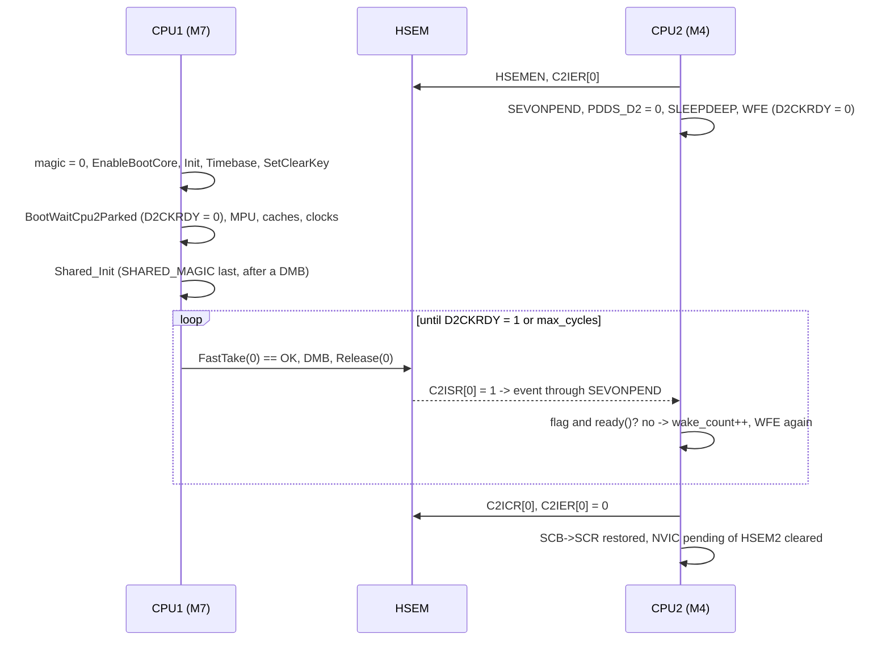

# STM32H755 Shared HSEM Driver (`01_shared_drivers/10_hsem`)

Peripheral-First (Plan A), 3-tier shared driver for the Hardware Semaphore of the
STM32H755ZI: 32 semaphores shared by CPU1 (Cortex-M7) and CPU2 (Cortex-M4). It
provides 1-step and 2-step locks that also exclude contexts of the same core, a
release that refuses to act when the caller is not the owner, lock timeouts
bounded in CPU cycles, recovery of a dead core's semaphores, interrupt
notifications, and the CPU1 → CPU2 boot handshake as a library function.

Status: validated on a NUCLEO-H755ZI-Q (silicon Rev V, `REV_ID = 0x2003`) on
2026-09-26. An independent audit found 13 defects in the first delivery and
closed the driver at `b6d0b26` (commit `6f7af43`), after reproducing every
hardware result itself. What that covers, and what it does not, is in
[section 11](#11-validation).

---

## 1. Tiers

| Tier | Files | CMake target | Links | ST dependency | Typical use |
| :--- | :--- | :--- | :--- | :--- | :--- |
| **Bare-Metal** | `hsem_bm.[c\|h]` | `stm32h7_driver_hsem_bm` | - | CMSIS only (`stm32h7xx.h`) | Both cores, the boot handshake, CM4 without HAL, fault paths |
| **Low-Level** | `hsem_ll.[c\|h]` | `stm32h7_driver_hsem_ll` | `stm32h7_driver_hsem_bm` | `stm32h7xx_ll_hsem.h` inlines | Projects written against LL constants |
| **HAL** | `hsem_hal.[c\|h]` | `stm32h7_driver_hsem_hal` | `stm32h7_driver_hsem_bm` | ST HAL (`HAL_HSEM_*`) | Cortex-M7 with FreeRTOS, HAL interrupt callbacks |

```cmake
target_link_libraries(cm4_firmware PRIVATE stm32h7_driver_hsem_bm)   # or _ll
target_link_libraries(cm7_firmware PRIVATE stm32h7_driver_hsem_bm)   # or _ll, _hal
```

```c
#include "hsem_bm.h"    /* never "10_hsem/hsem_bm.h": the directory is on the include path */
```

- **There is no unsuffixed `stm32h7_driver_hsem`.** The name means BM in `dma` and
  `gpio` and HAL in `uart` and `adc`; there was no older name to keep, so every
  project names the tier it wants. The umbrella `stm32h7_shared_drivers` does not
  link HSEM.
- **`hsem_bm` is the single copy** of the validation, the core check, the PRIMASK
  sections, the barriers, the DWT timebase, the recovery path and the boot
  handshake. LL and HAL call into it. The recovery, diagnostic and boot functions
  exist only in BM.
- **BM and LL keep no state in RAM** (`.data = .bss = 0` in the linked image), so
  both cores run the same code and share nothing but the peripheral. HAL keeps one
  callback pointer per image.
- **LL needs no LL `.c` file** and no `USE_FULL_LL_DRIVER`, and it never includes
  `stm32h7xx_hal.h`. **HAL compiles to nothing** without `HAL_HSEM_MODULE_ENABLED`.
- **The driver never defines `HSEM1_IRQHandler`, `HSEM2_IRQHandler` or
  `HAL_HSEM_FreeCallback`.** They belong to the project's `stm32h7xx_it.c` and to
  CubeMX (see §6).

### 1.1 Feature matrix

| Feature | BM | LL | HAL |
| :--- | :---: | :---: | :---: |
| 1-step lock (`RLR` read, PROCID 0) | yes | yes | yes |
| 2-step lock (`R` write + read-back, PROCID 1..255) | yes | yes | yes |
| Refuses a lock already held by this core (`BUSY_SELF`) | yes | yes | yes (`HAL_BUSY`) |
| Release checks the owner before writing | yes | yes | yes |
| `DMB` after the take and before the release | yes | yes | yes |
| Everything validated before the first peripheral access | yes | yes | yes |
| Core check against `SCB->CPUID`, `HSEMEN` check | yes | yes | yes |
| Wait bounded in DWT cycles, with a `relax` hook | yes | yes | yes |
| Owner, lock status, mask of a core's semaphores | yes | via BM | via BM |
| Release all semaphores of a core (`ReleaseAllOfCore`) | yes | via BM | via BM |
| Notification: enable (clears a stale flag), re-arm, disable | yes | yes | yes |
| One-shot notification service (`NotifyTake`) | yes | yes | `HAL_HSEM_IRQHandler` via `HSEM_HAL_IRQService` |
| Take-or-arm-notification (`TakeOrNotify`, RM0399 §11.3.7) | yes | no | no |
| Callback registry | - | - | `RegisterCallback` / `Dispatch` |
| Boot handshake | yes | via BM | via BM |

---

## 2. API summary

### 2.1 Status codes

BM and LL return `HsemBm_Status_t`. HAL returns `HAL_StatusTypeDef` with a fixed
mapping; the detail behind `HAL_BUSY` is still available from `HSEM_BM_GetOwner`.

| `HsemBm_Status_t` | Meaning | HAL |
| :--- | :--- | :--- |
| `HSEM_BM_OK` | Taken by the caller, or done | `HAL_OK` |
| `HSEM_BM_BUSY` | Held by the other core | `HAL_BUSY` |
| `HSEM_BM_BUSY_SELF` | Held by this core: another context, another PROCID, or a re-entry | `HAL_BUSY` |
| `HSEM_BM_TIMEOUT` | Still held when `max_cycles` ran out | `HAL_TIMEOUT` |
| `HSEM_BM_ERR_PARAM` | Refused before touching the peripheral | `HAL_ERROR` |
| `HSEM_BM_ERR_NOT_OWNER` | Release refused: the caller does not hold it; nothing was written | `HAL_ERROR` |
| `HSEM_BM_ERR_TIMEBASE` | DWT `CYCCNT` is not running, so a bounded wait is impossible | `HAL_ERROR` |
| `HSEM_BM_ERR_CORE` | `CORE_CM4` disagrees with `SCB->CPUID`, or `HSEMEN` is off on this core | `HAL_ERROR` |

A `bool` would not do here: a caller that retries while it gets `false` would spin
for ever on an invalid ID.

### 2.2 `hsem_bm.h`

```c
/* Setup, per core */
HsemBm_Status_t HSEM_BM_Init(void);            /* HSEMEN on this core's RCC bank, read back; core check */
HsemBm_Status_t HSEM_BM_CheckInit(void);       /* the same checks, no writes (every call runs them)     */
bool            HSEM_BM_TimebaseStart(void);   /* DWT CYCCNT on (unlocks DWT_LAR on the M7)             */
uint32_t        HSEM_BM_GetCoreId(void);       /* 3 on CM7, 1 on CM4                                    */

/* Lock */
HsemBm_Status_t HSEM_BM_FastTake(uint32_t id);                          /* 1-step, PROCID 0      */
HsemBm_Status_t HSEM_BM_Take(uint32_t id, uint32_t proc_id);            /* 2-step, proc_id 1..255 */
HsemBm_Status_t HSEM_BM_TakeTimeout(uint32_t id, uint32_t proc_id, uint32_t max_cycles);
HsemBm_Status_t HSEM_BM_TakeTimeoutEx(uint32_t id, uint32_t proc_id, uint32_t max_cycles,
                                      void (*relax)(void *ctx), void *ctx);   /* proc_id 0 = 1-step */
HsemBm_Status_t HSEM_BM_Release(uint32_t id, uint32_t proc_id);

/* State: reads HSEM_Rx only, never HSEM_RLRx */
bool            HSEM_BM_IsLocked(uint32_t id);
bool            HSEM_BM_GetOwner(uint32_t id, HsemBm_Owner_t *out);
uint32_t        HSEM_BM_GetLockedMask(uint32_t core_id);

/* Recovery, RM0399 §11.3.6 */
bool            HSEM_BM_SetClearKey(uint16_t key);                      /* key 0 refused */
HsemBm_Status_t HSEM_BM_ReleaseAllOfCore(uint32_t core_id, uint16_t key);

/* Notification, the calling core's line only */
bool            HSEM_BM_NotifyEnable(uint32_t sem_mask);   /* clear CnICR, then set CnIER: first arm */
bool            HSEM_BM_NotifyRearm(uint32_t sem_mask);    /* set CnIER only: re-arm from the ISR    */
bool            HSEM_BM_NotifyDisable(uint32_t sem_mask);
uint32_t        HSEM_BM_NotifyTake(void);                  /* MISR -> clear those IER bits, ICR, DSB */
uint32_t        HSEM_BM_GetRawStatus(void);                /* CnISR                                  */
IRQn_Type       HSEM_BM_GetIRQn(void);                     /* HSEM1_IRQn on CM7, HSEM2_IRQn on CM4   */
HsemBm_Status_t HSEM_BM_TakeOrNotify(uint32_t id, uint32_t proc_id);

/* Boot handshake */
HsemBm_Status_t HSEM_BM_BootWaitForCpu1(const HsemBm_BootWait_t *cfg);        /* CPU2 only, no timeout */
HsemBm_Status_t HSEM_BM_BootWaitCpu2Parked(uint32_t max_cycles);              /* CPU1 only             */
HsemBm_Status_t HSEM_BM_BootReleaseCpu2(uint32_t sem_id, uint32_t max_cycles); /* CPU1 only            */
```

### 2.3 `hsem_ll.h`

Same semantics and status codes as BM, built on the ST LL inlines. The line
(C1 or C2) is chosen with `CORE_CM4`.

```c
HsemBm_Status_t HSEM_LL_FastTake(uint32_t id);
HsemBm_Status_t HSEM_LL_Take(uint32_t id, uint32_t proc_id);
HsemBm_Status_t HSEM_LL_TakeTimeout(uint32_t id, uint32_t proc_id, uint32_t max_cycles);
HsemBm_Status_t HSEM_LL_TakeTimeoutEx(uint32_t id, uint32_t proc_id, uint32_t max_cycles,
                                      void (*relax)(void *ctx), void *ctx);
HsemBm_Status_t HSEM_LL_Release(uint32_t id, uint32_t proc_id);
bool            HSEM_LL_NotifyEnable(uint32_t sem_mask);
bool            HSEM_LL_NotifyRearm(uint32_t sem_mask);
bool            HSEM_LL_NotifyDisable(uint32_t sem_mask);
uint32_t        HSEM_LL_NotifyTake(void);
```

`LL_HSEM_1StepLock` reports success also when the same core already holds the
semaphore (its own documentation says so). The wrapper adds the `BUSY_SELF` check.

### 2.4 `hsem_hal.h`

A wrapper around `HAL_HSEM_*` that adds what the HAL leaves out (see §5):
validation that survives `USE_FULL_ASSERT` being off, the core check, `BUSY_SELF`,
barriers, an owner check before the release, cycle timeouts and PRIMASK around
the `CnIER` read-modify-writes.

```c
HAL_StatusTypeDef HSEM_HAL_FastTake(uint32_t id);
HAL_StatusTypeDef HSEM_HAL_Take(uint32_t id, uint32_t proc_id);
HAL_StatusTypeDef HSEM_HAL_TakeTimeout(uint32_t id, uint32_t proc_id, uint32_t max_cycles);
HAL_StatusTypeDef HSEM_HAL_TakeTimeoutEx(uint32_t id, uint32_t proc_id, uint32_t max_cycles,
                                        void (*relax)(void *ctx), void *ctx);
HAL_StatusTypeDef HSEM_HAL_Release(uint32_t id, uint32_t proc_id);
HAL_StatusTypeDef HSEM_HAL_NotifyEnable(uint32_t sem_mask);
HAL_StatusTypeDef HSEM_HAL_NotifyRearm(uint32_t sem_mask);
HAL_StatusTypeDef HSEM_HAL_NotifyDisable(uint32_t sem_mask);
HAL_StatusTypeDef HSEM_HAL_RegisterCallback(HsemHal_FreeCallback_t cb, void *ctx);
void              HSEM_HAL_IRQService(void);            /* HAL_HSEM_IRQHandler + __DSB()            */
void              HSEM_HAL_Dispatch(uint32_t sem_mask); /* call it from the project's FreeCallback */
```

---

## 3. Project contract

The driver defines no semaphore ID, PROCID or key. The project does.

### 3.1 IDs and their owners (`shared_memory.h`)

```c
#define HSEM_ID_BOOT_SYNC       0U   /* CPU1 -> CPU2 boot release                 */
#define HSEM_ID_SHARED_STATE    1U   /* SharedMemory_t.state (reserved, unused)   */
#define HSEM_ID_M7_TO_M4_MBOX   2U   /* m7_to_m4 mailbox (reserved, unused)       */
#define HSEM_ID_M4_TO_M7_MBOX   3U   /* m4_to_m7 mailbox                          */
#define HSEM_ID_ADC_DATA        4U   /* ADC telemetry and waveform                */
#define BOARD_GPIO_HSEM_ID      5U   /* 00_gpio cross-core pin lock (00_gpio F1)  */
/* 24..31: driver selftests only, never used by the application */
```

For every ID, write down **which contexts take it on each core, and with which
procedure**. A 1-step lock is correct only when a single context per core uses
that ID (or the caller holds PRIMASK from take to release). A second context on
the same core needs the 2-step lock with its own PROCID. The driver detects a
colliding take (`BUSY_SELF`), but it cannot tell which context releases a 1-step
lock (§10).

Today, in `prj_04`: HSEM 3 is taken with `SHARED_LOCK` by `Status_Task` on CM7
and by the super-loop on CM4. HSEM 4 is taken with `Shared_TryLockCycles` by the
`tcpip` thread on CM7 and by the super-loop on CM4.

### 3.2 Clear key (`board_def.h`)

```c
#define BOARD_HSEM_CLEAR_KEY    0xA5C3U   /* never 0 */
```

CPU1 sets it once, with `HSEM_BM_SetClearKey`, before it releases CPU2, in every
build. `HSEM_KEYR` resets to 0, and a key of 0 would let any stray write to
`HSEM_CR` free a core's semaphores; that is why the driver refuses it. `KEYR` is
shared and either core may write it, so "only CPU1 sets it" is a project rule.

### 3.3 Order of calls on each core

| Core | Where | Calls |
| :--- | :--- | :--- |
| CPU1 | Start of `main`, before the MPU and the clock tree | `g_shared.magic = 0` → `HAL_RCCEx_EnableBootCore(RCC_BOOT_C2)` → `HSEM_BM_Init()` → `HSEM_BM_TimebaseStart()` → `HSEM_BM_SetClearKey(BOARD_HSEM_CLEAR_KEY)` → `HSEM_BM_BootWaitCpu2Parked(32000000)` (500 ms at HSI 64 MHz) |
| CPU1 | After the clock tree and CPU2's peripheral clocks | `Shared_Init()` (publishes `SHARED_MAGIC` last) → `HSEM_BM_BootReleaseCpu2(HSEM_ID_BOOT_SYNC, 400000000)` |
| CPU2 | First line of `main` | `HSEM_BM_BootWaitForCpu1(&cfg)`, then `HAL_Init()`, `HSEM_BM_Init()`, `HSEM_BM_TimebaseStart()` |

Any take with a timeout needs `HSEM_BM_TimebaseStart()` on that core first,
otherwise it returns `HSEM_BM_ERR_TIMEBASE`.

### 3.4 Data placement

The HSEM orders accesses; it does not keep caches coherent. Data protected by a
semaphore goes in `.shared_ram` (SRAM4, `0x38008000`), which the CM7 MPU maps as
Normal non-cacheable. The CM4 has no data cache. Anything placed in cacheable
memory needs explicit clean and invalidate around the lock.

### 3.5 Lock timeouts (`shared_memory.h`)

Limits are written in time and converted per core, because each core's `CYCCNT`
counts its own clock:

```c
#define SHARED_ADC_TRYLOCK_US            100U
#define SHARED_ADC_TRYLOCK_CYCLES_CM7   (SHARED_ADC_TRYLOCK_US * 400U)   /* 40 000 at 400 MHz */
#define SHARED_ADC_TRYLOCK_CYCLES_CM4   (SHARED_ADC_TRYLOCK_US * 200U)   /* 20 000 at 200 MHz */
```

A limit has to come from a measured hold time. In `prj_04`, HSEM 4 is held up to
37.6 µs by CM4 and 42.7 µs by CM7 (§11.2). A first calibration of 25 µs, below
those holds, silently dropped UDP replies and ADC publications. The peaks are
published in `g_shared.m7_adc_lock_hold_cycles_max` and
`g_shared.m4_adc_lock_hold_cycles_max`, and every failed try counts in
`m7_/m4_adc_lock_fail_count` (one counter per core, so neither is a cross-core
read-modify-write).

---

## 4. Rules the driver enforces

1. **Validate before touching the peripheral.** `id > 31`, `proc_id > 255`,
   `proc_id = 0` in `Take`, an empty mask, a key of 0, an unknown `core_id`,
   `max_cycles` of 0 or above 2³¹ − 1, a wrong core or `HSEMEN` off: each returns
   an error before the first `HSEM->` access. PROCID 0 is kept for the 1-step lock,
   because a 2-step lock with PROCID 0 would be indistinguishable from it.
2. **1-step lock with self-detection.** Under PRIMASK, `FastTake` reads `R[id]`
   first. If this core already holds it, it returns `BUSY_SELF` without reading
   `RLR`; otherwise it reads `RLR[id]`. Without PRIMASK, an ISR could take the
   semaphore between the two reads and the interrupted context would think it was
   its own.
3. **2-step lock.** `Take` reads `R[id]` (a hit by this core is `BUSY_SELF`, even
   with the same PROCID: no re-entry), writes `LOCK | COREID | PROCID` and reads it
   back.
4. **Honest release.** RM0399 §11.3.5: a release with the wrong COREID or PROCID
   is ignored by the hardware, silently and without an interrupt. `Release` reads
   `R[id]` and, if the caller is not the owner, returns `ERR_NOT_OWNER` without
   writing. It does not read back afterwards: the other core may take the
   semaphore in the next cycle, and that is not a failure.
5. **Barriers.** ARMv7-M does not order Normal memory (SRAM4) against Device memory
   (the HSEM) without a barrier. A `__DMB()` follows every successful take and
   precedes every release, in all three tiers.
6. **Word accesses only.** RM0399 §11.4: byte and half-word accesses cause a bus
   error. The driver uses only 32-bit volatile accesses (checked with objdump).
7. **Never read `RLR` to look.** Reading `HSEM_RLRx` takes the semaphore
   (RM0399 §11.4.2). `RLR` is read only inside `FastTake` (and therefore
   `TakeOrNotify`). `IsLocked`, `GetOwner` and `GetLockedMask` read `R`.
8. **PRIMASK saved and restored, never forced.** Every read-modify-write of
   `CnIER`, and the 1-step detection, run with PRIMASK saved and restored with
   `__set_PRIMASK(saved)`. The driver never calls `__enable_irq()`, so it can be
   used from a fault handler.
9. **Bounded waits.** Every wait in the driver ends after a number of DWT cycles,
   except `BootWaitForCpu1`: CPU2 is in STOP, where `CYCCNT` does not count, and
   has nothing else to do. `TakeTimeoutEx` returns at once on anything other than
   `BUSY`, so a `BUSY_SELF` never waits for the timeout. `relax(ctx)` runs between
   attempts and never with the semaphore held. `CYCCNT` keeps counting with
   PRIMASK set, so a timeout also works inside a critical section, where
   `HAL_GetTick` would not advance.

---

## 5. Why not call `HAL_HSEM_*` directly

This is what the audit of the copies in the projects found, and what the driver
does instead. It is the reason to use the driver even in the HAL tier.

| `HAL_HSEM_*` (and the copies in the projects) | Consequence | Driver |
| :--- | :--- | :--- |
| `HAL_HSEM_FastTake` returns `HAL_OK` to any context of the core that already holds the semaphore (RM0399 §11.3.3 note) | Two FreeRTOS tasks, or a task and an ISR, are inside the critical section at once, and the first release frees it for both | `BUSY_SELF` (§4.2) |
| No `DMB` in take or release | On CM7 a write to shared data can become visible after the release | §4.5 |
| `SHARED_LOCK` spins for ever; no way to see the owner | A halted, faulted or reset core hangs the other one with no diagnostic | `TakeTimeout`, `GetOwner`, `GetLockedMask`, `ReleaseAllOfCore` |
| `HAL_HSEM_Release` is `void` and not checked | A wrong release does nothing, and nobody finds out | `ERR_NOT_OWNER` |
| `HAL_HSEM_ActivateNotification` and `HAL_HSEM_IRQHandler` both read-modify-write `CnIER`, unprotected | A task and the ISR of the same core lose or resurrect an enable bit | PRIMASK (§4.8) |
| The own COREID comes from `CORE_CM4` at compile time | An image built with the wrong macro takes the semaphore through `RLR` and reports it busy: it stays locked for ever | Core check against `SCB->CPUID` in every call |
| IDs are checked only by `assert_param`, compiled out in these projects | `R[id]` with `id` 32..63 lands on the `RLR` bank and 64 on `C1IER`: `HAL_HSEM_Release(64, 0)` writes CPU1's interrupt enables | §4.1 |
| `HAL_PWREx_EnterSTOPMode`, used by the old CPU2 boot wait, read-modify-writes `PWR_CR1`, which is shared | A write by CPU1 to `CR1` during boot (`DBP`, PVD) can be lost | The boot wait writes only `PWR_CPU2CR` and `SCB->SCR` |
| The boot handshake was copied into every project and had diverged | The warm-reset fix of `9034a5f` (CPU2 leaving STOP early and running on HSI with a 3× SysTick) had reached only `prj_04` | One function, `HSEM_BM_BootWaitForCpu1` |

---

## 6. Notifications

- **The line belongs to the calling core.** The `CnIER`/`CnICR`/`CnISR`/`CnMISR`
  set is chosen with `CORE_CM4`, the same way as `HSEM_COMMON` in CMSIS. The IRQ is
  `HSEM1_IRQn` on CM7 and `HSEM2_IRQn` on CM4 (`HSEM_BM_GetIRQn`).
- **A notification does not take the semaphore.** Whoever receives it still has to
  take it.
- **Three ways to set the enable bit, for three moments:**
  - `NotifyEnable` for the first arm: it clears `CnICR` and then sets `CnIER`, so an
    old flag does not fire.
  - `NotifyTake` in the ISR: it reads `CnMISR`, clears exactly those `IER` bits and
    flags, and ends with `DSB` so that the line drops before the M7 leaves the ISR.
    It is one-shot, like `HAL_HSEM_IRQHandler`.
  - `NotifyRearm` to arm again from the ISR: it sets `CnIER` only. A release that
    arrived between `NotifyTake` and the re-arm is still in `CnISR` and fires at
    once. Re-arming with `NotifyEnable` would erase it.
- **Notifications are flags, not counters.** Releases that happen while the flag is
  still set merge into one interrupt. Count events in your own data, not in IRQs.
- **`TakeOrNotify`** follows RM0399 §11.3.7: try; if busy, clear `CnICR` and try
  again; if still busy, set `CnIER` and return `BUSY`. It returns `BUSY_SELF`
  without arming anything when this core holds the semaphore.
- **HAL tier:** the project defines the handler and the weak callback, and the
  driver dispatches:

  ```c
  void HSEM1_IRQHandler(void)             { HSEM_HAL_IRQService(); }         /* stm32h7xx_it.c */
  void HAL_HSEM_FreeCallback(uint32_t m)  { HSEM_HAL_Dispatch(m); }
  ```

---

## 7. Dual-core boot handshake



```c
/* CPU2 */
static bool magic_ready(void *ctx) { (void)ctx; return g_shared.magic == SHARED_MAGIC; }

const HsemBm_BootWait_t cfg = {
    .sem_id     = HSEM_ID_BOOT_SYNC,
    .ready      = magic_ready,
    .ctx        = NULL,
    .wake_count = &g_shared.cpu2_wake_count,   /* optional: counts every wake from WFE */
};
(void)HSEM_BM_BootWaitForCpu1(&cfg);
```

- **Two conditions, both required.** The HSEM flag is reset with the system, so it
  cannot be stale. `SHARED_MAGIC` lives in SRAM4, which survives a warm reset, so
  on its own it can be the previous run's. CPU2 leaves only when the flag is set
  **and** `ready()` is true. Any other wake (an early release, a stray event) sends
  it back to `WFE`.
- **`SEVONPEND` is what wakes CPU2.** `WFE` resumes on an event, and a pending
  interrupt becomes one only with `SEVONPEND` (or when it is enabled in the NVIC,
  which would vector into the default handler). Without it, `C2ISR[0]` and
  `C2MISR[0]` are 1, CPU1 runs normally, and CPU2 never leaves the wait. Nothing
  faults.
- **The wait does not clear `C2ICR` on entry,** so a release that arrived before
  CPU2 armed is not lost. It clears the NVIC pending bit of `HSEM2_IRQn` on the way
  out (RM0399 §7.7.4), so a later `NVIC_EnableIRQ` does not enter the ISR for
  nothing.
- **It does not write `PWR_CR1`** (shared); `LPDS` is already 0 after reset.
- **`D2CKRDY` is the D2 domain, not the core.** CPU1 uses it as the "CPU2 has
  parked" and "CPU2 is running" signal. The domain can be awake while CPU2 sits in
  `WFE`. When you need to know what CPU2 did, ask CPU2 (that is what `wake_count`
  is for).
- **`BootReleaseCpu2` checks its own take** and returns the status without
  releasing if the take fails. It never writes RCC; enabling `BOOT_C2` stays with
  the project.

---

## 8. Silicon facts and the RM0399 / ARMv7-M matrix

| Rule | Mechanism | Test |
| :--- | :--- | :--- |
| RM §11.3.8, table 95: COREID 3 = CM7, 1 = CM4; a master that is not authorised is ignored | Core check against `SCB->CPUID` in every call | H0 |
| RM §11.3.3: 1-step lock, PROCID forced to 0, not safe for several processes of one master | `BUSY_SELF` under PRIMASK | H7 |
| RM §11.3.3: 2-step lock, write then read back COREID and PROCID | `Take` | H1, H3 |
| RM §11.3.5: a release with a wrong COREID/PROCID is ignored silently | `ERR_NOT_OWNER`, nothing written | H3 |
| RM §11.3.6: `HSEM_CR` with the key frees every semaphore of a COREID | `ReleaseAllOfCore` writes `HSEM_CR`; `SetClearKey` writes `KEYR` | H8 |
| RM §11.3.7: notification procedure; an interrupt does not lock | `TakeOrNotify`; `NotifyEnable` clears the flag before arming, `NotifyRearm` keeps it | H9 |
| RM §11.4: word accesses only | 32-bit volatile accesses | objdump |
| RM §11.4.2: reading `RLR` takes the semaphore | `RLR` read only in `FastTake` | H0, grep |
| RM §11.4.3-6: one `IER/ICR/ISR/MISR` set per CPU line | Line from `CORE_CM4`; `IER` read-modify-write under PRIMASK | H9, H10 |
| RM §9.7.1: `RCC_AHB4ENR.HSEMEN` is banked per core | `Init` on each core, with read-back | H0 |
| RM §7: CPU2 STOP of D2 = `PWR_CPU2CR.PDDS_D2 = 0` + `SLEEPDEEP`; `PWR_CR1` is shared | Only `CPU2CR` and `SCR` (restored) are written | H5 |
| ARMv7-M: Normal vs Device ordering needs a barrier | `DMB` after the take, before the release | H1b, objdump |
| ARMv7-M: `WFE` wakes on an event; `SEVONPEND` turns a pending IRQ into one | `BootWaitForCpu1` | H5 |

---

## 9. Silicon errata (ES0445 rev 6)

ES0445 has no entry for the HSEM (a search for `HSEM` and `semaphore` returns
nothing). Every constraint in this driver comes from RM0399 and the ARMv7-M memory
model.

---

## 10. Examples

### A. 1-step lock, one context per core (`hsem_bm`)

```c
if (HSEM_BM_FastTake(HSEM_ID_ADC_DATA) == HSEM_BM_OK)   /* the DMB is inside */
{
    g_shared.adc.millivolts = mv;
    (void)HSEM_BM_Release(HSEM_ID_ADC_DATA, 0U);        /* PROCID 0 for a 1-step lock */
}
```

### B. Two FreeRTOS tasks on the CM7 sharing one ID (`hsem_bm`)

```c
#define PROC_TASK_A   1U   /* one PROCID per context, never 0 */
#define PROC_TASK_B   2U

/* in task A */
if (HSEM_BM_Take(HSEM_ID_SHARED_STATE, PROC_TASK_A) == HSEM_BM_OK)
{
    update_state();
    (void)HSEM_BM_Release(HSEM_ID_SHARED_STATE, PROC_TASK_A);
}
/* task B, meanwhile, gets HSEM_BM_BUSY_SELF and can retry later */
```

### C. Bounded wait that yields the CPU (`hsem_bm` + FreeRTOS)

```c
static void yield(void *ctx) { (void)ctx; taskYIELD(); }   /* taskYIELD is a macro: wrap it */

HsemBm_Status_t st = HSEM_BM_TakeTimeoutEx(HSEM_ID_ADC_DATA, 0U,
                                           SHARED_ADC_TRYLOCK_CYCLES, yield, NULL);
if (st == HSEM_BM_OK)
{
    memcpy(local, (const void *)g_shared.adc.waveform, sizeof(local));
    (void)HSEM_BM_Release(HSEM_ID_ADC_DATA, 0U);
}
else
{
    g_shared.m7_adc_lock_fail_count++;   /* TIMEOUT or BUSY_SELF: count it, never ignore it */
}
```

### D. Notification with interrupt on the CM4 (`hsem_bm`)

```c
void HSEM2_IRQHandler(void)                       /* the project's stm32h7xx_it.c */
{
    uint32_t mask = HSEM_BM_NotifyTake();         /* one-shot: IER bits of 'mask' now off */
    if ((mask & HSEM_BM_SEM_MASK(MY_ID)) != 0U)
    {
        s_released++;                             /* try the take in thread context, not here */
        (void)HSEM_BM_NotifyRearm(HSEM_BM_SEM_MASK(MY_ID));   /* keeps a release that arrived meanwhile */
    }
}

/* setup, thread context */
(void)HSEM_BM_NotifyEnable(HSEM_BM_SEM_MASK(MY_ID));          /* clears any stale flag first */
NVIC_ClearPendingIRQ(HSEM2_IRQn);
NVIC_SetPriority(HSEM2_IRQn, 5U);
NVIC_EnableIRQ(HSEM2_IRQn);
```

### E. Recovering the semaphores of a dead CPU2 (CPU1)

```c
if (HSEM_BM_TakeTimeout(HSEM_ID_ADC_DATA, 0U, SHARED_ADC_TRYLOCK_CYCLES) == HSEM_BM_TIMEOUT)
{
    HsemBm_Owner_t o;
    if (HSEM_BM_GetOwner(HSEM_ID_ADC_DATA, &o) && (o.core_id == HSEM_BM_COREID_CPU2))
    {
        /* only once CPU2 is known to be dead: this frees ALL of its semaphores */
        (void)HSEM_BM_ReleaseAllOfCore(HSEM_BM_COREID_CPU2, BOARD_HSEM_CLEAR_KEY);
    }
}
```

---

## 11. Validation

Board: NUCLEO-H755ZI-Q, silicon Rev V (`REV_ID = 0x2003`). No external hardware:
both cores, the console and the ST-LINK. Project:
`02_firmware_projects/prj_04_adc_dma_bm_eth`, CMake preset `selftest-hsem`
(`HSEM_DRIVER_SELFTEST=ON`), code in `CM4/App/Src/hsem_selftest.c` and
`CM7/App/Src/hsem_selftest.c`. The tests use only IDs 24..31 and their own area in
SRAM4 (`0x38009000`). Each core prints its `Rev <git hash>` first. CM7 prints the
global verdict only after CM4 has finished, and it includes CM4's results.

### 11.1 Self-test

Numbers from the auditor's run on 2026-09-26 (`b6d0b26`).

| Test | What it proves | Negative control | Result |
| :--- | :--- | :--- | :--- |
| H0 | COREID 3 / 1 on each core, `Init`, every parameter refused, `GetOwner`/`IsLocked` leave a free semaphore free | A raw `RLR` read does take the semaphore; registers compared before and after the refusals | PASS on both cores |
| H1 | Exclusion across cores: 500 000 increments per core under the 1-step lock, and again under the 2-step lock | H2 | total 1 000 000 = sum of the two private counters, 0 lost, in both variants |
| H1b | No torn record: 8-word writes by CM4 read under the lock by CM7 | H2 | 500 000 reads, 0 torn |
| H2 | The control of H1/H1b: the same work without the lock | It must lose, or H1 proves nothing | 39 907 lost increments, 19 232 torn reads (every run so far: 39 907-45 217 and 6 206-19 232) |
| H3 | A raw release with the wrong PROCID, a raw release written by the other core (checked to set no ISF) and a driver release by a non-owner all leave the lock held | The right release frees it | PASS on both cores |
| H4 | Timeout on CM7 against a lock held by CM4, and the reverse, measured with each core's HAL tick (not the DWT the driver uses) | Free → `OK` at once; released at 5 ms → `OK` | `TIMEOUT` at 10 ms, about 36 000 `relax` calls |
| H5 | Boot: `D2CKRDY` stays 0 for 500 ms; a release before the magic (H5b) and a spurious event on configurable EXTI line 15 (H5c) wake CPU2, which goes back to STOP | CPU2's own `wake_count` must increase, then `D2CKRDY` must return to 0 | `woke=1 reparked=1` in H5b and H5c; release PASS |
| H6 | 20 warm resets of the production image | The pre-migration reference, with the same checks | 20/20, first sample `m7=4 m4=20`, same ratio as the reference (a 3× SysTick would triple it) |
| H7 | A second take by the same core returns `BUSY_SELF` (1-step and 2-step, BM and HAL); a cross-PROCID release returns `ERR_NOT_OWNER` | A raw `HAL_HSEM_FastTake` returns `HAL_OK`: the hazard exists | PASS; raw HAL = 0 (`HAL_OK`) |
| H8 | CM4 holds IDs 24-27 and stops; CM7 sees the owner, times out, and frees them with the key; its own ID 28 stays held | A wrong key frees nothing | PASS |
| H9 | Interrupt-driven notifications through the NVIC: 500 CM7 → CM4 (BM ISR, `NotifyRearm`) and 100 CM4 → CM7 (`HSEM_HAL_IRQService` + callback) | `IER` off → 0 IRQs; a stale flag, recorded as present before `NotifyEnable` → 0 IRQs | 500/500 and 100/100, controls 0 and 0 (`stale flag was=1`) |
| H10 | BM, LL and HAL give the same status and the same `R[24..30]`, `CnIER` and `CnISR` over 13 steps: take, re-entry, `TakeTimeoutEx` on a self-held lock, releases, parameter errors, notify | A deliberately altered snapshot is detected | PASS on CM4 (BM ↔ LL) and CM7 (BM ↔ LL ↔ HAL) |
| H11 | Production (selftest off) under load: ETH at 100 Mbps, ADC1 at 500 kSPS, 150 text queries and 300 back-to-back `WAVE` requests | Per-core fail counters and hold peaks read through SWD | 300/300 replies, both fail counters 0, `err`/`ovr`/`adc_ovr` = 0 |

### 11.2 Measurements (B1)

| What | CM7 (400 MHz) | CM4 (200 MHz) |
| :--- | :--- | :--- |
| Raw 1-step take (`RLR` read) | 16 cycles (40 ns) | 8 cycles (40 ns) |
| Raw 2-step take (write + read-back) | 30 cycles (75 ns) | 24 cycles (120 ns) |
| Raw release (buffered write) | 3 cycles | 6 cycles |
| Longest hold of HSEM 4 in `prj_04` | 17 069 cycles (42.7 µs), `WAVE` reply | 7 525 cycles (37.6 µs), `ADC_Acquisition_Process` |

A read of the HSEM costs about 40 ns from either core (AHB4, D3 domain). The hold
times are what the limit in §3.5 is sized against.

### 11.3 Evidence and independent run

In `prj_04_adc_dma_bm_eth/docs/`, each file the output of a single run:

- `hsem_selftest_capture.txt`: the self-test at `869decb`, with timestamps,
  through `CM4 VERDICT=PASS`.
- `warm_resets_f2.txt`: H6 at `35165d2`. `warm_resets_reference.txt` is the
  pre-migration reference.
- `hsem_regression_capture.txt`: H11 at `35165d2`, with the SWD dump of the
  counters.

The auditor rebuilt and re-ran the self-test, H6 and H11 on the board, from a
clean build, at `afa410d` and at `b6d0b26`. The 25 µs trylock problem of §3.5 was
found that way.

### 11.4 Reproducing it

```powershell
.\tools\env.ps1
cd 02_firmware_projects\prj_04_adc_dma_bm_eth
cmake --preset selftest-hsem; cmake --build --preset selftest-hsem
py tools/flash.py --preset selftest-hsem
py ..\..\tools\capture_hsem_run.py --out hsem.txt            # resets and captures until CM4 VERDICT
```

For H6 and H11, flash the production image and run:

```powershell
py tools/flash.py --preset debug
py ..\..\tools\run_warm_resets.py --port COM4 --out h6.txt --title "H6"
py tools/query_adc.py --wave --count 300
STM32_Programmer_CLI -c port=SWD mode=HOTPLUG -r32 0x380084E0 32   # fail counters at +0x08/+0x0C, peaks at +0x14/+0x18
```

Read only `0x58026400-0x5802647C` of the HSEM from the debugger (§12).

### 11.5 Not exercised in hardware

- `TakeOrNotify`. Its return values were reviewed, not run.
- The re-arm race itself. H9 spaces its releases so that the ISR always finishes
  before the next one, so it would also pass with a re-arm that loses releases.
  `NotifyRearm` is correct by construction (it does not touch `CnICR`). A
  deterministic test: the CM4 ISR, after `NotifyTake`, waits for CM7 to release
  again, and only then re-arms; one more IRQ must arrive with `NotifyRearm` and
  none with `NotifyEnable`.
- `ReleaseAllOfCore` while the target core takes one of the same IDs again.
- Any call with `HSEMEN` off. `CheckInit` refuses it before the peripheral is
  touched, but no test switches the clock off.
- A core halted by the debugger while it holds a semaphore, and a CPU-scoped
  reset.
- Silicon revisions other than V.

### 11.6 Flash budget

`hsem_bm` linked into the `prj_04` release images: **852 B** on CM4 and
**1 088 B** on CM7 (`.text`, measured from the `.map`, with "Discarded input
sections" excluded). With `--gc-sections`, functions a project does not call cost
nothing.

---

## 12. Known limitations and caveats

- **A debugger that reads the `RLR` bank takes the semaphores.** A read of
  `0x58026480` through SWD returned `0x80000300` and left semaphore 0 locked by
  COREID 3. Memory views, SVD peripheral viewers and `mdw` dumps must stay inside
  `0x58026400-0x5802647C` (`R`) and `0x58026500-0x58026544`.
- **The release of a 1-step lock does not know the context.** Every context of a
  core releases with PROCID 0. `BUSY_SELF` stops a second context from taking, but
  if that context releases anyway, the hardware accepts it. Where several contexts
  use one ID, use the 2-step lock with one PROCID each.
- **Never spin on a lock inside an ISR.** If the thread it interrupted holds the
  semaphore, `FastTake` returns `BUSY_SELF` for ever and the core hangs. In an ISR,
  try once or use a short `TakeTimeout`.
- **Cycle limits are the calling core's cycles.** The same number is twice as long
  on CM4 as on CM7, and much longer on HSI (64 MHz) before the clock tree is up.
  Write limits in time and convert them per core and per phase.
- **The DWT has to be started on each core.** `TimebaseStart` unlocks `DWT_LAR` on
  the M7, which a debugger hides by setting `TRCENA` itself; check it with the
  debugger disconnected.
- **`BootWaitForCpu1` has no timeout,** by design (§4.9).
- **`ReleaseAllOfCore` frees every semaphore of that core,** including ones that
  core still legitimately holds. Use it only when that core is known to be dead. It
  returns `ERR_PARAM` if the target takes one of the same IDs again between the
  clear and the read-back, although the clear worked.
- **HAL tier:** one callback per image, registered with PRIMASK. `HSEM_HAL_Take`
  returns `HAL_BUSY` whenever the semaphore is locked, by either core.
- **`HsemBm_BootWait_t` gained `wake_count`** after the API was frozen. It is the
  last field and NULL keeps the old behaviour.
- **Open items in the projects** (not in the driver), noted at the audit close:
  - The ID table in `prj_04/Common/Inc/shared_memory.h` does not describe IDs 1-3
    correctly. HSEM 3 is taken with `SHARED_LOCK` (1-step, unbounded) on both
    cores, not with `Shared_TryLockCycles`, and IDs 1 and 2 are not used.
  - The H0 register comparison includes `HSEM_CR`, which always reads 0
    (RM0399 §11.4.7). `R[0..31]` and `KEYR` would mean something.
  - The "300 / 300" line of `hsem_regression_capture.txt` is a written summary,
    not the output of `query_adc.py`. The auditor reproduced it, but the next
    capture should carry the raw output.

---

## 13. Consumers

| Project | Tiers | Notes |
| :--- | :--- | :--- |
| `prj_04_adc_dma_bm_eth` | BM on both cores; LL and HAL only in `selftest-hsem` | Boot through the driver. `SHARED_LOCK` / `Shared_TryLock` / `Shared_TryLockCycles` in `shared_memory.c` are built on `hsem_bm`; `shared_memory.h` includes only `<stdint.h>` and `<stdbool.h>` |
| `prj_01_template_dualcore` | BM on both cores | Boot through the driver, key set. New projects start from here |
| `prj_02_eth_lwip_dualcore`, `prj_03_adc_dma_eth` | none | Not migrated (`DRIVER_ROADMAP.md` §8). They keep a hand-written handshake that leaves STOP on any wake, without the fix of `9034a5f`, and `SHARED_LOCK` over `HAL_HSEM_FastTake` |
| `prj_eth_lwip_node` | none | Private copies, by decision |
| `00_gpio` F1 (planned) | BM | Installs a cross-core lock hook on `HSEM_BM_FastTake(BOARD_GPIO_HSEM_ID)`, under PRIMASK |

---

## 14. Scope

| Item | Status |
| :--- | :--- |
| Locks, release, state, recovery, notifications, boot handshake | In, all tiers where §1.1 says so |
| RTOS mutexes, queues, priority inheritance | Out: the project decides whether and how to yield (`relax`) |
| IDs, PROCIDs, keys | Out: project (`shared_memory.h`, `board_def.h`) |
| RCC (`BOOT_C2`, clock tree) | Out: the driver only reads `RCC_CR.D2CKRDY` |
| `HSEMx_IRQHandler`, `HAL_HSEM_FreeCallback` | Out: project |
| `TakeOrNotify` in LL and HAL | Not provided; use BM |

---

## 15. Changing this driver

Several projects build this driver unchanged, and both cores depend on it at the
same time. Before changing it:

1. **Public signatures and existing struct fields are immutable**
   (`01_shared_drivers/README.md` rule 2). Add new functions, or new fields at the
   end of a struct with 0/NULL meaning the old behaviour. Check with
   `git diff main -- '01_shared_drivers/10_hsem/*.h'`: only additions or comments.
2. **Validate before the first peripheral access,** and keep BM, LL and HAL giving
   the same result, including on error paths. Extend H10 with every new path.
3. **Every test needs a negative control that prints its value** and fails the
   test when it does not reproduce the hazard. An expected result computed by the
   code under test proves nothing: use an independent oracle (private counters,
   the other core's tick, register snapshots, CPU2's own `wake_count`).
4. **Captures are the output of one run,** with timestamps and a clean
   `Rev <hash>` on both cores, and are never edited. A new run is a new file or a
   new section.
5. **Size limits from measurements.** Any timeout that depends on how long the
   other side holds a lock comes from a recorded hold time, with the margin
   written down.
6. **Tests use IDs 24..31 only** and must not free, hold or corrupt anything the
   application uses. Check `GetLockedMask` before a recovery test.
7. **Before merging:** `.\tools\build_all.ps1 -Clean` (8/8 with `-Werror`), a clean
   `selftest-hsem` build, the self-test on the board with both verdicts, H6, and
   the H11 load with the SWD counter read.

---

## 16. History

| Milestone | Commits |
| :--- | :--- |
| Implementation plan (audit of the copies in the projects, 13 findings) | `7038e3d` |
| First delivery, phases F0-F5 (BM, boot handshake and migration, LL, HAL, docs) | `2a82d5e` … `f4d2a43` |
| Independent audit of `992f309`: blockers in the evidence, the tests and the README | recorded in `4ac6bac` |
| Corrections 1: LL/HAL parity, `CheckInit`, EXTI line 15 for H5c, interrupt-driven H9, conditional verdict, README rewrite | `79a84ad` … `afa410d` |
| Corrections 2: 100 µs trylock from measured holds, `NotifyRearm`, dual-core verdict | `13b9da1` … `b6d0b26` |
| Audit closed | `6f7af43` |

The implementation plan, the audit record and the implementation report were
removed from this folder once what a user of the driver needs was folded into this
README. They stay in git history:

```bash
git show 7038e3d:01_shared_drivers/10_hsem/IMPLEMENTATION_PLAN.md
git show 6f7af43:01_shared_drivers/10_hsem/AUDIT.md
git show 6f7af43:01_shared_drivers/10_hsem/HSEM_IMPLEMENTATION_REPORT.md
```
