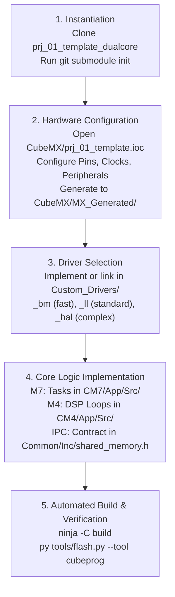

# STM32H755 Dual-Core Workspace & Architecture Guide

> **Target Audience:** Firmware Developers, Systems Architects, and AI Assistants (Antigravity, Claude Code).  
> **Hardware Target:** STM32H755ZI (Dual-Core Arm Cortex-M7 @ 480 MHz + Cortex-M4 @ 240 MHz).  
> **Toolchain:** CMake + Ninja + GNU Arm Embedded Toolchain (`arm-none-eabi-gcc`) + Visual Studio Code.

---

## 1. Executive Summary & Core Principles

This workspace is engineered for modular, portable, and deterministic dual-core embedded firmware development. It enforces five strict principles:

1. **Centralized Hardware Truth (`00_docs_stm32h7`)**: Datasheets, searchable register dumps, silicon errata, and golden linker templates are stored once at the workspace level and referenced by all projects.
2. **Strict Core Separation**:
   - **Cortex-M7 (CPU1)**: Runs FreeRTOS; handles high-throughput communication, networking, heavy math, and overall system orchestration.
   - **Cortex-M4 (CPU2)**: Pure Bare-Metal (no RTOS); dedicated to deterministic, real-time control loops and DSP pipelines.
3. **Three-Tier Driver Abstraction (`Custom_Drivers/`)**:
   - `*_hal.[c|h]`: High-level ST HAL API implementations.
   - `*_ll.[c|h]`: Low-Level ST API implementations (performance-oriented register wrappers).
   - `*_bm.[c|h]`: Pure Bare-Metal register manipulation without ST library overhead.
4. **Isolated Code Generation (CubeMX)**:
   - STM32CubeMX is used strictly as a pinout/clock generator.
   - Generated code is isolated in `CubeMX/MX_Generated/` and acts solely as a trampoline into modular `App/` logic.
5. **Fast AI & Developer Searchability**:
   - Every ST Reference Manual chapter and peripheral specification is available as a plain `.txt` dump next to its PDF for instantaneous `grep` indexing without opening heavy 3,500-page manuals.

---

## 2. Workspace Directory Layout (Macro Structure)

The workspace root is organized with numbered prefixes to establish clear hierarchy and execution order:

```text
stm32h755/                                       # Workspace Root
│
├── README.md                                    # This Master Guide for Developers & AI
├── stm32h755.code-workspace                     # Multi-root VS Code workspace definition
│
├── 00_docs_stm32h7/                             # [IMMUTABLE] Master Hardware & Knowledge Hub
│   ├── CLAUDE.md                                # Core programming rules, errata, cache & DMA constraints
│   ├── DRIVER_ARCHITECTURE_GUIDELINES.md        # Plan A driver architecture, 3-tier rules & portability guide
│   ├── STM32H755_Alternate_Functions.md        # AF0–AF15 pin multiplexing reference
│   ├── STM32H755_Memory_Map.md                  # Physical address boundaries and attributes
│   ├── STM32H755_Pin_Definitions.md             # Complete package pinout table
│   └── docs/
│       ├── INDEX.md                             # Central navigation index for all manuals
│       ├── 00_core_and_system/
│       │   ├── errata_summary.md                # Curated code-impacting silicon workarounds
│       │   ├── cache_mpu_rules.md               # 32-byte D-Cache alignment & barrier guidelines
│       │   ├── dual_core_boot_ipc.md            # Boot sequence & HSEM synchronization
│       │   ├── memory_and_domains.md            # D1/D2/D3 domain routing and bus matrix
│       │   ├── linker_templates/                # Golden linker scripts & MPU/IPC definitions
│       │   │   ├── README.md                    # Linker script contract documentation
│       │   │   ├── stm32h755zi_cm7.ld           # Cortex-M7 Linker Script (Flash Bank 1)
│       │   │   ├── stm32h755zi_cm4.ld           # Cortex-M4 Linker Script (Flash Bank 2)
│       │   │   ├── mpu_config.c                 # MPU configuration matching linker regions
│       │   │   ├── mpu_config.h                 # MPU_Config() declaration (companion to the .c)
│       │   │   └── shared_memory.h              # Inter-Core shared memory struct & HSEM IDs
│       │   └── rm0399_system/                   # Text dumps (.txt) & PDFs for system peripherals
│       ├── 01_drivers_and_hal/
│       │   ├── UM2217_stm32h7_hal_ll_manual.txt # Greppable ST HAL/LL API reference (~2,500 pages)
│       │   ├── FreeRTOS/                        # FreeRTOS kernel documentation and guides
│       │   └── STM32CubeH7/                     # Pruned reference package, 137 MB (CMSIS/HAL/LwIP/FreeRTOS/Examples)
│       │       └── PRUNED.md                    # Explanation of pruned package structure
│       ├── 02_board_hardware/                  # Nucleo-H755ZI-Q circuit schematics and board manual
│       └── peripherals/                         # Searchable .txt + .pdf chapters per peripheral
│           │                                    # (authoritative map: docs/INDEX.md section 5)
│           ├── adc_dac/                         # ADC, DAC, VREFBUF, COMP, OPAMP
│           ├── crc_cec_swpmi/                   # CRC, HDMI-CEC, SWPMI
│           ├── crypto_hash_rng/                 # RNG, CRYP, HASH
│           ├── dfsdm_camera/                    # DFSDM, DCMI
│           ├── display_graphics/                # DMA2D, LTDC, DSI, JPEG
│           ├── dma_mdma/                        # MDMA, DMA1/2, BDMA, DMAMUX
│           ├── ethernet/                        # Ethernet MAC + DMA, MDIOS
│           ├── fdcan/                           # FDCAN1, FDCAN2
│           ├── fmc_quadspi/                     # FMC, QUADSPI, DLYB
│           ├── gpio/                            # GPIO, SYSCFG
│           ├── hsem_dualcore/                   # Hardware semaphore (M7 <-> M4 IPC)
│           ├── i2c/                             # I2C1 - I2C4
│           ├── interrupts_exti/                 # NVIC1/NVIC2, EXTI
│           ├── rcc/                             # RCC clock tree, CRS
│           ├── sdmmc/                           # SDMMC1, SDMMC2
│           ├── spi/                             # SPI, SAI, SPDIFRX
│           ├── timers_pwm/                      # HRTIM, TIM1-TIM17, LPTIM
│           ├── usart_uart/                      # USART/UART, LPUART
│           ├── usb/                             # USB OTG_HS
│           └── watchdog_rtc/                    # WWDG, IWDG, RTC
│
├── 01_shared_drivers/                           # Centralized Plan A 3-tier reusable peripheral drivers
│   │                                            # NN_ prefix = bring-up order, not the alphabet
│   ├── CMakeLists.txt                           # INTERFACE target: stm32h7_shared_drivers
│   ├── 00_gpio/                                 # Pin muxing & EXTI - prerequisite of everything below
│   ├── 01_led/                                  # 3-bit boot diagnosis, works before the clock tree
│   ├── 02_dma/                                  # DMA1/2, BDMA, MDMA alignment & cache helpers
│   ├── 03_tim/                                  # Time base (TIM1-17, LPTIM)
│   ├── 04_uart/                                 # USART1-8, LPUART1 - console / log
│   ├── 05_i2c/                                  # I2C1 - I2C4
│   ├── 06_spi/                                  # SPI1 - SPI6
│   ├── 07_adc/                                  # ADC1, ADC2, ADC3
│   ├── 08_eth/                                  # Ethernet MAC + LAN8742 PHY (needs 02_dma)
│   ├── 09_fdcan/                                # FDCAN1, FDCAN2
│   └── 10_hsem/                                 # M7 <-> M4 IPC - needs both cores alive
│
├── 01_firmware_templates/                       # Golden Base Firmware Templates
│   └── prj_01_template_dualcore/                # [GIT REPO] Production Dual-Core CMake Template
│
├── 02_firmware_projects/                        # Active Product Repositories (Cloned from Template)
│   ├── prj_motor_controller/                    # Example: Dedicated motor drive firmware
│   └── prj_telemetry_node/                      # Example: Industrial sensor gateway firmware
│
└── 99_shared_hardware/                          # Hardware CAD, Altium/KiCad, Lab Notes
```

---

## 3. Firmware Project Structure (`prj_01_template_dualcore`)

Every firmware project is an independent Git repository configured for dual-core CMake compilation:

```text
prj_01_template_dualcore/
├── .git/
├── .gitmodules                         # Tracks external/STM32CubeH7 submodule
├── .gitignore
├── CMakeLists.txt                      # Top-level dual-core CMake orchestrator
├── CMakePresets.json                   # Presets for VS Code / CLI Ninja builds
│
├── cmake/
│   ├── arm-none-eabi.cmake             # Toolchain file (Cortex-M cross-compiler)
│   └── common_flags.cmake              # Standard warning, security, and optimization flags
│
├── .vscode/
│   ├── extensions.json                 # C/C++, CMake Tools, Cortex-Debug
│   ├── settings.json                   # Toolchain & CMake build configuration
│   ├── tasks.json                      # VS Code build and flash automation tasks
│   └── launch.json                     # Cortex-Debug dual-core GDB attach/launch
│
├── external/
│   └── STM32CubeH7/                    # Git Submodule: https://github.com/STMicroelectronics/STM32CubeH7.git
│       ├── Drivers/
│       │   ├── CMSIS/
│       │   │   ├── Core/Include/       # CMSIS core headers (core_cm7.h, core_cm4.h)
│       │   │   └── Device/ST/STM32H7xx/
│       │   └── STM32H7xx_HAL_Driver/   # HAL & LL drivers (Inc/, Src/)
│       └── Middlewares/
│           └── Third_Party/FreeRTOS/   # FreeRTOS Kernel source (used by CM7)
│
├── CubeMX/                             # Isolated STM32CubeMX Workspace
│   ├── prj_01_template.ioc             # Master CubeMX hardware configuration
│   └── MX_Generated/                   # Clean target for generated boilerplate
│       ├── CM7/Core/                   # Generated main.c, stm32h7xx_it.c, stm32h7xx_hal_conf.h
│       ├── CM4/Core/                   # Generated main.c, stm32h7xx_it.c, stm32h7xx_hal_conf.h
│       └── Common/                     # Generated system boot code
│
├── Common/                             # Dual-Core Contract (Shared by CM7 and CM4)
│   ├── Inc/
│   │   ├── shared_memory.h             # IPC layout in SRAM4 (0x38008000)
│   │   ├── hw_semaphore_map.h          # Hardware semaphore (HSEM) channel allocation
│   │   └── board_def.h                 # Shared clock frequencies and hardware constants
│   └── Src/
│       └── shared_memory.c             # Inter-core barrier and handshake routines
│
├── CM7/                                # Cortex-M7 Core (RTOS Domain - D1)
│   ├── CMakeLists.txt                  # CM7 target build definition
│   ├── FreeRTOSConfig.h                # RTOS configuration (Priority grouping = 4)
│   ├── linker/
│   │   └── stm32h755zi_cm7.ld          # Flash Bank 1 (0x08000000), DTCM, AXI SRAM, SRAM1 (DMA)
│   ├── startup/
│   │   └── startup_stm32h755xx_cm7.s   # GNU assembler vector table & reset handler
│   └── App/
│       ├── Inc/
│       │   ├── app_main.h              # Application entry called from MX main.c
│       │   ├── mpu_config.h            # MPU initialization declarations
│       │   └── rtos_tasks.h            # FreeRTOS task definitions
│       └── Src/
│           ├── app_main.c              # Core 1 task creation and scheduler launch
│           ├── mpu_config.c            # MPU configuration (Executed BEFORE SCB_EnableDCache)
│           └── rtos_tasks.c            # Application task implementations
│
├── CM4/                                # Cortex-M4 Core (Bare-Metal Domain - D2)
│   ├── CMakeLists.txt                  # CM4 target build definition
│   ├── linker/
│   │   └── stm32h755zi_cm4.ld          # Flash Bank 2 (0x08100000), SRAM2
│   ├── startup/
│   │   └── startup_stm32h755xx_cm4.s   # GNU assembler vector table & reset handler
│   └── App/
│       ├── Inc/
│       │   ├── app_main.h              # Application entry called from MX main.c
│       │   └── dsp_pipeline.h          # Fast control loop / DSP declarations
│       └── Src/
│           ├── app_main.c              # Core 2 initialization and super-loop
│           └── dsp_pipeline.c          # Deterministic real-time processing
│
├── Custom_Drivers/                     # 3-Tier Layered Peripheral Drivers
│   │                                   # NN_ prefix = slot in the bring-up sequence,
│   │                                   # same numbering as 01_shared_drivers/, so
│   │                                   # promoting a driver is a plain move
│   ├── CMakeLists.txt                  # Compiles drivers for both CM7 and CM4
│   ├── 03_tim/
│   │   ├── tim_hal.h   / tim_hal.c
│   │   ├── tim_ll.h    / tim_ll.c
│   │   └── tim_bm.h    / tim_bm.c
│   ├── 04_uart/
│   │   ├── uart_hal.h / uart_hal.c     # High-level ST HAL implementation
│   │   ├── uart_ll.h  / uart_ll.c      # Low-Level ST LL implementation
│   │   └── uart_bm.h  / uart_bm.c      # Pure Bare-Metal register manipulation
│   └── 06_spi/
│       ├── spi_hal.h  / spi_hal.c
│       ├── spi_ll.h   / spi_ll.c
│       └── spi_bm.h   / spi_bm.c
│
└── tools/                              # Project Automation & Verification Tools
    ├── env.ps1                         # Resolves the CubeIDE/CubeCLT toolchain onto $env:PATH
    ├── flash.py                        # Automated dual-core flasher (STM32CubeProg / OpenOCD)
    ├── flash.sh                        # Fast shell wrapper for CLI flashing
    ├── monitor.py                      # Follows the USART3 log on the ST-LINK VCP (read-only, no deps)
    ├── test_server.py                  # Local mock TCP/UDP server for network testing
    └── openocd/
        └── stm32h755_dualcore.cfg      # OpenOCD board config (interface comes from ST's stlink-dap.cfg)
        └── stlink_v3.cfg               # Interface configuration for ST-LINK/V3
```

---

## 4. Memory Partitioning & Hardware Contracts

The memory layout is strictly partitioned to guarantee zero core contention and prevent cache coherency hazards:

| Memory Region | Physical Address | Size | Assigned Core | Cache Policy | Primary Purpose |
| :--- | :--- | :---: | :--- | :--- | :--- |
| **FLASH Bank 1** | `0x08000000` | 1024 KB | Cortex-M7 | ART Accelerator | CM7 Firmware executable |
| **FLASH Bank 2** | `0x08100000` | 1024 KB | Cortex-M4 | Prefetch buffer | CM4 Firmware executable |
| **ITCM RAM** | `0x00000000` | 64 KB | Cortex-M7 | Zero-wait-state | Time-critical CM7 interrupt handlers (`.itcm_text`) |
| **DTCM RAM** | `0x20000000` | 128 KB | Cortex-M7 | Zero-wait-state | CM7 Stacks, OS heap, FreeRTOS variables. **(Inaccessible by DMA1/DMA2)** |
| **AXI SRAM (D1)**| `0x24000000` | 512 KB | Cortex-M7 | **Cacheable** (WB/WA) | Large data structures, network frames. Requires manual cache flush/invalidate |
| **SRAM1 (D2)** | `0x30000000` | 128 KB | Cortex-M7 | **Non-Cacheable** (MPU) | DMA1 / DMA2 buffers (`.dma_buf`). Completely immune to cache bugs |
| **SRAM2 (D2)** | `0x30020000` | 128 KB | Cortex-M4 | Non-cacheable | CM4 `.data`, `.bss`, heap, and stack |
| **SRAM3 (D2)** | `0x30040000` | 32 KB | Cortex-M7 | **Non-Cacheable** (MPU) | Ethernet DMA descriptors (`.eth_ram`) |
| **SRAM4 (D3)** | `0x38000000` | 32 KB | Both | Non-cacheable | BDMA buffers (`.d3_ram`) |
| **SRAM4 (D3)** | `0x38008000` | 32 KB | Both | Non-cacheable | **Dual-Core Shared Memory (`.shared_ram`)** for IPC |

---

## 5. Non-Negotiable Rules for Code Generation (AI & Developers)

### A. D-Cache & DMA Coherency
1. **32-Byte Alignment**: Every buffer passed to DMA (DMA1, DMA2, MDMA, BDMA) on the Cortex-M7 **MUST** be aligned to a 32-byte cache line:
   ```c
   uint8_t tx_buffer[BUFFER_SIZE] __attribute__((aligned(32)));
   ```
2. **32-Byte Multiple Sizing**: Buffer size must be a multiple of 32 bytes to prevent cache-line false sharing corruption.
3. **Cache Maintenance with Memory Barrier (ERRATA ES0445 2.1.5)**:
   - Before TX (Memory -> Peripheral): `SCB_CleanDCache_by_Addr((uint32_t*)buf, len);`
   - Before/After RX (Peripheral -> Memory):
     ```c
     SCB_InvalidateDCache_by_Addr((uint32_t*)buf, len);
     __DMB(); /* Mandatory barrier before reading buffer */
     ```
   - Preferred alternative: Place buffers in `.dma_buf` (SRAM1) configured as Non-Cacheable via MPU.
4. **MPU Timing**: `MPU_Config()` **MUST** execute **before** `SCB_EnableDCache()`.

### B. FreeRTOS & Interrupt Priorities
1. **NVIC Priority Grouping**: Always set:
   ```c
   HAL_NVIC_SetPriorityGrouping(NVIC_PRIORITYGROUP_4);
   ```
2. **SysCall Interrupt Priority**: Any ISR calling `...FromISR()` FreeRTOS functions must have a numerical priority >= 5 (assuming `configLIBRARY_MAX_SYSCALL_INTERRUPT_PRIORITY = 5`).
3. **HAL Timebase Conflict**: Do **NOT** use `SysTick` for `HAL_GetTick()`. Configure **TIM6** or **TIM7** in CubeMX as the HAL timebase source.

### C. Silicon Errata Workarounds
1. **USART/LPUART DMA Lock (ES0445 2.20.3)**: Bit 20 of `DMA_SxCR` must be set after `HAL_DMA_Init()` and before enabling the stream.
2. **Watchdog System Reset (ES0445 2.3.1)**: Set `RCC_GCR.WW1RSC` and `WW2RSC` so watchdog resets trigger a global system reset, preventing AXI bus deadlock.
3. **480 MHz / VOS0 Limitation (ES0445 2.3.5)**: VOS0 is unavailable on silicon revisions Y and W. Verify `REV_ID` in `DBGMCU_IDC` before targeting 480 MHz; otherwise run at 400 MHz (VOS1).
4. **Cortex-M4 FPU (ES0445 2.2.2)**: Clear `LSPEN` in `FPCCR`, or guarantee every CM4 ISR has more than 2 instructions prior to exception return.

---

## 6. How to Use `00_docs_stm32h7` with AI Assistants

When pair-programming with Claude Code or Antigravity:

### Instant Search with `grep`
Do **not** attempt to load or extract large PDF manuals. Use the `.txt` search dumps located inside `00_docs_stm32h7`:

```bash
# Locate register bit definitions (e.g., WW1RSC in RCC)
grep -rn --include='*.txt' 'WW1RSC' 00_docs_stm32h7/docs/

# Search exact HAL/LL API function signatures
grep -n 'HAL_UART_Transmit_DMA' 00_docs_stm32h7/docs/01_drivers_and_hal/UM2217_stm32h7_hal_ll_manual.txt

# Inspect silicon errata workarounds for a specific peripheral
grep -n -A20 'DMA stream locked' 00_docs_stm32h7/docs/00_core_and_system/ES0445_stm32h755_errata_sheet.txt

# Read ST's actual implementation, not prose (HAL/LL source)
grep -rn 'ETH_MACCR_' 00_docs_stm32h7/docs/01_drivers_and_hal/STM32CubeH7/Drivers/STM32H7xx_HAL_Driver/Src/

# Register bit masks and struct offsets
grep -n 'ETH_DMAC' 00_docs_stm32h7/docs/01_drivers_and_hal/STM32CubeH7/Drivers/CMSIS/Device/ST/STM32H7xx/Include/stm32h755xx.h
```

### Pinout & Multiplexing Verification
Before writing GPIO initialization or custom drivers:
1. Verify package pinout in `00_docs_stm32h7/STM32H755_Pin_Definitions.md`.
2. Confirm Alternate Function mapping in `00_docs_stm32h7/STM32H755_Alternate_Functions.md`.

---

## 7. Dual-Core Compilation & Flashing Workflow

### Build Commands
From the project directory (`prj_01_template_dualcore`):

```bash
# Configure with Ninja using the cross-compilation toolchain
cmake -B build -G Ninja -DCMAKE_TOOLCHAIN_FILE=cmake/arm-none-eabi.cmake

# Build both CM7 and CM4 binaries simultaneously
ninja -C build
```

This generates:
- `build/CM7/cm7_firmware.elf` and `cm7_firmware.bin` (Bank 1: `0x08000000`)
- `build/CM4/cm4_firmware.elf` and `cm4_firmware.bin` (Bank 2: `0x08100000`)

### Flashing with `tools/flash.py`
To program both cores and verify memory in a single command:

```bash
# Using STM32CubeProgrammer CLI (Default)
py tools/flash.py --tool cubeprog

# Using OpenOCD
py tools/flash.py --tool openocd
```

---

## 8. STM32CubeMX Update Protocol (Zero Breakage)

To update the `.ioc` configuration without destroying CMake or custom code:

1. **Commit Working Tree**: Run `git status` and commit changes before launching CubeMX.
2. **Open `.ioc`**: Modify pinouts, clock tree, or peripheral clock dividers in `CubeMX/prj_01_template.ioc`.
3. **Generate Code**: Output target is strictly `CubeMX/MX_Generated/`.
4. **Review Diffs**:
   ```bash
   git diff CubeMX/
   ```
5. **Trampoline Pattern**: Ensure `MX_Generated/.../main.c` simply calls `app_main()`:
   ```c
   /* USER CODE BEGIN 2 */
   app_main();
   /* USER CODE END 2 */
   ```
   All application tasks and state machines remain untouched in `CM7/App/` and `CM4/App/`.

---

## 9. Critical Hardware Hazards & Mitigation Matrix

| Hazard / Bug | Physical Mechanism | Architectural Mitigation |
| :--- | :--- | :--- |
| **Boot Race Condition** | CM4 boots before CM7 sets up system clocks and power domains (VOS), causing CM4 to hang or crash on invalid clock ratios. | CM7 boots first from Flash Bank 1. CM7 configures PWR, RCC, and PLLs, then releases CM4 using `HAL_RCCEx_EnableBootCore(RCC_BOOT_C2)` or HSEM notification. |
| **Flash Bank Cross-Talk** | Sector erase during flashing accidentally deletes code on the companion core. | Sectors on H7 are 128 KB each. Splitting code across Bank 1 (`0x08000000`) and Bank 2 (`0x08100000`) isolates the physical flash arrays. `tools/flash.py` programs each bank independently. |
| **DTCM to DMA Routing Failure** | DTCM (`0x20000000`) is coupled tightly to the M7 core; DMA1 and DMA2 cannot physically access DTCM via the bus matrix. | Linker script enforces `.dma_buf` into SRAM1 (`0x30000000`). Never pass stack-allocated buffers in DTCM to DMA1/DMA2. |
| **Silent DMA Lockup (ES0445)** | High-speed USART/LPUART DMA stream hangs indefinitely under specific FIFO conditions. | In `Custom_Drivers/04_uart/*`, set bit 20 of `DMA_SxCR` after calling `HAL_DMA_Init()` and before enabling the stream. |
| **CM4 FPU Lazy Stacking (ES0445)** | Interrupt entry during floating-point operations corrupts registers if ISR return occurs in $\le 2$ instructions. | In CM4 initialization, clear `FPCCR.LSPEN = 0`, or guarantee that every CM4 ISR has more than 2 instructions prior to return. |

---

## 10. Driver Selection Matrix

When implementing or consuming peripheral drivers in `Custom_Drivers/`, adhere to this selection rule:

```text
Performance / Determinism Requirement:
Hard Real-Time (<1 µs latency, DSP, Motor FOC) ──> Use *_bm.[c|h] (Pure Bare-Metal, direct registers)
Standard Peripherals (UART, I2C, SPI, Timers)  ───> Use *_ll.[c|h]  (Low-Level ST inline wrappers)
Complex Stacks (USB, LwIP Ethernet, SDMMC)     ───> Use *_hal.[c|h] (Full HAL State Machine & Callbacks)
```

| Layer | File Pattern | Characteristics | Typical Use Cases |
| :--- | :--- | :--- | :--- |
| **Bare-Metal** | `*_bm.[c|h]` | Direct pointer/register manipulation (`TIM1->CCR1 = val;`), 0 function overhead, atomic bit-banding where applicable. | CM4 deterministic control loops, ADC DMA triggering, cycle-counted delay/timing. |
| **Low-Level** | `*_ll.[c|h]` | ST `stm32h7xx_ll_*.h` static inline functions, minimal footprint, avoids HAL state handles. | Standard UART streaming, SPI sensor communication, general GPIO toggling. |
| **HAL** | `*_hal.[c|h]` | ST `HAL_*` functions with state locking, handle structs (`UART_HandleTypeDef`), and callback architecture. | Ethernet RMII MAC init, USB CDC/HID descriptor handling, FreeRTOS device drivers. |

---

## 11. 5-Stage Project Lifecycle & Instantiation Plan

When starting a new firmware project (e.g., `prj_motor_controller`):



1. **Stage 1 — Template Instantiation**:
   - Clone `01_firmware_templates/prj_01_template_dualcore` into `02_firmware_projects/prj_<name>`.
   - Initialize Git submodule: `git submodule update --init --recursive`.
2. **Stage 2 — Hardware Configuration**:
   - Open `CubeMX/prj_01_template.ioc`, configure pinouts, PLLs, and assign peripherals to CM7 or CM4.
   - Generate code directly to `CubeMX/MX_Generated/`. Inspect diffs via `git diff CubeMX/`.
3. **Stage 3 — Driver Implementation**:
   - Place peripheral drivers into `Custom_Drivers/` using the appropriate `*_bm`, `*_ll`, or `*_hal` layer.
4. **Stage 4 — Core Logic & IPC**:
   - CM7: Write FreeRTOS tasks in `CM7/App/Src/rtos_tasks.c`.
   - CM4: Write deterministic loops in `CM4/App/Src/dsp_pipeline.c`.
   - Inter-Core IPC: Define message structs in `Common/Inc/shared_memory.h` placed in `.shared_ram` and synchronize with `HSEM`.
5. **Stage 5 — Automated Build & Verification**:
   - Run `ninja -C build`.
   - Flash both cores simultaneously via `py tools/flash.py`.
   - Monitor telemetric outputs using `tools/monitor.py`.

---

## 12. Long-Term Scalability: Shared Driver Submodule Evolution

As firmware projects proliferate across your organization, transition `Custom_Drivers/` from a project-local folder into an enterprise-wide shared Git repository:

```text
stm32h755/
├── 00_docs_stm32h7/              # Central Reference Manuals, Linker Contracts & Errata
├── 01_shared_drivers/            # [GIT REPO] Reusable *_hal, *_ll, *_bm peripheral drivers
└── 02_firmware_projects/
    ├── prj_01_template_dualcore/ # Submodules 01_shared_drivers -> Custom_Drivers/
    ├── prj_motor_controller/     # Submodules 01_shared_drivers -> Custom_Drivers/
    └── prj_telemetry_node/       # Submodules 01_shared_drivers -> Custom_Drivers/
```

This guarantees that peripheral bug fixes (such as errata workarounds or DMA memory barriers) propagate instantly and reliably across all firmware projects.
